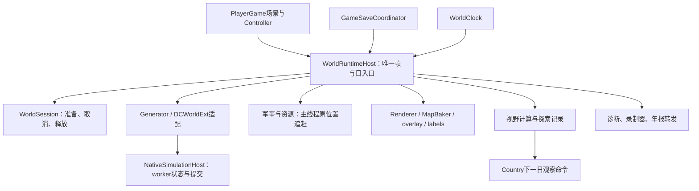

# S9/S10 拆分方案与实施边界

本文保留S9原始方案及逐轮更新；最新实施范围见S13节。历史行区间不代表当前行号。

本页原结构图对应 S9 的 `economy_runtime.h` 10,240 行和 `world_runtime_host.gd` 7,368 行。S10头文件仍逐字节未改，host已提取9个纯值函数，现7,319行。下方结构表行号保留S9阅读位置；实施状态见S10补充，不应当作新的API。旧过程文档已清理，29 份待决定文档未动。

## 经济头文件

实际类名是 `NativeEconomyRuntime`。它把类型、完整对象布局、内联函数和公开入口放在同一个头文件中，不能仅把私有结构移到命名空间外而仍宣称签名/类型身份不变。

| 当前范围（economy_runtime.h） | 内容 | 可评估的内部片段 / 前提 |
| --- | --- | --- |
| 1–155 | include、前置声明、TrackBDerivedCellWork、EffectInputSnapshot/TagSnapshot | 顶层值类型可独立头，但先核对完整类型使用；Country/Effect 前置声明不升为实现 include |
| 156–1675 | 公共常量、命令、配置、查询、ReadView/BuildingVisualView | 公共入口先留原头；只移动完全独立值类型需保留现有限定名，不能直接换类型 |
| 1676–2033 | 私有 stage、财政/科研/远征 continuation、living-cost memo | 可做类体内声明片段；必须保留 private 位置、嵌套名称和声明顺序 |
| 2034–2687 | 配方、需要、环境、建筑、owner opportunity、建设引用 | 按原顺序提取规则/建筑类型片段；互相依赖时使用现有前置声明，不新建循环 include |
| 2688–3499 | 人物/家庭、殖民、投资、预留、聚落 | 家庭仍是经济拥有的嵌套类型；需明确 lint 文件归属，不能靠改文件名掩盖依赖 |
| 3500–4286 | 市场/贸易/关税/劳动力、命令、审计、订单、市场结果 | 可拆贸易类型与账目类型片段；不移动嵌套身份，不改变字段顺序 |
| 4287–5057 | 事件/现金流/运河/生产结果、SaveState/RestoreState、故障上下文 | 存档结构只是内存工作状态，不能因换文件顺手换编码；内联实现需要相同声明可见性 |
| 5058–约7989 | 大量状态列、缓存、队列；穿插采购/税/家庭等内部类型 | 不先改成多个状态对象：那会改变布局/构造顺序。第一步只能原序声明片段，精确切点需下一轮确认 |
| 7990–10155 | 私有实现声明、公共查询/军事适配，public/private 多次切换 | 可按成员声明群拆，但访问标记与 friend 不变；不能把内部片段直接给其它模块包含 |
| 文件尾 | GoodsBill/算术 inline 与 EconomyTargetSelectorTests | inline 保持相同定义、链接规则和可见性；不以头拆分为由改变算术 |

包含关系实测：拆 cpp 前有 **99** 个直接包含者（97 cpp、2 h），本轮后 **120**（118 cpp、2 h），新增21个均是机械拆出的实现文件。两个中转头是 `economy_runtime_persistence_codec.h` 与 `ideology_opinion_bridge.h`；完整清单在本轮 scratch 的 `header-includers.json`。这不是全量传递包含图，也不是编译时间测量。

建议下轮先评估“原类体内按原序包含声明片段”，各片段≤2000行、无 namespace/独立 include、由原头唯一包含。理论上可保留类名、嵌套类型与布局，`header_exposed` 应维持总量；但按文件的依赖键会移动，当前检查器只接受已审定的 h→cpp 移位，不直接允许 h→内部 h。**未经词元展开比较、布局/构建与护栏迁移验证，不宣称安全。** 即使通过，所有原包含者仍读取同样声明，不会自动减少编译扇出；要真正降低扇出需以后用窄读取接口替换包含关系。头拆分及该依赖规则调整均未开始。

## GDScript 宿主的已核实分布

`WorldRuntimeHost` 目前281个函数，仍是单一 Node，下面按实际函数群归纳。范围跨过少量声明/注释；完整逐函数状态词与调用词清单保存在 `host-function-map.json`，该文本清单不等于运行时依赖证明。

| 行范围 / 函数组 | 读取和写入 | 调用方、信号与 C++ 边界 | 拟归属 |
| --- | --- | --- | --- |
| 1–471 配置与状态 | session、生成请求、World/Map/Generator、时钟、渲染引用、各回写代数/游标、GM和诊断计数 | 11个信号定义；场景持有 host | World 生命周期及日边界状态留 owner；显示缓存可后拆 |
| 472–834 configure/时钟日推进 | 绑定时钟/相机；日屏障、pending day、计时 | WorldClock.day_changed；generator 报告/环境捕获/同步 tick、inline/worker 分支 | 单一调用顺序 owner，最后再拆 |
| 835–975 相机/建筑目录/选择及访问器 | 相机可见范围、选中格、视觉目录 | PlayerController、renderer；目录读取经济 | 表现适配，访问器保持 host 转发 |
| 976–1183 种子/失败/会话入口 | seed、generation error、WorldSession、昼夜、capture | world_generation_failed；save coordinator begin/end_state_capture | 会话 owner + 可提取错误格式器 |
| 1184–1589 生成/prepare/close/release | World/Map/Generator与资源生命周期；await取消检查 | world_ready/progress；WorldSessionModules的 world→presentation→restore→simulation；stop前不释放DataCore | owner保留生命周期，准备适配可后拆 |
| 1590–2008 worker启动/平台策略/run_daily_tick | authority配置、inline fallback、prefetch参数、运行报告 | C++ start/stop/capture；Web authority关闭仍同步回退 | 运行适配；Web范围待用户决定，不能删 |
| 2009–2149 overlay请求/Web帧记录 | overlay缓存/dirty、Web frame counters | Renderer/Telemetry | 表现与诊断可先拆 |
| 2150–2348 _process/领先与预发布 | 下一环境日、领先预算、日屏障、worker进度 | 先prefetch再liveness；不能交给两个Node各自_process | host保持唯一帧入口 |
| 2349–2755 prefetch诊断/保存暂停/活性 | 诊断缓存、保存暂停、capacity pending；按原顺序服务回执 | generator环境发布/边界恢复；保存协调者 | 诊断可独立；保存/推进仍owner串行调用 |
| 2756–3334 故障、Country/Effect/Modifier/Ideology/Trigger回写 | fault pause、snapshot generation、trigger delivery ACK、Country地图镜像 | 各native report/consume/intent通道；country_peer_serviced | 各域适配器可分离，但消费顺序/ACK点不变 |
| 3335–3876 提交消费/军事资源追赶/气候策略 | commit day/generation、visual cursors、resource/military target与last、climate writeback | poll_runtime_commit；resource flush/pass；military facade.run_daily；simulation_committed | 日边界与追赶状态由owner持有；外围仍原位置 |
| 3877–4340 visual patch/overlay/finish/报告与录制器接口 | 显示缓存、tick timing/summary、recorder引用 | daily_tick_completed、record_runtime_visual_timings；PlayerController和测试读取 | 报告格式器/表现可拆，finish先保留 |
| 4341–5218 GM命令/开关/健康检查 | GM sequence、请求日、暂停与故障状态；向Country/Economy提交 | GM UI、facade submit；禁止把状态写逻辑混进纯格式器 | 命令适配与诊断两组件，host保留公开转发 |
| 5219–6024 材质/流纹理探针、GI、perf采样 | 渲染纹理读取、GI保存值、recorder samples | renderer、MapBaker、录制器 | 先拆诊断，但GI开关确有写入，不能当纯函数 |
| 6025–6322 时钟速度/昼夜预览/季节/相机 | 时钟、runtime running、预览状态、季节地形 | clock binding、renderer；GM预览信号 | 运行开关留owner，纯预览适配可拆 |
| 6323–6680 renderer/labels/Country视觉/建筑intel | 场景节点与资源引用、territory镜像、intel缓存 | Country committed/research信号；renderer/baker刷新 | 表现；需保留延迟加载和取消顺序 |
| 6681–7067 玩家归属/存档视觉/视野/边界 | player handle、physical visible/explored/fog、vision generation | run_vision_research_pass、submit_observation_batch（下一日）；save finalize | **含模拟命令，不是纯表现**；暂留owner |
| 7068–7368 setup/地形文件/气候profile/退出/进度/年报 | 配置、feature flags、退出标记、loading进度、annual session | generation_progress/annual_report_ready；年报session与catalog | 配置组装/年报转发后拆；退出仍owner |

外部连接已核实：`scenes/player_game.tscn:8`仍挂原脚本；`player_game.gd:32,153`持有RuntimeHost并监听world_ready；`player_controller.gd:1051,1054`监听simulation_committed/country_peer_serviced；`game_save_coordinator.gd:314,356,1077`使用恢复视觉和capture生命周期；`world_session_modules.gd:8`通过原方法名构造Callable。拆分必须保留这些名字及信号发出点。

当前可见顺序也属于契约：`world_runtime_host.gd:3427`的`simulation_committed`及随后的`finish_daily_tick`早于`:3450,3464`的资源/军事drain；不能在搬迁时把信号改成“所有外围已完成”。`_process:2150`先预发布再服务活性；prepare按world→presentation→restore→simulation，关闭先停止执行者再释放世界。上述顺序本轮均未改变。

## 建议实施顺序（步骤1部分实施，其余未开始）

每步保留原host公开转发和唯一 `_process`，组件先为被动 RefCounted，显式传参/窄回调；不引入第二个自动_process，不把整个host属性袋暴露给新组件。每步独立补丁，失败只撤该步自己的改动；不得借回退覆盖其他人的工作。

| 步骤 | 可回退的提取范围 | 验收证据 | 主要风险 |
| --- | --- | --- | --- |
| 1 | 错误文本、报告格式、纹理统计等纯计算；保留时间采样和信号在原点 | 输入固定的字典/数组输出逐项相同；默认回归；五链；诊断输出对照 | 把读取GPU或触发状态改变的方法误当纯函数 |
| 2 | overlay、昼夜预览、labels、建筑intel等表现适配；资源引用由会话显式绑定/释放 | player_game场景实际启动与关闭、player_country_ui_smoke、loading/resource lifetime；截图/交互需另做，headless不能替代 | Node生命周期、await后失效、可见性变化掩盖业务输入 |
| 3 | GM校验/组装及录制器封装 | 同一命令的day/sequence/回执相同；GM拒绝/暂停/故障路径；年报与录制输出对照 | GM真能写状态，不能改默认日和序号递增次数 |
| 4 | 单域回写适配（先Modifier等无跨域ACK者），host按原序调用 | golden核心10次、v5至少3次；worker restart/stop/lifetime与存档；记录consume/ACK顺序 | Country接纳边界及trigger ACK重入，重现S3的日时点差异 |
| 5 | 生成/恢复/关闭准备适配 | world_session、state_module_boundary、game_save_session、loading_exit测试；反复切换/取消/读档 | 原有准备依赖和“先stop后release”丢失 |
| 6 | 日边界/prefetch/追赶协调器；host保留最薄顺序外壳 | 容量阻塞、保存暂停恢复、跨帧积压、全部五链、S8双模式比较；平台分别实测 | 最敏感，不能只以行数下降验收；不得同时迁军事/资源执行位置 |

需用户决定：Web继续支持哪些同步/inline/worker组合；故障和无worker能力时的产品行为；是否另立非零军费与积压/存档覆盖后再尝试外围日对齐。**本方案的机械拆分无需删除任何回退；Web决定未到前全部保留。** S8的对齐实验默认继续关闭，其单一v5证据不足以选择生产默认。状态模块拆分不等于把Map/World主所有权分散给多个Node。

## S10 步骤1逐项判定

| 候选（正式host当前行） | 读取 / 写入及结论 |
| --- | --- |
| `_world_generation_failure_summary`:1094 | 只读传入Dictionary，构造字符串；已提取 |
| `_flow_buffer_stats`:5471 | 只读传入PackedFloat32Array和expected，局部统计；已提取，保留步长及非有限值口径 |
| `_flow_format_descriptor`:5498 | 只映射整数与Image枚举，不读取图像；已提取 |
| `_gm_arg`:5710 | 参数→新字典，无宿主状态；已提取 |
| `_gm_choice_arg`:5714 | 参数→新字典，choices仍借用原引用；已提取 |
| `_gm_positive_arg`:5718 | 参数→新字典，保留默认float与原min；已提取 |
| `_gm_day_arg`:5722 | 固定字段新字典；已提取 |
| `_gm_ok`:5726 | 参数→新字典；已提取 |
| `_gm_error`:5730 | 参数→新字典，data借用/默认新字典语义保留；已提取 |
| `_format_world_generation_detail`:1080 | 内部读系统时间；未提取，时间采样点不变 |
| `_flow_texture_descriptor`:5475、`_flow_sampler_inventory`:5502 | 读取对象/RID/材质shader参数；未提取 |
| `_decode_flow_texture_size_view`:5530、`_summarize_flow_debug_image`:5565 | 读取Image像素对象；本轮不把它当纯值数组契约，未提取 |
| `_capture_flow_debug_view` / GI / perf报告 | GPU或宿主状态、采样和写入；未提取 |
| `_gm_validate_args`:5054、`_gm_convert_arg`:5082 | 校验链仍在原处，涉及未收窄Variant转换；后续步骤3单独验证，不随格式构造函数搬迁 |

新helper是被动RefCounted静态函数，host仍保留全部9个原名字/参数/默认值转发。测试用S10前独立实现对照helper与host，93项通过；headless场景生命周期由默认`player_country_ui_smoke_test`实际启动player_game、等待world_ready、close_world后queue_free覆盖。图形观感未测试。

`Project/perf-validation`有独立project.godot，自己的player_game场景引用本工程res根内4,739行旧host，不能直接覆盖为正式工程7,319行版本。此次字节不变，也未独立运行它；是否将其更新为当前正式宿主及需要哪些性能参照由后续任务决定。Web同步回退仍待用户决定，旧实现与默认均保留。

## S12 对步骤2的实施更新

| 候选 | 读/写与风险 | 本轮状态 |
| --- | --- | --- |
| set/clear/dirty/diagnostics/interval/refresh overlay | 读地图、气候、时钟、资源目录；写显示请求、LUT缓存、耗时统计，调用renderer/layer；无await/模拟命令 | 6方法原体进入world_runtime_overlay；host保留调用点与set_process控制；GPU实际图像未验 |
| refresh_building_visual_catalog / intel | 读取经济目录/已提交快照、消费显示dirty队列；写玩家所见资料缓存、刷新标记；不提交Country命令 | 原体进入world_runtime_presentation；8组fog/force/成功失败对照 |
| bind_settlement_labels | 读取地图、相机、经济facade，替换显示子节点 | 原体搬迁，延迟4秒及取消检查仍在host；headless不能证明标签观感 |
| 昼夜预览 | hold/release_visual_day_phase，TOD重算、renderer状态 | 本轮未搬；尚缺实际图形/视觉时钟保持释放交互的等价验证 |
| refresh_vision / country visual refresh | 含视野研究命令与国家可见状态 | 不搬，不当纯表现处理 |

host 7319→7179行；9原方法体逐字节相同，其余270方法不变；仅会话释放两处补显式解绑。无新增_process、信号或await。perf-validation另一项目副本不动，未推定其配置与正式项目相同。步骤2为**部分实施**，不能写成全量完成；步骤3及以后未开始。旧过程文档已清理，29份待决定未动，Web同步回退产品决定仍待用户。

## S13 对步骤3的实施更新

| 候选 | 所有权与等价边界 | 状态 |
| --- | --- | --- |
| GM规格、参数校验、数值换算 | 显式输入→结果；原Variant转换与choices/default顺序不变 | 已提取到world_runtime_gm_commands |
| Country/Economy提交组装 | 当次generator/窄resolver，原方法接纳、默认日和序号留host | 已提取；请求/回执/求值次序对照 |
| execute_gm_command、GM toggle、claim结果信号 | 时钟/故障、序号、信号/异步时点 | 保留原位，方法体词元不变 |
| recorder状态、就绪、交付、回执格式 | 无持久引用；sample/recorder显式传入 | 已封装到world_runtime_recorders |
| perf采样、累计量清零、年报poll/commit/发奖 | 读写host状态与时间、影响日边界 | 原位保留；展开包装后采样词元不变 |

步骤3的命令/录制器边界已接入；没有把整个perf方法或年报生命周期整体搬走。host7179→7087；perf-validation副本字节不变，未运行其独立项目。Web回退方向现已授权：第1步明确失败＋默认关闭逃生已实施，第2步删除未开始；真实Web目前默认worker而非inline，最终默认选择不能由旧注释推断。步骤4及以后的域回写/日协调者抽取未开始。29份待决定未动。

## S14 对步骤4的实施更新

只抽取Modifier：ready/generator检查、授权mask读取、apply_runtime_modifier_snapshot消费、generation前移进入无状态`world_runtime_modifier_writeback.gd`，host原同名方法及四处调用点保留。没有跨域ACK、await或持久引用；112项固定输入/调用顺序对照通过。host7087→7074，perf-validation副本不动。其他回写适配、日协调者及外围执行位置迁移未开始；不能将步骤4写成全量完成。Web默认worker保持，真实Web验证待有工具链机器，删除回退第2步未开始。29份待决定未动。

## S19 步骤5状态

准备表现和停止等待已通过 `world_runtime_preparation.gd` 被动适配，并保留 host 的恢复顺序、信号和 `_process`。完整生成/恢复/关闭组件化仍未开始，原因是需要更多跨 await/取消/lifetime 的场景证据。

## S22 下一小步实施

将`_format_world_generation_detail`文本构造提取到已有被动values脚本，host保留同名转发和系统时间采样。冻结参照来自本轮前host，固定timestamp、空/非空hint等输入逐项比较；总99项通过。host7036→7029行。此函数不含模拟命令、ACK、await或资源所有权；没有借此拆动生成/恢复/关闭主流程或Web回退。perf-validation副本不动。其余大型回写/生命周期抽取仍未开始。

## S23 安全子集

Economy头文件10240→2742；5个内部头只是原class内部片段，不改可见性/声明顺序，展开后除独立新增视图及诊断游标外逐字节还原原头。151个传递cpp包含者集合不变，未声称降低重编扇出。主cpp仍7989，19成员及阻塞的跨域include位移清单见module-boundaries。

宿主恢复准备的同步适配提取到`world_runtime_restore_preparation.gd`，host保留原入口、回调、信号和气候读档顺序；16项冻结对照通过，7029→7010。完整生成/取消/关闭流程及5500行目标未完成；perf-validation副本与Web回退未改。
