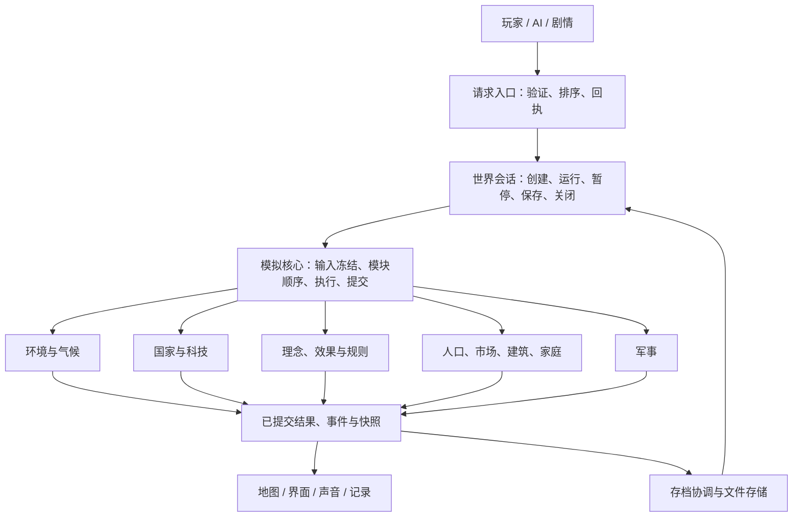
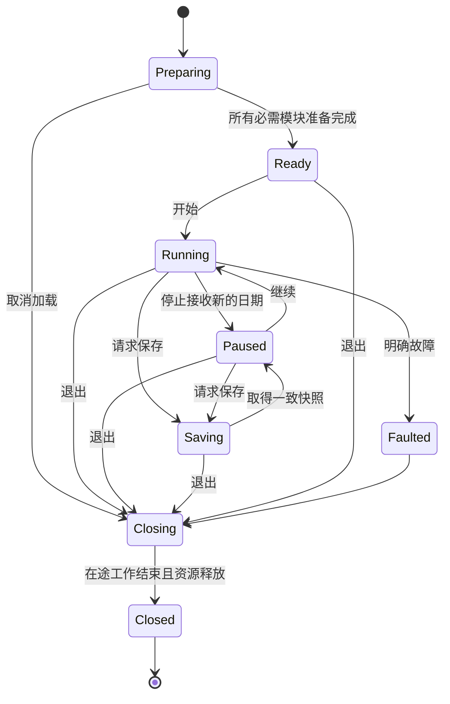

# 世界运行架构

状态：目标设计与迁移契约；世界会话、公共执行边界、时间控制及全部 18 个旧保存模块已接入实际流程。本文把目标、已接入的部分、尚未迁移的部分分开记录，不能据此宣称全项目重构完成。

## 1. 从需求出发

游戏需要同时满足：世界持续推进、界面及时响应、多个系统相互影响、任意时刻可以请求暂停/保存/退出、新功能能独立加入，以及同样的输入能复现同样的结果。

设计采用**一个世界、一个模拟执行者、多个业务模块、单向展示**。执行者可以是桌面后台线程，也可以是 Web 主线程上的分段调用；业务规则不感知这种差别。生产流程不把“每个系统随时换线程”作为玩法能力。

保留 Godot 负责场景、输入、界面、图片和声音，C++ 负责模拟数据与计算。既有算法按模块接入；保存格式、玩家行为和计算结果的变化须另行声明。

## 2. 五层职责

| 层 | 负责 | 不应负责 |
| --- | --- | --- |
| 应用 | 菜单、玩家输入、AI 决策、剧情调用、场景切换 | 直接修改模拟中的容器 |
| 世界会话 | 世界身份、加载取消、模拟启停、保存窗口、资源关闭 | 经济公式、气候算法、界面布局 |
| 模拟核心 | 模块登记、依赖检查、确定顺序、请求分发、执行边界、结果提交 | 任一业务模块的内部规则 |
| 业务模块 | 本模块状态、命令处理、计算、查询结果、存档片段 | 调用界面、取得其他模块的可写容器 |
| 平台与展示 | Godot 对象、文件、网络、音频、纹理上传、显示缓存 | 决定模拟状态或代替业务模块提交 |

装配入口创建各模块并注入所需接口。底层模块不得反向访问总控的私有字段；避免再产生一个“能访问一切”的 Context。接口按能力提供，例如 CountryFacts、TreasuryTransactions、CommittedPopulation，而非整个 World 指针。

## 3. 两件必须分开的事

**执行许可**回答“现在能否开始新工作”；**数据归属**回答“哪个模块/数据存储保存着当前真实状态”。暂停或请求停止只改变前者，不能使读者突然改读开局副本。

同样必须区分：

- 请求已接受与业务已完成：收到请求编号不等于钱已转账或卡片已生效。
- 正在计算的结果与已提交结果：展示可以落后一拍，不能读到一半的新状态。
- 一天的日期与某个慢周期的采样日期：经济可以跨日完成，输入继续沿用该周期冻结的版本。
- 世界会话与执行线程：换线程不能重建业务状态、重复执行已完成阶段或复用旧请求编号。

## 4. 模块契约

每个可接入模块必须提供如下信息。没有这些信息，注册失败，不能先运行再猜依赖。

| 项目 | 含义 |
| --- | --- |
| 稳定模块名 | 如 `country`；用于日志、依赖、存档与测试，不用对象地址 |
| 唯一数据归属 | 本模块负责的可写状态及其存放位置 |
| 必需输入 | 类型、单位、版本、采样时点；来源模块 |
| 接收请求 | 操作、验证规则、稳定编号、排序和去重方法 |
| 调用阶段 | 准备、执行、提交或观察；真正需要的先后依赖 |
| 结果 | 可只读的已提交视图、事件、版本号和回执 |
| 继续条件 | 未完成时的游标、等待哪个结果、怎样唤醒 |
| 保存 | 片段名、格式版本、恢复依赖、旧版本处理策略 |
| 关闭 | 拒绝新请求、结束当前调用、保存待办、释放资源的规则 |

模块内部可用按列数组和专用算法；核心不要求它们继承统一的庞大基类。接口以小型类型和适配器连接。只有装配入口知道具体实现。

## 5. 模块相互作用

读取分为三类：不变目录、周期冻结输入、已提交查询视图。每类必须标明版本。禁止把“最新”隐含成“同一批次”。

修改另一模块只能提交请求。跨模块资金、物资等操作采用现有明确事务：验证双方条件→准备→分别完成→唯一回执。重试保持同一编号，不重复扣款；暂时未准备好返回等待，规则错误返回拒绝。

命令有确定顺序：世界代次、语义日期、生产者、生产者序号。AI 和玩家使用相同业务入口，调试工具也不得偷偷绕过验证。事件是已发生事实；不得靠监听器执行顺序决定资金归属。

不引入全局万能事件总线替代依赖关系，也不为所有模块添加互相等待的同步调用。

## 6. 执行与提交

一次推进先冻结输入，再按登记的依赖执行模块，最后发布完成结果。模块可返回完成、需要继续、等待外部结果、拒绝或故障；等待不能被解释为成功，也不能自动当作故障。

经济等跨日模块保存自己的采样日期、阶段和游标。执行者只安排继续调用，不能重置这些信息。改变运行速度只改变调度频率，不改变公式和提交顺序。

主线程与后台之间的收尾服务独立于日历推进。后台为了等待某项主线程服务而让出执行时，
宿主在每帧继续该请求；不能要求下一天到来才重试。已完成阶段停止调用，新世界重置进度。

依赖图只表示硬依赖。周期反馈通过上次已提交视图连接，例如人口影响需求、需求影响建筑投资、投资影响未来人口，不能形成当天的无限互等。

后台只接收普通数值/数组、不可变目录和可拥有的快照。Godot 对象、场景树、图片上传留在主线程。Web 使用同一业务执行接口，按实际完成点让出主线程，不另写一套模拟。

## 7. 世界会话与关闭

关闭顺序固定：

1. 关闭新命令和新日期的入口，标记会话即将关闭。
2. 唤醒并取消加载中的等待，阻止迟到结果绑定到旧场景。
3. 当前执行调用到达真实边界；期间继续使用原数据归属，不改读旧副本。
4. 保存仍需恢复的业务游标、请求回执和已提交视图；释放线程只释放执行资源。
5. 确认执行者已退出，再按依赖的逆序释放业务状态和 Godot 对象。

用户请求退出与执行者已退出是两个状态。任何超时都不能伪造“已停止”。更换世界必须使用新会话代次，旧回调和旧存档捕获不能进入新世界。

实际入口为 `WorldSession`：`world → presentation → restore → simulation` 的装配位于
`world_session_modules.gd`；扩展模块登记在模拟启动之前。现有生成、展示、恢复和模拟
接入为四个适配器，具体算法继续由现有业务模块拥有。准备失败也释放已部分准备的模块。
GameFlow 等待关闭完成后再换场景；界面缓存仍由场景拥有，随场景销毁，不参与模拟状态交接。
原生 `simulation_executor_exited` 在执行函数和局部资源退出后才变为真；`FAULTED` 本身
不再被当作资源已经安全释放的证据。保存捕获期间会话为 `SAVING`，捕获完成才恢复运行状态。

## 8. 保存与恢复

文件存储负责原子写入、容器校验与备份；各模块负责自己的格式与恢复验证；会话协调一致的保存时点。三者分开。

模块通过登记声明恢复依赖，系统检查重复片段、缺失依赖和依赖环。18 个内建模块的编码、解析和恢复实现在 `scripts/game/save_modules/`；`world_state_bindings.gd` 在每次调用时提供所需接口，模块不持有总控或地图生成器。当前必要关系包括国家先于军事/视野，效果先于经济，国家和经济先于 AI，所有模拟恢复完成后再恢复玩家展示。

先完整验证可验证的格式、目录身份和模块兼容性，再安装状态。只在安装成功后开放命令和日期。迁移旧格式须有明确迁移器；不能以默认值掩盖缺失的必需状态。

## 9. 现有功能接入表

下表是迁移映射，不意味着相关旧总控文件已经全部拆除。

| 模块 | 唯一业务状态 | 请求/输入 | 对外结果 | 接入位置 |
| --- | --- | --- | --- | --- |
| 世界生成 | 地理、地形初值 | 配置、种子、作者地图 | 完整初始世界 | 会话准备任务 |
| 环境 | 气候、水文、资源、生态 | 冻结地理与上一周期输入 | 环境视图 | 模拟模块 |
| 国家 | 身份、领土、科技、国库、税策 | 国家命令与资产事务 | 国家事实和回执 | 模拟模块 |
| 理念 | 收藏、卡片、理解度、民意 | 国家与人口事实、玩家命令 | 效果请求与已提交理念视图 | 模拟模块 |
| 效果/修正 | 效果实例、待办、属性修正 | 领域请求 | 经目标模块确认的结果 | 模拟模块 |
| 触发/事件 | 触发进度和已发生事件 | 已提交事实 | 带稳定编号的效果请求/记录 | 模拟模块 |
| 经济 | 人口、市场、建筑、贸易、家庭、人物、开拓 | 环境和国家冻结输入、经济命令 | 结算、统计、事务和展示数据 | 模拟模块；内部子模块共享明确的经济边界 |
| 军事 | 部队、行动与军事状态 | 国家地理事实、军事命令 | 已提交行动和地图表现 | 模拟模块 |
| 国家 AI | 决策记忆 | 已提交可见事实 | 普通玩家同类命令 | 决策模块 |
| 年报/剧情 | 年度事实、叙事历史 | 已提交事件 | 报告、文本与可验证奖励请求 | 观察/应用模块 |
| 视野 | 玩家探索记录 | 国家和地形事实 | 可见性视图 | 玩家状态模块 |
| 地图/界面/声音 | 展示缓存与 Godot 资源 | 只读结果、语义事件 | 画面和声音 | 展示适配器 |
| 保存/设置/网络 | 文件及外部服务状态 | 明确请求 | 完成/失败回执 | 平台服务 |

## 10. 为未来系统留出的扩展点

新增疾病、外交或运输系统时，先选择独立数据归属，再登记模块和能力。无需把它塞进地图生成器、国家总控或经济头文件。新模块接入应集中在自己的目录、装配登记和消费者接口。

- 新数据：稳定身份、单位和保存版本；不借用其他模块的数组塞字段。
- 新命令：沿用有编号的命令和回执；明确是接受还是完成。
- 新跨系统影响：目标模块验证并执行；外部系统不能拿到可写指针。
- 新周期：独立采样/游标/提交点；不默认每天重扫整个世界。
- 新展示：读已提交视图；关闭窗口不影响模拟。
- 新平台：替换文件、线程和展示适配器；公式复用。
- 新可选模块：启用前验证依赖，缺失时明确禁用或拒绝载入，不凭空补状态。

现有固定的 12 个执行域是兼容边界，不要求每增加一种玩法就增加一个线程域或修改存档容器版本。业务模块可挂在适合的阶段；只有新增真正的执行边界时才扩展核心登记并做协议兼容检查。

## 11. 迁移与验收

迁移顺序由风险决定，所有阶段保持可运行：

1. 建立核心生命周期和模块契约，先覆盖停止期间数据归属、重新执行和迟到结果。
2. 把现有模拟域的公共接入判断统一到核心，保留公式和存档内容；经济重启故障必须复现后消除。
3. 把模块保存/恢复登记从位置约定改为显式依赖，接入所有现有保存模块。
4. 逐模块收窄对总控的访问，提取加载、展示、诊断及业务适配器；删除原实现，避免两套长期并存。
5. 将跨线程生产/诊断路径分离；生产世界使用唯一执行者，比较试验使用独立世界及相同输入。

每次迁移必须证明：原业务断言仍通过；同输入的结果一致或差异已解释；保存后继续计算正确；暂停/关闭/重启不重复修改数据；退出无泄漏。文件搬家或类名变化不能作为完成证据。

## 12. 取舍

本设计增加少量明确接口和装配声明，换取更少隐含交接。小功能不强制拆成独立模块；同一数据归属且总是一起提交的功能可放在原模块内部。

不把所有业务状态复制成全世界快照，不为每个模块开线程，不引入通用脚本插件虚拟机，不要求所有公式事件化。优化先量测；借用、共享不变数据、局部快照和确定性批处理优先。

后续开发从 [开发指南](development-guide.md) 进入。现有具体实现契约仍在 `docs/cpp-dots-runtime/`；遇到迁移差异，应更新实际接入状态和相关契约，不把目标设计当成已实现事实。

## 13. 实际接入状态

| 边界 | 当前实现 | 状态 |
| --- | --- | --- |
| 世界会话及模块生命周期 | `world_session.gd` + `runtime_session_module.gd` + `world_session_modules.gd`；四个实际阶段、扩展登记、代次、捕获状态、反向释放 | 已接入开局、读档、重建、返回菜单和退出 |
| 执行许可与在途数据归属分离 | `RuntimeAuthorityControl` + `RuntimeExecutionContext`；worker/inline 共用会话上下文，现有十二个域沿共同查询接入 | 已接入；保留原阶段顺序及公式 |
| 模块保存与恢复依赖 | `world_state_modules.gd` 登记 18 个模块，`save_modules/` 拥有实现，`world_state_bindings.gd` 按次提供接口；`runtime_module_registry.gd` 验证顺序 | 已迁移旧模块读写、解析及恢复后准备；原总控实现已删除 |
| 时间控制 | `WorldClock.control_changed` → `runtime_clock_binding.gd` → 执行者及会话 | 准备完成后绑定并立即同步，取消/退出时解除；界面只负责操作和展示 |
| 主线程收尾继续 | 宿主按帧继续原日期的理念实例/派生刷新，原生层保留游标与真实提交边界 | 不依赖下一天唤醒；已完成阶段停止重试，世界重建时清除日期标记 |
| 本地图形计算资源 | `VisualTileHorizonBaker` 拥有设备、提交状态及资源句柄 | 正常完成、失败、取消、销毁共用释放入口；实际 GPU 工作结束后释放设备 |
| 新模块格式与缺失处理 | provider 自己声明可读版本；未知模块存档拒绝加载；扩展在绑定世界前登记 | 已接入 |
| 加载取消与拥有关系 | 共享 LoadingFrameGate、借用拥有者上下文、会话按实际执行退出确认关闭；后台冻结写盘独立完成 | 已接入 |
| 经济交接 | `EconomyAuthorityTransfer` 只提供冻结日期、捕获、恢复、国家核验及已授权资产请求服务；临时恢复标记自动归还 | `NativeSimulationHost` 不再是经济模块的友元；孤立自检移入 `EconomyInvariantProbe` |
| 经济记录 | `EconomyRecordSource` 在模拟拥有者上复制已提交数据；`EconomyCsvRecorder` 排队、写入、回滚和退出收尾 | 文件写入器不再有经济私有访问权；价格压力由经济模块计算一次 |
| 测试聚落开局 | `TestStartInputs` 捕获数据，`TestStartPolicy` 声明内容，`TestSettlementPlanner` 规划，`TestStartFinance` 计算初始钱与库存 | 原两千行入口变为装配；计算模块不持有世界、Facade 或注册服务 |
| 其余业务模块内部边界 | 原生计算与存储继续由所属模块拥有 | 保留业务实现，未宣称全部原生大类已拆完 |
| 应用/展示拆分 | GameFlow 委托会话关闭；WorldRuntimeHost 提供四个准备适配器，顺序由独立装配决定 | 生命周期已抽出；展示/诊断的内部方法仍可继续拆小 |
| 生产与混合调试路径隔离 | 保留现有单线程/后台及部分域诊断模式的兼容入口 | 目标设计已确定；未完成所有旧模式隔离 |

旧保存模块已按职责迁出并收窄脚本入口。现有 C++ 业务实现、其余原生 facade 的内部访问范围、主机内部展示/传输方法及部分域调试路径仍保留，未标为全部迁移完成。继续迁移应沿第 11 节顺序进行，
每次接入同时更新此表；不为赶进度一次替换所有业务算法。

已执行的检查、失败对照及平台范围见 [接入与验证记录](world-runtime-validation.md)。
