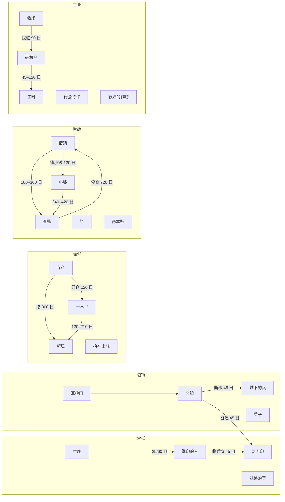
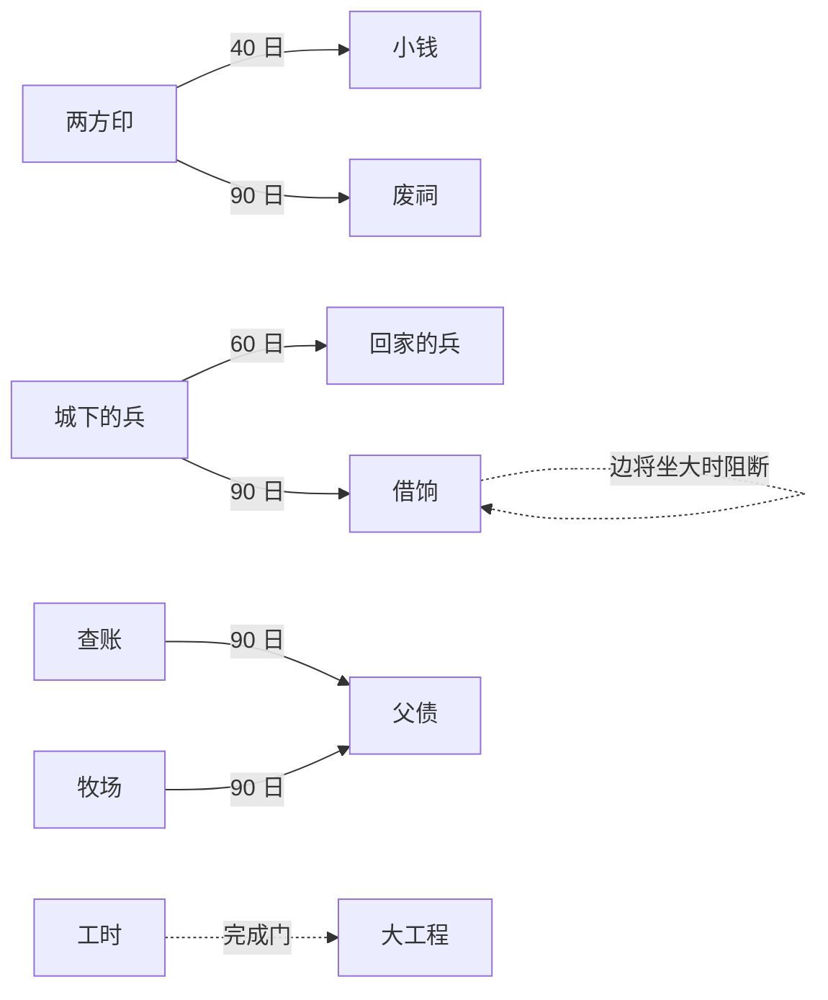

# 叙事事件网（二十五包 · 一百六十三条）

这张网是 `narrative_event_authoring.md` 的续篇：前者讲「一条事件怎么写」，这里讲「一百六十三条事件怎么互相咬住，以及怎么继续加而不乱」。

- 代码入口：`narrative_event_registry.gd`
- 契约测试：`tests/game/narrative_event_web_test.gd`（约 15700 项）
- 覆盖审计：`tests/probes/probe_event_coverage.gd` + `narrative-event-coverage.md`
- 规模：本网 25 包 163 条；并入既有 16 条后，默认事件库共 179 条

---

## 1. 三条写作纪律

### 1.1 P 社骨架

每条正文按同一副骨架写，读起来才像「事件」而不是「报告」：

1. **开门见山给处境**：谁死了、堤垮了、银子不够了。
2. **谁在要求什么**：一个具名的推动者，带着一个具体的诉求。
3. **一个能看见的细节**：药碗凉了、界石被羊啃掉一个角、秤砣往袖子里塞。
4. **反对者的算盘**：他不是坏人，他只是要保住自己的东西。
5. **落在必须决断的时刻**：一句话、一个动作、一件还没落下去的锤子。

允许一句引语（`speaker` + `quote_text`，≤40 字），全库不超过四成事件；其余对白揉进叙述。

### 1.2 三层专名

| 层 | 用法 | 例 |
| --- | --- | --- |
| 世界内专名（必用） | 人名、地名、器物、书名、机构名；每条正文至少两个 | 韩宿、雁回堡、《星度常序》、铁砧社、鱼鳞册 |
| 制度专名（常用） | 有历史质感的制度词，按时代与地块挑 | 行会、教团、钱监、驿馆、漕运、盐引、度支房 |
| 真实史事（限一层） | 只作人物口中的类比，每条最多一处；不复述过程与结局 | 「上一朝也有人这么干，后来仓里空了」 |

判据不是「玩家能不能认出类型」，而是「能不能指出这是某一件史事的逐段复述」。能，就重写。

### 1.3 neta 的重组

保留**三处同构**：

1. 推动者的身份类型（掌印的老臣 / 边将 / 行首 / 炉头 / 计时员）；
2. 机制骨架（谁出钱、谁担保、谁承担失败）；
3. 失败方式（债主上门、机器吃手、名单上划掉十八个）。

重组**四处**：人名、地点、时间、结局。史相原型只写在这份文档里，不写进玩家可见文本。

---

## 2. 文件与维护

### 2.1 四个基础文件

| 文件 | 职责 | 什么时候动它 |
| --- | --- | --- |
| `narrative_event_ids.gd` | 所有 `event_id` / `flag_*` / `tag` 常量的唯一真源 | 加事件、加标记、加 tag |
| `narrative_event_shared.gd` | 效果构造器（`agriculture()`、`cash_in()`、`bias()`、`schedule()`…），标签自动生成 | 需要新的效果形状时（少见） |
| `narrative_event_pack.gd` | pack 元数据 schema 与自检 | 几乎不动 |
| `narrative_event_registry.gd` | 有序注册表：哪些包、按什么顺序 | 加包时改三行 |

### 2.2 二十一个内容包

| 包 | 文件 | 条数 | 尺度 | 时代 |
| --- | --- | --- | --- | --- |
| 宫廷 | `narrative_event_catalog_court.gd` | 4 | 3 宏观链 + 1 微观 | 2–7 |
| 边镇 | `narrative_event_catalog_frontier.gd` | 4 | 3 宏观 + 1 微观 | 2–7 |
| 信仰 | `narrative_event_catalog_faith.gd` | 4 | 3 中观链 + 1 中观 | 1–8 |
| 财政 | `narrative_event_catalog_fiscal.gd` | 5 | 3 宏观链 + 2 中/微观 | 3–8 |
| 工业与劳工 | `narrative_event_catalog_labor.gd` | 5 | 3 链（2 中观 + 1 宏观）+ 2 孤立 | 3–8 |
| 高时代 | `narrative_event_catalog_era.gd` | 4 | 2 宏观 + 1 中观 + 1 微观 | 8–10 |
| 人与家 | `narrative_event_catalog_family.gd` | 4 | 4 微观孤立 | 1–9 |
| 地块 | `narrative_event_catalog_land.gd` | 4 | 2 中观 + 2 微观 | 1–9 |
| 风土 | `narrative_event_catalog_wilds.gd` | 8 | 8 中观孤立 | 1–8 |
| 市井 | `narrative_event_catalog_town.gd` | 8 | 6 中观 + 2 微观，全部孤立 | 2–9 |
| 历代 | `narrative_event_catalog_ages.gd` | 8 | 6 中观 + 2 微观，全部孤立 | 0–10 |
| 黎明 | `narrative_event_catalog_dawn.gd` | 7 | 7 孤立 | 0–2 |
| 远航 | `narrative_event_catalog_sea.gd` | 7 | 7 孤立 | 4–6 |
| 铁路 | `narrative_event_catalog_rail.gd` | 7 | 7 孤立 | 6–8 |
| 原子 | `narrative_event_catalog_atom.gd` | 7 | 7 孤立 | 8–10 |
| 学院 | `narrative_event_catalog_school.gd` | 7 | 7 孤立 | 3–9 |
| 疫与医 | `narrative_event_catalog_plague.gd` | 7 | 7 孤立 | 1–9 |
| 律法 | `narrative_event_catalog_law.gd` | 7 | 7 孤立 | 2–9 |
| 使节 | `narrative_event_catalog_envoy.gd` | 7 | 7 孤立 | 3–7 |
| 筑城链 | `narrative_event_catalog_citychain.gd` | 3 | 3 幕宏观链 | 0–3 |
| 停堆链 | `narrative_event_catalog_atomchain.gd` | 3 | 3 幕宏观链 | 8–10 |
| 家族桥 | `narrative_event_catalog_family2.gd` | 10 | 10 条中观/微观孤立 | 1–9 |
| 家族桥（二） | `narrative_event_catalog_family3.gd` | 12 | 12 条中观/微观孤立 | 1–9 |
| 战争 | `narrative_event_catalog_war.gd` | 15 | 6 事实 + 6 脉冲 + 3 节链 | 2–10 |
| 技术 | `narrative_event_catalog_tech.gd` | 6 | 6 条中观孤立 | 2–10 |

> 后三个包（风土 / 市井 / 历代）是「零散层」：24 条全部不接链、单条收束，但都带两三条权重规则，
> 并参与 `unrest` / `market` / `labor` 等 tag 的软偏置，所以仍然是网的一部分，不是孤岛。

### 2.3 加一条事件只需三步

1. `narrative_event_ids.gd` 加常量（`EVT_*` / `FLAG_*`）；
2. 对应 pack 的 `append()` 里加一条 `NarrativeEventDefinitionScript.from_dict({...})`；
3. 该 pack 的 `meta()` 的 `node_ids` 加一项、`expected_count` 改数。

测试会校验：声明节点 = 实际注册、前缀合法、id 全局唯一、每条效果有标签、每个标记有人读、每条排程有目标。

### 2.4 命名

- 事件 id：`evt.<pack>.<snake_case>`，前缀必须等于 pack 的 `prefix`。
- 标记：`flag_<snake_case>`；标签写「标记「四字短语」」，不写内部 id。
- 选项 id：动词短语（`pull_the_stakes`），不写数字序号。

---

## 3. 网络图

### 3.1 五条链



### 3.2 跨包硬边



---

### 3.3 零散层（24 条，不接链）

风土 / 市井 / 历代三个包是「零散层」：每一条都自成一体，抽到就能独立成立，不依赖任何前情。它们的作用不是推进长线，而是**密度**——同一片领土在同一个时代，应该有不止五个话题可抽。

它们仍然属于网：

- 每条的 `tags` 都带主题族（`land` / `town` / `unrest` / `market` / `labor` 等），会被别的包写下的 `ADD_EVENT_WEIGHT_BIAS` 命中；
- 每条自己带 2–3 条权重规则，随建筑、职业构成、价格、时代、满意度浮动，不是纯随机；
- 两条链的收束会排程到它们（宫廷「两方印·发兵」→ 废祠；边镇「城下的兵·放箭」→ 回家的兵），所以零散层也吃得到链的余波。

新增零散事件不需要加边：只要它是脉冲入口、有 ≥2 条权重规则、不写死读数，测试会自动把它当 entry 纳入全部断言。


---

## 4. 节点表（58）

> 尺度：宏 = 国家/时代；中 = 聚落/产业线；微 = 一个人、一家、一块地。
> 结构：链 = 有前后幕；孤 = 单条收束。

| # | event_id | 标题 | 尺度 | 结构 | 时代 | 触发支点 | 史相原型（仅文档） |
| --- | --- | --- | --- | --- | --- | --- | --- |
| 1 | court.empty_seat | 空座 | 宏 | 链1 | 2–5 | 人口≥10；衙门多、人心不定加权 | 罗马养子继承 / 奥斯曼王子相争 / 濮议 |
| 2 | court.regent_bargain | 掌印的人 | 宏 | 链2 | 2–6 | 需完成 1 | 宫相 / 多尔衮 / 司马氏 |
| 3 | court.two_seals | 两方印 | 宏 | 链3 | 3–7 | 由 2 或 6 排程 | 禅让 / 红白玫瑰 |
| 4 | court.exiled_official | 过路的官 | 微 | 孤 | 2–7 | 学者占比、建筑数、满意度 | 苏轼流放 / 奥维德 |
| 5 | frontier.soldier_farm | 军粮田 | 中 | 链1 | 2–5 | 河流 + 平原 + 人口≥8 | 屯田 / limitanei / 卫所 |
| 6 | frontier.long_garrison | 久镇 | 宏 | 链2 | 3–6 | 需完成 5；自筹标记加权 | 藩镇 / 边将 / 守护大名 |
| 7 | frontier.general_at_gate | 城下的兵 | 宏 | 链3 | 3–7 | 由 6「断粮」排程 | 安史 / 渡卢比孔 |
| 8 | frontier.hostage_boy | 质子 | 微 | 孤 | 2–6 | 人口≥10；有商人 | 重耳 / 人质外交 |
| 9 | faith.temple_estate | 寺产 | 中 | 链1 | 2–5 | 建筑≥3、人口≥12；粮价/民怨加权 | 三武一宗 / 亨利八世 |
| 10 | faith.one_book | 一本书 | 中 | 链2 | 3–6 | 需完成 9 + 建筑≥4 | 伽利略 / 胡斯 |
| 11 | faith.new_altar | 新坛 | 宏 | 链3 | 3–7 | 由 9 或 10 排程 | 尼西亚 / 国教确立 |
| 12 | faith.plague_procession | 抬神出城 | 中 | 孤 | 1–8 | 最不满群体≤0.55；寺产入官则阻断 | 鞭笞派 / 迎佛骨 |
| 13 | fiscal.state_loan | 借饷 | 宏 | 链1 | 4–7 | 商人≥3%、人口≥15；兵怨/盐禁加权 | 佛罗伦萨公债 / 英国国债 |
| 14 | fiscal.debased_coin | 小钱 | 宏 | 链2 | 3–7 | 由 3 或 13 排程 | 第纳尔贬值 / 宝钞 |
| 15 | fiscal.audit | 查账 | 宏 | 链3 | 3–8 | 由 13 或 14 排程 | 清丈 / 路易十四查账 |
| 16 | fiscal.salt_licence | 盐 | 中 | 孤 | 3–6 | 商人≥2%；两印并立则阻断 | 盐铁官营 / 包税制 |
| 17 | fiscal.two_ledgers | 两本账 | 微 | 孤 | 3–8 | 建筑≥2；官民两价加权 | 复式账 / 火耗 |
| 18 | labor.enclosure | 牧场 | 中 | 链1 | 6–8 | 平原、人口≥18 | 英国圈地 / 高地清地 |
| 19 | labor.broken_loom | 砸机器 | 中 | 链2 | 6–8 | 需完成 18；失业≥8%；借饷摊派也能触发 | 卢德运动 / 西里西亚织工 |
| 20 | labor.factory_act | 工时 | 宏 | 链3 | 6–8 | 由 19 排程 | 十小时法案 / 日本女工 |
| 21 | labor.guild_charter | 行会特许 | 中 | 孤 | 3–6 | 工匠≥8%、建筑≥2 | 行会 / 特许状 |
| 22 | labor.widow_workshop | 寡妇的作坊 | 微 | 孤 | 3–8 | 建筑≥2、人口≥10；火漆未干加权 | 寡妇承业 |
| 23 | era.great_works | 大工程 | 宏 | 孤 | 8–10 | 需完成 20；人口≥25、建筑≥5 | 曼哈顿 / 阿波罗 |
| 24 | era.standard_war | 标准 | 宏 | 孤 | 9–10 | 建筑≥5、人口≥25；河鼓已响加权 | 轨距 / 制式步枪 |
| 25 | era.algorithm_shift | 排班 | 中 | 孤 | 9–10 | 建筑≥5、人口≥30；标准未定加权 | 泰勒制 / 零工经济 |
| 26 | era.quiet_room | 安静的房间 | 微 | 孤 | 8–10 | 建筑≥4、人口≥12；学者占比加权 | 伽利略 / 萨哈罗夫 |
| 27 | family.second_son | 次子 | 微 | 孤 | 1–6 | 人口≥8；农户占比加权 | 诸子析产 |
| 28 | family.bride_price | 聘礼 | 微 | 孤 | 1–7 | 人口≥10；分家状态加权 | 两族联姻 / 彩礼 |
| 29 | family.fathers_debt | 父债 | 微 | 孤 | 2–9 | 满意度≤0.45、有商人；旧债未销加权 | 债务继承 |
| 30 | family.returning_soldier | 回家的兵 | 微 | 孤 | 2–9 | 人口≥10；由 7 或 27 排程 | 老兵返乡 |
| 31 | land.silted_harbor | 淤了的港 | 中 | 孤 | 2–8 | 沿海 + 河流 + 商人 | 港口淤积 / 河道改道 |
| 32 | land.old_mine | 老矿 | 中 | 孤 | 2–8 | 有矿产、建筑≥2；封坑则阻断 | 矿竭 / 重启废矿 |
| 33 | land.forest_edge | 林边 | 微 | 孤 | 1–8 | 森林植被、人口≥6 | 滥伐与保育 |
| 34 | land.ruined_shrine | 废祠 | 微 | 孤 | 1–9 | 人口≥6；由 3 排程 | 废墟再利用 / 记忆政治 |
| 35 | wilds.dry_well | 枯井 | 中 | 孤 | 2–8 | 湿度≤0.35、人口≥10 | 井竭争水 |
| 36 | wilds.locust_swarm | 蝗 | 中 | 孤 | 1–7 | 平原、人口≥10 | 蝗灾与烧田 |
| 37 | wilds.wolf_winter | 狼冬 | 中 | 孤 | 1–6 | 气温≤0、人口≥8 | 雪灾与兽害 |
| 38 | wilds.salt_bloom | 盐霜 | 中 | 孤 | 2–7 | 湿度≤0.30、人口≥12 | 盐碱地刮盐 |
| 39 | wilds.landslide | 塌方 | 中 | 孤 | 2–8 | 山地/丘陵、人口≥8 | 塌方露矿 |
| 40 | wilds.river_ford | 渡口 | 中 | 孤 | 1–7 | 有河、人口≥10 | 渡口与过路钱 |
| 41 | wilds.reed_fire | 苇火 | 中 | 孤 | 1–6 | 湿地植被、人口≥8 | 苇荡野火 |
| 42 | wilds.cold_spring | 倒春寒 | 中 | 孤 | 1–6 | 气温≤6、人口≥10 | 霜冻补种 |
| 43 | town.night_watch | 更夫 | 中 | 孤 | 2–8 | 人口≥12、建筑≥2 | 夜禁与铺捐 |
| 44 | town.beggar_guild | 丐头 | 中 | 孤 | 2–8 | 人口≥12、有商人 | 丐帮与街面秩序 |
| 45 | town.false_coin | 私钱 | 中 | 孤 | 3–7 | 商人≥2%、建筑≥2 | 私铸与官钱成色 |
| 46 | town.fire | 火 | 中 | 孤 | 3–9 | 建筑≥3、人口≥15 | 街火与拆屋 |
| 47 | town.stall_fight | 摊 | 微 | 孤 | 2–7 | 商人≥2%、人口≥12 | 摊位与地钱 |
| 48 | town.rumor | 谣言 | 中 | 孤 | 2–9 | 人口≥12、最不满≤0.55 | 粮价谣言 |
| 49 | town.guild_funeral | 出殡 | 中 | 孤 | 2–8 | 工匠≥8%、人口≥12 | 行会丧仪与公匣 |
| 50 | town.well_dispute | 井水 | 微 | 孤 | 2–8 | 人口≥14、建筑≥2 | 共井争水 |
| 51 | ages.first_seed | 第一把种子 | 微 | 孤 | 0–1 | 人口≥6 | 留种还是吃掉 |
| 52 | ages.first_grave | 第一座坟 | 微 | 孤 | 0–2 | 人口≥8 | 埋在哪里 |
| 53 | ages.clay_figure | 泥人 | 微 | 孤 | 0–2 | 人口≥8、建筑≥1 | 泥塑与窑 |
| 54 | ages.caravan_lost | 迷路的商队 | 中 | 孤 | 4–6 | 商人≥1%、人口≥12 | 外邦商队 |
| 55 | ages.compass_doubt | 针 | 中 | 孤 | 4–6 | 学者≥1%、人口≥12 | 指南针与妖术 |
| 56 | ages.signal_tower | 信号塔 | 中 | 孤 | 8–10 | 建筑≥5、人口≥20 | 航标与灯钱 |
| 57 | ages.machine_hears | 机器听见 | 中 | 孤 | 9–10 | 建筑≥6、人口≥25 | 算法排班 |
| 58 | ages.last_forest | 最后的林子 | 中 | 孤 | 7–10 | 森林植被、人口≥15 | 最后一片林 |

### 4.1 扩充批（62 条，2026-11-12）

| event_id | 标题 | 时代 | 一句话 |
| --- | --- | --- | --- |
| dawn.first_wall | 第一道墙 | 0–2 | 圈墙防谁，石头和劳力从哪来 |
| dawn.divide_fields | 分地 | 1–2 | 按人头还是按户 |
| dawn.common_well | 公井 | 0–2 | 井归谁修、谁先打水 |
| dawn.first_market | 集市 | 1–2 | 收不收地钱、谁管秤 |
| dawn.first_smith | 铁匠 | 1–2 | 铁器先给谁 |
| dawn.oath_stone | 盟誓 | 1–2 | 两族押什么 |
| dawn.water_brawl | 械斗 | 1–2 | 上下游抢水 |
| sea.chart | 海图 | 4–6 | 买、抄、还是不信 |
| sea.monsoon | 季风 | 4–6 | 等风还是抢风 |
| sea.pirate | 海盗 | 4–6 | 买路、清剿、招安 |
| sea.port_charter | 港口特许 | 4–6 | 把港税包给一家 |
| sea.wreck | 沉船 | 4–6 | 先救人还是先捞货 |
| sea.drydock | 船坞 | 5–6 | 修一座能拖船上岸的坞 |
| sea.pilot | 引航 | 4–6 | 老引航员带徒弟 |
| rail.land_taken | 征地 | 6–8 | 铁路穿过谁家的田 |
| rail.station | 车站 | 6–8 | 修在旧城还是城外 |
| rail.timetable | 时刻表 | 6–8 | 全城按一张表走 |
| rail.fare | 票价 | 6–8 | 三等车厢坐不坐得起 |
| rail.bridge | 桥 | 6–8 | 合龙赌一次还是再等一季 |
| rail.tunnel | 隧道 | 6–8 | 两头对挖，挖偏了怎么办 |
| rail.freight | 货场 | 6–8 | 归铁路还是归脚行 |
| atom.reactor | 核站 | 8–10 | 冷却水从哪来 |
| atom.waste | 废料 | 8–10 | 废料埋在哪、谁来守 |
| atom.satellite | 卫星 | 9–10 | 天上的东西谁能用 |
| atom.channel | 电视 | 8–10 | 全国一个台，播什么 |
| atom.network | 网络 | 9–10 | 把全城的账接进一张网 |
| atom.privacy | 隐私 | 9–10 | 行踪查到哪一层 |
| atom.automation | 自动化 | 9–10 | 不用人的产线，人做什么 |
| school.charter | 书院 | 3–5 | 要不要一张官家凭状 |
| school.society | 学会 | 6–9 | 读书人自己评人 |
| school.press | 印刷所 | 4–5 | 印什么、谁校、错了算谁的 |
| school.patent | 专利 | 6–9 | 一个法子归不归一个人 |
| school.exam | 考试 | 3–5 | 取谁家的孩子 |
| school.abroad | 留学 | 7–9 | 送出去的人还回不回来 |
| school.priority | 优先权 | 7–9 | 同时想出同一步，谁先署名 |

> 学院包内部按时代分成两条线：书院线（3–5，廪米、束脩、童生）与近代线（6–9，专利、显微镜、留学）。
> 没有拆成两个文件，是因为事件 id 已进入 `pknr` 的已结算记录，改文件名可以、改 id 会让旧存档的“已发生过”失效；
> 用不重叠的时代窗把两条线隔开，效果等同于拆包。
| plague.ship | 疫船 | 2–8 | 船上有人发烧，让不让进港 |
| plague.quarantine | 隔离 | 2–9 | 封几条街、谁送饭 |
| plague.midwife | 产褥热 | 1–8 | 接生婆的手洗不洗 |
| plague.herbs | 药圃 | 1–7 | 一种草退烧，采光了怎么办 |
| plague.hospital | 医院 | 5–9 | 穷人病床的钱从哪来 |
| plague.vaccine | 疫苗 | 6–9 | 拿一个孩子试，还是再等 |
| plague.quack | 庸医 | 2–9 | 万灵药信的人比大夫多 |
| law.code | 法典 | 2–7 | 谁的名字写进条文 |
| law.assize | 审判 | 2–8 | 判给谁都要得罪人 |
| law.debtors | 债狱 | 3–8 | 关起来还是做工抵债 |
| law.deed | 地契 | 2–8 | 四至写得含糊 |
| law.witness | 伪证 | 2–9 | 证人改了口 |
| law.pardon | 赦免 | 3–9 | 赦不赦、赦哪些人 |
| law.notary | 公证 | 4–9 | 合同要人作保 |
| envoy.tribute | 贡船 | 3–7 | 收下就等于认了什么 |
| envoy.interpreter | 通译 | 3–7 | 会两种话的人替谁说话 |
| envoy.border_market | 边市 | 3–7 | 铁器算不算违禁 |
| envoy.broken_oath | 背盟 | 3–7 | 盟约还在纸上，对面已动兵 |
| envoy.marriage | 婚约 | 3–7 | 嫁过去的是人，押过去的是信 |
| envoy.horses | 马礼 | 3–7 | 二十匹好马，回什么礼 |
| envoy.secret_clause | 密约 | 4–7 | 不能给人看的条款 |
| citychain.wall | 筑城 | 0–2 | 垒墙、修栅栏，还是先种地 |
| citychain.king | 城里的主 | 1–2 | 推举、世袭，还是让带兵的人管 |
| citychain.siege | 围城 | 1–3 | 闭门、开城谈，还是夜里打一下 |
| atomchain.light | 并网 | 8–10 | 满功率、半功率，还是再查一遍 |
| atomchain.waste | 废料池 | 9–10 | 就地扩建、运走，还是封存 |
| atomchain.vote | 表决 | 9–10 | 继续、逐步停堆，还是交给上头 |

### 4.2 家族桥（10 条，2026-11-12）

> 这十条真的读家族快照、真的写家族特质（`GRANT/REMOVE_FAMILY_TRAIT`）。门槛用 `FAMILY_*` 四个算子；
> 文案用 `{family_name}`；没有家族的格子不会触发，效果静默模拟。契约见 `narrative-family-bridge.md`。

| event_id | 标题 | 时代 | 家族门槛 | 特质变化 |
| --- | --- | --- | --- | --- |
| family2.school | 族学 | 2–7 | 威望≥3、建筑≥2 | 授 `i005_knowledge`（学术赞助） |
| family2.granary | 族仓 | 2–8 | 人口占比≥0.25 | 授 `i001_agrarian`（重农）／`j017_loyal`（老实） |
| family2.feud | 争产 | 1–8 | 拥建筑≥1、威望≥1 | 授 `j016_shrewd`（精明） |
| family2.loan | 借粮 | 2–8 | 威望≥3、建筑≥3 | 授 `i028_counter`（逆周期经营） |
| family2.office | 求官 | 3–8 | 威望≥3、建筑≥3 | 授 `j020_gentry`（士绅门第） |
| family2.migration | 迁族 | 2–9 | 人口占比≥0.30、最不满≤0.5 | 授 `i025_pioneer`（拓荒者） |
| family2.guild | 族与行会 | 3–7 | 威望≥2、工匠≥8% | 授 `j004_craft`（工匠世家）／撤同款 |
| family2.marriage | 联姻 | 1–8 | 威望≥2、人口≥12 | 授 `i026_magnate`（家大业大） |
| family2.relief | 族赈 | 1–8 | 威望≥2、最不满≤0.5 | 授 `j017_loyal`（老实） |
| family2.sea | 族船 | 4–7 | 沿海、威望≥3 | 授 `i029_coastal`（沿海资本） |

### 4.3 家族桥第二批（12 条，2026-11-12）

> A 层 6 条沿用现有桥；B 层 6 条用 `HAS_FAMILY_TRAIT`（op 44）读“这个族本来是什么”，
> 所以同一个圈地/特许/行会冲突，遇到不同的族会是不同的局面。

| event_id | 标题 | 时代 | 家族门槛 | 特质变化 |
| --- | --- | --- | --- | --- |
| family3.wet_nurse | 乳母 | 1–6 | 威望≥1、人口≥10 | 认亲授 `j017_loyal`（老实） |
| family3.ancestral_hall | 祠堂 | 2–7 | 拥建筑≥1、威望≥2 | 准扩授 `j020_gentry`（士绅门第） |
| family3.scholar_board | 牌坊 | 3–8 | 威望≥3、学者≥1% | 立牌坊授 `j009_letters`（书香门第） |
| family3.tax_farm | 包税 | 3–8 | 威望≥4、商人≥2% | 包税授 `i019_trade`（商路人脉） |
| family3.private_arm | 族丁 | 3–8 | 威望≥4、拥建筑≥2 | 准养授 `j016_shrewd`（精明） |
| family3.charity_estate | 义庄 | 2–9 | 威望≥2、人口≥15 | 准设授 `j017_loyal`（老实） |
| family3.enclosure_resist | 重农族 | 6–8 | 有 `i001_agrarian`、威望≥2 | 强圈撤重农／换地授 `i025_pioneer` |
| family3.charter_guild | 商帮 | 4–7 | 有 `i019_trade`、商人≥3% | 特许授 `i026_magnate`（博弈 60/40） |
| family3.craft_split | 工匠族 | 4–8 | 有 `j004_craft`、工匠≥10% | 支持族授 `i003_manufacturing`／支持行会撤工匠 |
| family3.letters_raid | 查书 | 3–8 | 有 `j009_letters`、学者≥1% | 保书授 `i005_knowledge`／交书撤书香 |
| family3.magnate_tax | 抗税 | 5–9 | 有 `i026_magnate`、威望≥4 | 谈判授 `i019_trade` |
| family3.coastal_shift | 转产 | 6–9 | 有 `i029_coastal`、时代≥6 | 转产授 `i003_manufacturing` |

### 4.4 战争（15 条，2026-11-12）

> 前六条吃 `GameplayEventBus` 的战事事实（40–45），中间六条读军事快照的 `AT_WAR` / 兵员数，
> 最后三节是「族中子弟从军 → 家书 → 立祠」的家族从军链。只读不写军事状态。

| event_id | 标题 | 时代 | 门槛 | 三个选项 | 入口 |
| --- | --- | --- | --- | --- | --- |
| war.declaration | 宣战 | 2–10 | 在战、人口≥8 | 加征粮秣／开官仓／缓办 | 事实 40 |
| war.victory | 捷报 | 2–10 | 不在战、人口≥8 | 大办凯旋／先发抚恤／封赏报功 | 事实 41 |
| war.battle | 战报 | 2–10 | 人口≥8 | 送医官／送回原籍／就地安置 | 事实 42 |
| war.city_taken | 易手 | 2–10 | 人口≥8 | 安民开仓／纵兵三日／封仓待命 | 事实 43 |
| war.army_lost | 败信 | 2–10 | 人口≥8 | 开门收容／追责主将／按逃兵办 | 事实 44 |
| war.annexed | 旧印 | 3–10 | 人口≥8 | 旧钱照收（博弈）／折价／作废 | 事实 45 |
| war.conscription | 征丁 | 2–9 | 在战、人口≥10 | 按册强征／出钱免役／缓征一半 | 脉冲 |
| war.arrears | 欠饷 | 3–10 | 在战、兵≥100 | 补发／白条／裁掉一半 | 脉冲 |
| war.wounded | 伤兵 | 2–10 | 在战、兵≥150 | 加派医官／送回乡里／只留能治的 | 脉冲 |
| war.refugees | 城下的人 | 2–10 | 在战、人口≥12 | 开门／城外设棚／不放 | 脉冲 |
| war.army_market | 军市 | 3–10 | 在战、商人≥2% | 官营／包商／取缔 | 脉冲 |
| war.aftermath | 战后 | 2–10 | 不在战、人口≥12 | 抚恤／垦荒／追欠税 | 脉冲 |
| war.kindred_levy | 族里出人 | 2–9 | 在战、族威望≥2 | 出人（接链）／买免／抽别家 | 脉冲 · 链首 |
| war.kindred_wait | 家书 | 2–9 | 族中子弟已从军 | 没找到人（接链）／人回来了／没有消息 | 排程 150 日 |
| war.kindred_shrine | 立祠 | 2–9 | 族中子弟阵亡 | 刻名／不立祠／只记族谱 | 排程 240 日 |

### 4.5 技术（6 条，2026-11-12）

> 之前所有事件只按「时代」粗分，没有一条读 `HAS_TECHNOLOGY`：同样在蒸汽时代，
> 研没研出蒸汽动力遇到的事是一样的。这六条各认一门具体科技，让「先点什么」在叙事层有回报。

| event_id | 标题 | 时代 | 科技门槛 | 三个选项 |
| --- | --- | --- | --- | --- |
| tech.irrigation | 水册 | 2–6 | `tech.irrigation` | 按亩分水／按户分水／官定水册 |
| tech.printing | 盗印 | 3–7 | `tech.movable_type_printing` | 查禁／放任／官印官卖 |
| tech.gunpowder | 炮位 | 4–8 | `tech.gunpowder_weapons` | 加厚城墙／多铸炮／都不办 |
| tech.steam | 蒸汽房 | 6–8 | `tech.steam_power` | 办厂／让织户合营（博弈）／暂缓 |
| tech.rail | 车站 | 7–9 | `tech.rail_logistics` | 建货栈／让把式转行／先看 |
| tech.fertilizer | 地力 | 8–10 | `tech.synthetic_fertilizer` | 全面推广／先试一半／先放着 |

统计：链节 24，孤立 139；宏观 20，中观 105，微观 38。

---

## 5. 边表

### 5.1 排程边（31 条，硬边）

| 父事件（选项） | 子事件 | 间隔 |
| --- | --- | --- |
| 空座（立幼子 / 不发丧） | 掌印的人 | 25 / 60 |
| 掌印的人（收兵符） | 两方印 | 45 |
| 久镇（召还） | 两方印 | 45 |
| 久镇（断粮） | 城下的兵 | 45 |
| 两方印（发兵） | 小钱 / 废祠 | 40 / 90 |
| 城下的兵（放箭） | 回家的兵 / 借饷 | 60 / 90 |
| 寺产（开仓成功） | 一本书 | 120 |
| 寺产（拖） | 新坛 | 300 |
| 一本书（烧书 / 算赢 / 算输 / 锁书） | 新坛 | 150 / 150 / 120 / 210 |
| 借饷（券卖完 / 卖不足 / 推堤 / 铸小钱） | 查账 / 查账 / 查账 + 砸机器 / 小钱 | 180 / 240 / 300+180 / 120 |
| 小钱（照铸 / 回炉 / 只发军饷） | 查账 | 240 / 300 / 420 |
| 查账（一查到底成功） | 父债 | 90 |
| 查账（停查） | 借饷 | 720 |
| 牧场（拔桩 / 递呈文） | 砸机器 / 父债 | 90 / 90 |
| 砸机器（三个分支） | 工时 | 45–120 |
| 次子（抽丁） | 回家的兵 | 210 |

### 5.2 完成门（5 条，永久）

`掌印的人 ← 空座`、`久镇 ← 军粮田`、`一本书 ← 寺产`、`砸机器 ← 牧场`、`大工程 ← 工时`。

> 完成门读的是引擎的永久记账，所以可以跨时代；标记与偏置最多 1825 日，只做短程门。

### 5.3 阻断门（4 条，负向）

| 被阻断 | 由谁阻断 | 叙事 |
| --- | --- | --- |
| 借饷 | 久镇「加封」→ 边将坐大 | 商人不敢借钱给一个说话不算数的朝廷 |
| 盐 | 两方印「划界」→ 两印并立 | 两个主子，盐引谁批 |
| 抬神出城 | 寺产「田入官册」→ 寺产入官 | 教门不肯出面，抬不出神像 |
| 老矿 | 老矿「封坑」→ 井口封死 | 五年之内没人再提重开 |

### 5.4 软边（按 tag 的权重偏置）

六个 tag 族：`court`、`frontier`、`faith`、`market`、`labor`、`era`，另有 `unrest`（动荡）与 `people`/`land`。
一条链的失败会把下一场危机的权重抬高 1.2–1.5 倍，一次成功会压低 0.75–0.9 倍；全部带 240–900 日时长。
测试要求：**每条偏置至少命中一个真实事件**，否则视为死边。

---

## 6. 史相台账

| 包 | 史相骨架 | 位移手法 |
| --- | --- | --- |
| 宫廷 | 继承不确定→摄政→两印并立 | 换掉朝代与官制，只留「谁抱孩子、谁收兵符」；内战的结局不回写到「谁赢了」，只写铸钱掺铅、祠塌没人修 |
| 边镇 | 军屯→久镇→兵临城下 | 不给「忠/奸」判断，只给粮、旗、召书三件物；断粮的代价由城下的人承担 |
| 信仰 | 寺产清查→一本书→定名分 | 三方各有一件圣物（铜镜、木牌、泥像）；胜利者不写「真理获胜」，只写谁的名字被抹掉 |
| 财政 | 借饷→小钱→查账 | 债务周期写成环：停查之后 720 日又会来借；贬值的代价落在咬钱边的人身上 |
| 工业 | 圈地→砸机器→工时 | 不写「工业化的必然」，只写界石、梭子、记时钟；每条选项都有人失去位置 |
| 高时代 | 大工程→标准→排班→安静的房间 | 举国工程写迁坟与名单；标准写轨距与辞呈；排班写秒表与格子；安静写橡皮擦破的纸 |
| 人与家 | 分家、聘礼、父债、归乡 | 幅度只有 3–4%，代价是「多一双筷子、少一个劳力、门口多一句闲话」 |
| 地块 | 淤港、老矿、林边、废祠 | 每块地都有人靠它吃饭；修复与放弃都要付钱，且都能被下一次事件接住 |
| 风土 | 井、蝗、雪、盐、塌、渡、火、霜 | 每条只写一种天气/地貌与一群靠它吃饭的人；不写「天灾无情」，只写谁先被牺牲 |
| 市井 | 更夫、丐头、私钱、街火、摊位、谣言、出殡、共井 | 规矩都是人立的：收钱的人、被收的人、装作没看见的人，三方各有名字 |
| 历代 | 留种、埋人、泥塑、迷路商队、指南针、航标、算法、最后一片林 | 用一件小物件串起一个时代的技术门槛；不写「文明进步」，只写谁因此多活/少活 |
| 家族桥 | 族学、族仓、争产、借粮、求官、迁族、族与行会、联姻、族赈、族船 | 每条只改一个家族特质；门槛用人口占比/威望档/拥有建筑，让「本地最大族」成为真正的主角 |
| 家族桥（二） | 乳母、祠堂、牌坊、包税、族丁、义庄；重农族、商帮、工匠族、查书、抗税、转产 | 后半批先读「这个族本来是什么」，再让同一件事按族的身份分岔；撤特质只用于“族不再是原来的族” |
| 战争 | 宣战、捷报、战报、易手、败信、旧印；征丁、欠饷、伤兵、城下的人、军市、战后 | 事实通道负责“战事刚发生”，脉冲通道负责“仗打久了以后”；两条入口共用同一套经济与人心杠杆 |
| 技术 | 水册、盗印、炮位、蒸汽房、车站、地力 | 每条只认一门科技，科技不到就不弹；同一件事在「有这门科技」与「没有」时是两种局面 |

---

## 7. 效果预算

| 包 | 主货币 | 常用杠杆 |
| --- | --- | --- |
| 宫廷 | 合法性 | 建设成本、军粮消耗、动荡/宫廷权重、双边现金 |
| 边镇 | 军粮与商路 | 农业（含 1 环）、军粮消耗、贸易容量、马匹实物 |
| 信仰 | 人心 | 出生率、主食开销、知识、印刷科研线索 |
| 财政 | 现金流 | 国库↔人群、贸易容量、采掘、建设成本、军粮 |
| 工业 | 产能与工时 | 制造、出生率、工具开销、工业组织/电气化线索 |
| 高时代 | 国家能力 | 知识、建设成本、科研线索、采掘 |
| 人与家 | 家庭现金 | 小额双边现金、出生率、主食/工具开销 |
| 地块 | 部门产出 | 农业/制造/采掘、主食、建设成本、矿产线索 |
| 风土 | 口粮与地力 | 农业/采掘、主食、出生率、建设成本、矿产线索 |
| 市井 | 钱与产能 | 双边现金、制造、主食、行会/工潮权重、印刷/工业组织线索 |
| 历代 | 时代门槛 | 知识、出生、贸易、制造、远洋/矿产线索 |
| 家族桥 | 家族特质 | `GRANT/REMOVE_FAMILY_TRAIT` + 通用城修正/现金/权重；不写家族现金或威望 |
| 家族桥（二） | 家族身份分岔 | `HAS_FAMILY_TRAIT` 门槛 + 授/撤特质；同一事件按既有门风走不同分支 |
| 战争 | 战事与后方 | 事实通道 40–45；`AT_WAR`/`SOLDIERS_TOTAL_GTE`/`WAR_GOING_BADLY`；不写军事状态 |
| 技术 | 具体科技 | `HAS_TECHNOLOGY` 门槛 + 通用杠杆；科技不写入，只做门槛 |

**每包至少四种 `Kind`；单条选项最多五行效果；同一事件的三个选项必须用不同的「代价货币」**（测试会逐条比对代价指纹）。

禁用（引擎没有对应能力，写了就是骗人）：直接改价格、减税、把物资直接发给人群、给「最穷的一群人」发钱、负向全国部门产出。

---

## 8. 测试与已知边界

### 8.1 跑法

```powershell
& "D:\Godot\Godot_v4.6.2-stable_win64.exe\Godot_v4.6.2-stable_win64_console.exe" `
  --headless --path Project/project-keynes `
  --script tests/game/narrative_event_web_test.gd --quit
```

同一命令换 `narrative_event_runtime_test.gd`、`narrative_event_waterworks_chain_test.gd`、
`narrative_event_people_test.gd`、`narrative_effect_radius_test.gd` 跑回归。

### 8.2 已知边界

1. **单次弹窗额度**：每格每游戏年两次，AI/脉冲/事实共用；所以 34 条的冷却都拉到 480–900 日，入口 `one_shot`。
2. **标记 1825 日上限**：跨时代因果一律用完成门；标记只做短程门与权重支点。
3. **`required_story_flags` 是 AND**：每个节点最多读一个标记。
4. **定时通道不复核条件**：同一节点被两条父边排程会重复触发；本网的收束幕都写成可以「再来一次」的语气。
5. **`MARKET_ADD_STOCK` 需要商人**：所有增补实物的事件都在条件里写了 `PROFESSION_SHARE_GTE merchant`。
6. **负向全国部门产出不存在**：厂子受损一律写成本地 `.cut`。
7. **真实史事密度**：按「三层专名」执行；如果后续要把真实国名/朝代提到正文，只需改这一条纪律，不动结构。

---

## 9. 扩展 SOP

1. 先在本文档的节点表里加一行（id、尺度、结构、时代、支点、史相），再写代码。
2. 在 `narrative_event_ids.gd` 加常量。
3. 选一个包；若新包，复制 `narrative_event_pack.gd` 的 meta 结构，注册表加三行。
4. 正文按 P 社骨架写；专名 ≥2；选项 3 个、代价互不相同。
5. 至少一条出边（排程/标记/偏置）与一条入边；不要造「只进不出」或「只出不进」的节点。
6. 跑 `narrative_event_web_test.gd`；它会把新节点自动纳入全部断言。
7. 在本文档补上边表与史相台账两行。
