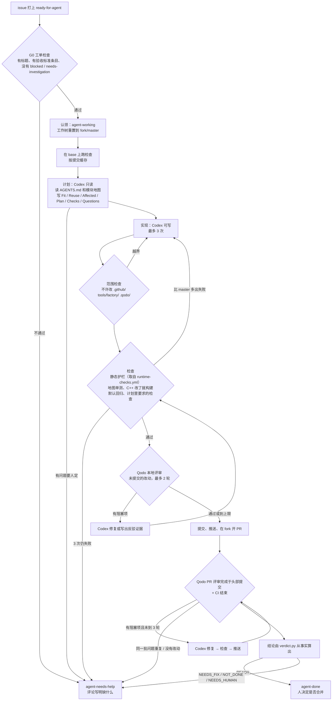

# 工厂

工厂主要做**审查后的修复**：fork（`hrhgit/Project.Keynes`）上每个打开的 PR，Qodo 评审完头部提交后，如果有阻塞项（action_required / remediation_recommended），工厂就让 Codex 在这个 PR 的分支上修，跑检查，没有新增失败才推送；推送后 Qodo 会评审新提交，下一轮再看。工厂**不会自动认领 issue**，issue 模式只能手动运行。**工厂从不合并**，合并由人决定，合到 fork 后再由人向上游提 PR。

代码在 `tools/factory/`，配置在 `tools/factory/config.json`，Qodo 评审规则在 [qodo-rules.json](qodo-rules.json)，每条规则由什么强制见 [rule-coverage.md](rule-coverage.md)，人工纠正记录在 [corrections.md](corrections.md)。

## PR 模式（定时运行）

`tools/factory/watch_prs.py`，每 600 秒由 launchd 运行一次。每个 PR 的处理由 `decide()` 决定（纯函数，测试在 `tests/test_watch.py`）：

| 情况 | 动作 |
|---|---|
| 草稿、分支在别的仓库、带 `blocked` / `needs-investigation` | 跳过 |
| Qodo 还没评审头部提交，或评审进行中 | 跳过，下一轮再看 |
| 评审以 failed 等非 completed 状态结束 | 停下，打 `agent-needs-help` |
| 头部提交上没有未关闭的阻塞项 | 跳过 |
| 有阻塞项 | 修复：检出头部提交，先跑一遍检查记下已有失败，Codex 修，再跑检查，没有新增失败才推送（`--force-with-lease` 指定原头部提交），在 PR 上评论 |
| 工厂修过之后又出现同一批问题，或连续修了 3 轮还不干净 | 停下，打 `agent-needs-help` |
| Codex 认为某条评审不成立 | 这条不再重试，写进评论由人决定 |
| 修复改到 C++、基线或契约文件、`.github/`、`tools/factory/` | 不推送，补丁存在本地，停下交给人 |

人往分支上推了新提交，轮数重新计算；工厂停下的那个头部提交不会再试。每个 PR 的状态存在 `~/.keynes-factory/prs/<编号>.json`，每次修复的记录存在 `~/.keynes-factory/runs/pr-<编号>-<时间>.json`。工厂的提交带 `Fixed-By: keynes-factory` 和 `Implemented-By: Codex`。注意：工厂会往你的 PR 分支推提交，本地继续改之前先 `git pull`。

## Issue 模式（只能手动）




## 质量关卡

| 关卡 | 必须满足 | 证据 | 不满足时 |
|---|---|---|---|
| G0 工单 | 标题；`## Acceptance criteria` 或 `## 验收标准` 下有勾选框或编号条目；没有跳过标签 | issue 正文和标签 | `agent-needs-help`，评论列出缺项 |
| 计划 | 六个小节齐全；Questions 为 `none` | Codex 只读输出，贴在 issue 上 | 有问题时停下等人 |
| 范围 | 不改 `.github/`、`tools/factory/`、`.qodo/` | `git diff` + 未跟踪文件 | 退回 Codex；基线和契约文件改了就交给人 |
| 检查 | 在 base 上通过的检查，在改动后也要通过 | 每项检查的日志，存在 `~/.keynes-factory/logs/` | 失败日志尾部发给 Codex，最多 3 次 |
| 本地评审（尽力而为） | Qodo 对未提交改动没有阻塞项（action_required / remediation_recommended） | `qodo review --repo hrhgit/Project.Keynes --json` | Codex 修复或写反驳证据；到上限后交给人。评审本身跑不起来时记入运行记录和 PR 正文，继续走 PR 评审 |
| PR 评审 | Qodo 对**当前头部提交**的评审已完成，没有未关闭的阻塞项 | `qodo read pr-review-session findings` | 最多 3 轮修复；同一批问题重复就停 |
| CI | 头部提交上的检查全部成功 | GitHub check runs | NEEDS_FIX |

结论的先后顺序：NEEDS_HUMAN → NOT_DONE（证据不全）→ NEEDS_FIX → READY。以下情况一律交给人：master 本身就有检查失败（AGENTS.md 要求推送前修掉已发现的问题）；改了 C++（两种 macOS 库都要重编并提交，再跑 `check_macos_runtime_extension.py`，工厂不提交二进制）；Codex 对某条评审有不同意见；状态无法识别的评审结果。仅供参考的评审结果会列出来，由人决定。

## 运行

```bash
python3 tools/factory/watch_prs.py --dry        # 只打印每个 PR 的决定，不写任何东西
python3 tools/factory/watch_prs.py --pr 5       # 只看一个 PR
python3 tools/factory/run.py --issue 12 --dry   # issue 模式：只跑 G0
python3 tools/factory/run.py --issue 12         # issue 模式：处理一张指定工单
tools/factory/install_poller.sh                 # 每 600 秒运行一次 watch_prs.py（launchd）
tools/factory/install_poller.sh --remove
python3 tools/factory/sync_rules.py [--apply]   # 把 qodo-rules.json 里缺的规则建到 Qodo
python3 -m unittest discover -s tools/factory/tests
```

本机目录 `~/.keynes-factory/`：`work/` 是 agent 的完整工作树（反复使用，保留 `.godot` 导入缓存和 SCons 中间文件）；`runner/` 是轮询用的稀疏工作树，固定在 fork/master；`runs/` 存每次运行的 JSON 记录（结论、理由、事实、事件）；`logs/` 存检查和 Codex 的日志；`base-checks/` 按提交缓存 base 检查结果。

工作树基于 `fork/master`。上游有新提交时，先同步 fork：`gh repo sync hrhgit/Project.Keynes --source HkingAuditore/Project.Keynes`。

## 已知限制

- Codex 在沙箱里运行，不能联网，所以计划步骤没有调用 Qodo Codebase Wisdom，只读本地代码和文档。
- 工厂不构建 release 库，也不提交 `addons/dots_ext/bin/` 下的二进制；改了 C++ 的 PR 一律交给人收尾。
- 本地没有跑 CI 里的 C++ sanitizer 用例；这部分以 PR 上的 CI 结果为准。
- Qodo 本地评审目前跑不起来：评审服务在 120 秒内检出不了这个仓库的 base（2026-11-19 两次都超时）。所以 `localReviewRequired` 设为 `false`，本地评审失败时只记录，不拦；把关的是 PR 上对头部提交的 Qodo 评审，`verdict.py` 没有它就不会给 READY。
- 工作树的 `origin` 是上游，Qodo 里没有连上游，所以本地评审显式传 `--repo hrhgit/Project.Keynes`。
- 计划里要求的额外检查只接受 `tools/ci/<脚本>.py [--参数]` 这种格式，其他命令会被拒绝并记录下来。
