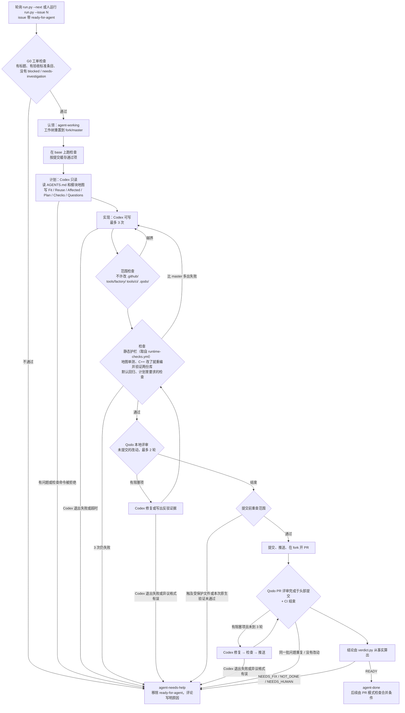

# 工厂

工厂负责**更新冲突分支、修复评审问题和合并 PR**。fork（`hrhgit/Project.Keynes`）上的 PR 有合并冲突时，工厂先把目标分支合入 PR 分支。Qodo 评审完头部提交后，如果有阻塞项（action_required / remediation_recommended），工厂就让 Codex 在这个 PR 的分支上修，跑检查，没有新增失败才推送。推送后 Qodo 会评审新提交，工厂在后续轮询中合并满足条件的 PR。另一项定时任务独立认领最早的一张可做工单（见下文 Issue 模式）。合到 fork 后，再由人向上游提 PR。

代码在 `tools/factory/`，配置在 `tools/factory/config.json`，Qodo 评审规则在 [qodo-rules.json](qodo-rules.json)，每条规则由什么强制见 [rule-coverage.md](rule-coverage.md)，人工纠正记录在 [corrections.md](corrections.md)。

## PR 模式（定时运行）

`tools/factory/watch_prs.py`，每 600 秒由 launchd 运行一次。每个 PR 的处理由 `decide()` 决定（纯函数，测试在 `tests/test_watch.py`）：

| 情况 | 动作 |
|---|---|
| 草稿、分支在别的仓库、带 `blocked` / `needs-investigation` | 跳过 |
| GitHub 报告有合并冲突 | 更新：把目标分支合入 PR 分支，解决允许的冲突，检查通过后推送。带 `agent-needs-help`、`agent-working` 或关闭 `autoUpdateConflicts` 时跳过 |
| GitHub 尚无法判断是否有冲突（`UNKNOWN`） | 跳过，下一轮再看 |
| Qodo 还没评审头部提交，或评审进行中 | 跳过，下一轮再看 |
| 评审以 failed 等非 completed 状态结束，或评审项的状态或未关闭项的处理级别无法识别 | 停下，打 `agent-needs-help` |
| 头部提交上没有未关闭的阻塞项，且 CI、文件范围、标签和 GitHub 可合并状态均满足下方条件 | 请求 GitHub 合并到 fork，按下方规则评论并写运行记录 |
| PR 改到受保护路径（含正式项目的 dots_ext 库目录），或无法读取完整的改动文件列表 | 跳过自动合并，记录原因 |
| 无法读取 CI | 停下，打 `agent-needs-help`，写运行记录 |
| CI 未完成、有非成功结论，或 GitHub 尚未确认可合并 | 跳过，下一轮再看 |
| 合并命令失败 | 停下，打 `agent-needs-help`，把错误写入运行记录 |
| 有阻塞项 | 修复：检出头部提交，先跑一遍检查记下已有失败，Codex 成功退出后再跑检查，没有新增失败才推送（`--force-with-lease` 指定原头部提交），在 PR 上评论 |
| 工作树不完整，或检查脚本、测试目录缺失 | 停下，打 `agent-needs-help`，把错误写入运行记录 |
| 修复后有新增失败的检查 | 用 `codex exec resume` 接着修复时的同一个 Codex 会话，把失败检查的报错行和日志尾部交给它再修（拿不到会话 id 时才新开会话），最多 `checkFixRounds` 轮（默认 2），每轮重新查范围、重跑检查；仍有新增失败才停下，打 `agent-needs-help`，不推送 |
| 修复评审项时 Codex 退出失败或超时 | 停下，打 `agent-needs-help`，保存本地补丁并列出路径 |
| 工厂修过之后又出现同一批问题，或连续修了 3 轮还不干净 | 停下，打 `agent-needs-help` |
| Codex 有异议且改了文件 | 按修复流程跑检查，异议写进评论由人决定 |
| Codex 没改文件 | 停下，打 `agent-needs-help`。有异议的条目交给人判断，其余阻塞项列出 ID |
| 异议格式有误，或 ID 不在本次交给 Codex 的评审项中 | 停下，打 `agent-needs-help`，列出有问题的行，保存本地补丁并列出路径 |
| 检出时发现头部提交已变 | 停掉本次修复，记入运行记录，下一轮查看新提交 |
| 修复改到 C++ | 工厂在本地重编两种 macOS 库，导入项目并逐库验证。通过后提交、推送源码，生成的库留在本地 |
| 修复改到 `gdext/godot-cpp/`、`gdext/rebuild.sh`、基线或契约文件、`.github/`、`tools/factory/`、`tools/ci/` 或 `.qodo/` | 停下交给人，保存本地补丁并列出路径。跑检查前和提交前各查一次范围 |

人往分支上推了新提交，轮数重新计算。同一个由人推送的头部提交最多交给 Codex 修复一次。每次修复或更新结束都移除 `agent-working`。每个 PR 的状态存在 `~/.keynes-factory/prs/<编号>.json`，每次修复或更新的记录存在 `~/.keynes-factory/runs/pr-<编号>-<时间>.json`。工厂的提交带 `Fixed-By: keynes-factory`，用到 Codex 的提交另带 `Implemented-By: Codex`。**工厂推送后，正在这个分支上工作的人必须先执行 `git pull`，再继续修改。**

### 更新有冲突的分支

- `autoUpdateConflicts` 默认开启。工厂先检查 PR 头部与最新取到的 `fork/master`，分别记录结果并复用按提交缓存的普通检查。无已跟踪的 macOS 库时先为对应提交本地构建，再将已检查的目标提交合入工作树，暂不提交。普通检查在两个父提交上都通过、在合入后失败时才阻止更新。合入后有 C++ 改动或缺少任一份库时，先重编、导入并逐库验证。
- 文本冲突交给 Codex 保留双方意图，并逐文件说明处理方式。Codex 只编辑冲突文件，并逐项报告保留或删除。工厂对照交接前的 Git 暂存区，发现其他文件被改动、删除或新增时，列出路径、中止合并并打 `agent-needs-help`。工厂核对报告覆盖全部冲突、处理方式与实际文件一致且无冲突标记，再只把这些文件登记到暂存区。Codex 失败、未解决的路径或残留冲突标记也会让工厂停下。
- 受保护路径（`paths.forbidden`、`paths.needsHuman`）、子模块或二进制文件（包括旧分支仍跟踪的 macOS 库）发生冲突时，工厂中止合并，列出路径并打 `agent-needs-help`。提交前核对范围，只计算与两个父提交都不同的文件。
- 合并后的检查如果出现"PR 头和目标分支上都通过、合并后才失败"的项（例如两边各自没超尺寸基线，合在一起超了），工厂把失败日志交给 Codex，在尚未提交的合并上修，最多 `limits.checkFixRounds` 轮；修不好才停下并打 `agent-needs-help`。
- 工厂创建 `Merge <base> into <branch>` 合并提交。推送前重读 PR 并核对标签、头部和目标提交，有变化就放弃本轮；目标分支只有 `tools/factory/` 和 `docs/factory/` 下的文件变了不算变化，因为它们不影响检查结果。推送成功后，工厂在 PR 上评论冲突处理、重编和检查结果。更新算一轮，与评审修复共用 `prReviewRounds` 上限。同一个头部提交最多尝试更新一次。工厂刚更新完又遇到同一组冲突文件时停下并打 `agent-needs-help`。

### 自动合并

- `autoMerge` 默认开启。设为 `false` 时，工厂仍可更新冲突分支和修复评审问题。
- PR 必须来自 fork 内的分支，已退出草稿且没有跳过标签、`agent-needs-help`、`agent-working` 或 `no-auto-merge`。GitHub 必须报告 `MERGEABLE`，尚无法判断时等下一轮。
- Qodo 必须已完成对当前头部提交的评审。所有评审项的状态和处理级别都要能识别，所有阻塞项都要关闭。Codex 提出异议的评审项按它的判断处理（见下），关闭失败的才交给人；仅供参考的评审项会列在评论中。
- 当前头部提交至少有一条 GitHub Actions 工作流。每个工作流和每项检查只看最新一次运行，均须完成且结论为 `success`。重跑成功后，旧的失败结果不再阻止合并。读取失败时停下交给人。
- 读取 PR 相对目标分支的完整改动文件列表。触及 `paths.forbidden` 或 `paths.needsHuman`（如 `.github/`、`tools/factory/`、`tools/ci/`、`.qodo/`、基线、`gdext/godot-cpp/` 和 `gdext/rebuild.sh`）的 PR 由人合并。`Project/project-keynes/addons/dots_ext/bin/` 目录的文件改动也由人处理。文件列表读取失败时跳过。触及 `checks.nativePaths` 时，工厂在当前头部提交上本地重编、导入并逐库验证，随后重新核对 PR 状态。
- 合并前重读 PR。标签、头部提交、目标分支或可合并状态有变化时，跳过并记录原因。合并命令仍绑定评审过的头部提交。
- 合并命令成功后，工厂再次读取 PR。确认预期的头部提交已合并时，记录合并提交，评论列出评审提交、CI 运行和仅供参考的评审项。若查询失败，仍记录合并成功，合并提交留空并记下查询错误。若 GitHub 返回其他状态或头部提交，则记录 `not_merged`，评论说明 GitHub 返回的状态，并打 `agent-needs-help`。打标签成功后，移除标签即可重试。若打标签失败，工厂在本地记录当前提交已停止，等分支收到新提交后再检查。合并记录存在 `~/.keynes-factory/runs/merge-pr-<编号>-<时间>.json`。

两种模式都从仓库根目录的 `.factory-disagree.md` 读取异议，每行严格按 `- <评审项 ID>: <证据>` 写一项。ID 必须和交给 Codex 时给出的一致，可以直接写，也可以用一对反引号包住。证据写明相关文件和行号。空行可跳过。格式有误或 ID 不认识时保存补丁，列出问题行交给人处理。

本地 AI（Codex）的判断优先于 Qodo（`config.json` 的 `acceptAgentDisputes`，默认开）：PR 上的评审项由工厂调用 `qodo pr-review-session dismiss`（理由 `rejected`，说明里附 Codex 的证据）关闭，并在评论中列出；Issue 模式本地评审的异议项不再算阻塞项，PR 上的照样关闭，异议都列在 PR 描述里，不让结论变成需要人处理。Codex 异议了全部评审项又没改代码时，PR 轮询不再停下，下一轮按合并条件处理同一提交。只有关闭失败的评审项才像以前一样交给人。关掉这个开关就恢复为所有异议都交给人。

补丁都保存在本次日志目录。主仓库的补丁是 `fix.patch`，有改动的子模块各有一份以子模块路径命名的补丁，例如 `fix.gdext__godot-cpp.patch`。停下时会列出所有保存的路径。

## Issue 模式

Issue 定时任务独立运行 `run.py --next`（`config.json` 的 `autoClaimIssues`，默认开）：按创建时间取最早一张打了 `ready-for-agent`、没有 `agent-working` / `agent-needs-help` / 跳过标签、且 `agent/issue-N` 分支上没有打开的 PR 的 issue，与 `run.py --issue N` 一样处理；锁被占用时这一轮不认领。认领时移除 `ready-for-agent`，所以一张工单只会被自动认领一次；结论不是 READY 时要人移除 `agent-needs-help` 并重新加 `ready-for-agent` 才会再跑。也可以手动运行 `run.py --issue N` 指定工单。已关闭或没有 `ready-for-agent` 的 issue 直接跳过（`--dry` 只看 G0，不受此限）。Issue 模式的分支名以 `agent/issue-` 开头（`config.json` 的 `issueBranchPrefix`），PR 轮询默认跳过这类 PR，避免两边同时修同一个 PR 或在结论出来前合并；没有标签就是安全状态，所以加标签失败、PR 查找失败都不会让轮询提前接手。结论为 READY 时工厂加 `factory-handoff`，交给 PR 轮询按合并条件处理；加不上就加 `agent-needs-help` 并在 PR 上说明由人补加。其他结论加 `agent-needs-help`，由人处理。`gh pr create` 之后查找 PR 失败时，`finish()` 再按分支找一次，找到就照样贴标签。Codex 在实现或修复期间退出失败或超时，当场停下，保存本地补丁并列出路径。



计划里要求的额外检查，会在计划写完后先在目标分支上跑一遍。基线上就失败的额外检查（例如和这次改动无关的耗时检查）不挡这次改动，PR 描述里会列出；静态护栏和默认回归仍然是任何失败都要修。

## 质量关卡

| 关卡 | 必须满足 | 证据 | 不满足时 |
|---|---|---|---|
| G0 工单 | 标题；`## Acceptance criteria` 或 `## 验收标准` 下有勾选框或编号条目；没有跳过标签 | issue 正文和标签 | `agent-needs-help`，移除 `ready-for-agent`，评论列出原因 |
| 计划 | 六个小节齐全，Questions 为 `none`，额外检查命令符合允许格式（`tools/ci/<脚本>.py`，可带 `--参数` 和 `tests/<路径>.gd`；开头的 `python3` 会去掉） | Codex 只读输出，贴在 issue 上 | 有问题或命令被拒绝时交给人 |
| 范围 | `.github/`、`tools/factory/`、`tools/ci/`、`.qodo/`、基线、契约文件、`gdext/godot-cpp/`、`gdext/rebuild.sh` 和`Project/project-keynes/addons/dots_ext/bin/` 目录由人处理。正式项目的 macOS dylib 是本地构建产物 | 每次提交前重查 `git diff`、未跟踪文件和子模块状态，核对库目录的改动和重编产物 | 提交前发现越界或库文件不符合要求就停下 |
| 检查 | 工作树完整，检查脚本和测试目录齐全；推送前**所有**检查都要通过，master 上原本就失败的也算（AGENTS.md：推送前修复已发现的问题，不能因为是既有失败就留到以后）。base 上的失败只用来告诉 Codex 哪些是改动前就有的。C++ 改动时先跑 `gdext/rebuild.sh`，再导入项目，然后用 `check_macos_runtime_extension.py` 分别验证两份库。每次执行回归都先导入候选项目 | 每项检查的日志，存在 `~/.keynes-factory/logs/` | 工作树不完整或检查入口缺失时立即停下，记录错误并打 `agent-needs-help`。Issue 实现阶段把普通检查的失败日志尾部发给 Codex，最多尝试 3 次。PR 模式报告失败并停下 |
| 本地评审（默认尽力而为） | Qodo 对未提交改动没有阻塞项（action_required / remediation_recommended） | `qodo review --repo hrhgit/Project.Keynes --json` | 评审失败或覆盖不完整时记入运行记录和 PR 正文，继续走 PR 评审。若配置要求本地评审，则停下交给人 |
| PR 评审 | Qodo 对**当前头部提交**的评审已完成，没有未关闭的阻塞项 | `qodo read pr-review-session findings` | 最多 3 轮修复；同一批问题重复就停 |
| CI | 头部提交至少有一次 GitHub Actions 工作流运行，所有工作流和检查都已结束，检查全部成功 | GitHub Actions 和 check runs | 等待中为 NOT_DONE，检查失败为 NEEDS_FIX，查询失败时立即停下并给出 NEEDS_HUMAN |

结论的先后顺序：NEEDS_HUMAN → NOT_DONE（证据不全）→ NEEDS_FIX → READY。master 本身有检查失败、Codex 对某条评审有不同意见，或评审状态无法识别时，交给人处理。C++ 改动必须通过本轮的本地重编、项目导入和两份库的运行验证。重编与验证结果写入运行记录和 PR 正文或评论。仅供参考的评审结果会列出来，由人决定。

## 运行

```bash
python3 tools/factory/watch_prs.py --dry        # 只打印每个 PR 的决定，不写任何东西
python3 tools/factory/watch_prs.py --pr 5       # 只看一个 PR
python3 tools/factory/run.py --issue 12 --dry   # issue 模式：只跑 G0
python3 tools/factory/run.py --issue 12         # issue 模式：处理一张指定工单
tools/factory/install_poller.sh                 # 安装两项独立的 launchd 任务，各每 600 秒运行一次
tools/factory/install_poller.sh --remove
python3 tools/factory/sync_rules.py [--apply]   # 把 qodo-rules.json 里缺的规则建到 Qodo
python3 -m unittest discover -s tools/factory/tests
```

Issue 开发和 PR 检查独立运行。Issue 任务领最早的一张可领工单，开发、验证并开 PR；PR 任务检查已交接的 PR，并持有 PR 锁逐个合并。两项任务可以重叠，合并前仍会重新核对 GitHub 上的 PR 和目标分支。

| 本机路径 | Issue 开发 | PR 检查 |
|---|---|---|
| 程序目录 | `runner/` | `pr-runner/` |
| 完整工作树 | `work/` | `pr-work/` |
| 基线检查缓存 | `base-checks/` | `pr-base-checks/` |
| 任务锁 | `issue.lock` | `pr.lock` |
| 轮询日志 | `poll.log` | `poll-pr.log` |

这些目录都在 `~/.keynes-factory/` 下。每份工作树保留自己的 Godot 导入缓存、Godot 用户数据和 SCons 编译文件。两边的检查日志与运行记录分别按任务保存在 `logs/` 和 `runs/`。PR 检查沿用 `prs/` 下的历史状态。

安装脚本把 `tools.python` 写进两个 launchd 任务。配置改变后重新安装。两个程序目录默认从 `fork/master` 更新。也可用 `install_poller.sh --runner-ref <本地提交>` 部署本地版本。该提交进入 `fork/master` 后会自动跟随 `fork/master`。无参数运行 `poll.sh` 领 Issue，传 `--pr-lane` 检查 PR，传 `--pr 5` 或 `--dry` 则保持原有的 PR 模式。手动执行时，未配置 `KEYNES_FACTORY_PYTHON` 就使用 PATH 上的 `python3`。

`sync_rules.py --apply` 创建缺失规则，有任何创建失败就返回非零。修改已有规则先用 `qodo rules update`，再更新 JSON。

工作树基于 `fork/master`。上游有新提交时，先同步 fork：`gh repo sync hrhgit/Project.Keynes --source HkingAuditore/Project.Keynes`。

## 已知限制

- Codex 在沙箱里运行，不能联网，所以计划步骤没有调用 Qodo Codebase Wisdom，只读本地代码和文档。
- C++ 检查在 Apple Silicon macOS 上运行，覆盖本地构建的 arm64 debug 和 release 库。库目录的改动交给人。
- 本地没有跑 CI 里的 C++ sanitizer 用例；这部分以 PR 上的 CI 结果为准。
- Qodo 本地评审目前跑不起来：评审服务在 120 秒内检出不了这个仓库的 base（2026-11-19 两次都超时）。所以 `localReviewRequired` 设为 `false`，本地评审失败时只记录，不拦；把关的是 PR 上对头部提交的 Qodo 评审，`verdict.py` 没有它就不会给 READY。
- 工作树的 `origin` 是上游，Qodo 里没有连上游，所以本地评审显式传 `--repo hrhgit/Project.Keynes`。
- 计划里要求的额外检查只接受 `tools/ci/<脚本>.py [--参数]` 这种格式。被拒绝的命令会写进运行记录和结论。
