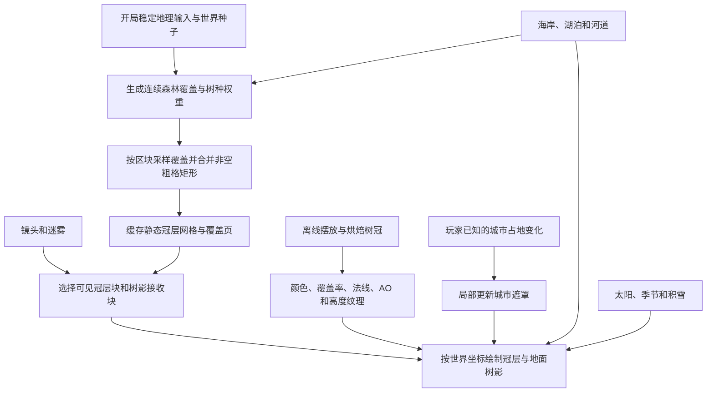

# 大面积森林冠层渲染方案

设计方案（修订版） · 2026-11-28

## 1. 目标与画面

- 一片森林可以横跨十几格、几十格或更远。整图能看清整片林地的轮廓、疏密、河谷和林间空地；拉近后能辨认树冠，且保持与现有近景树冠相近的清晰度、单株/小簇级秋叶色差与河岸贴合度。
- **产品与渲染边界**：树冠是纯渲染表现，不进入模拟状态。游戏只关心区域里有没有森林，以及森林在水域、河道和城市边界处是否留空。森林边界由开局地图确定，**整局固定**（除城市持续占地遮罩外，不随气候生态演替增减覆盖范围；季节、干旱、枯荣与积雪通过着色与调色表达）。
- PC 远景有冠层法线、环境光遮蔽（AO）和随太阳方向、仰角变化的地面树影。影子能伸到林缘外，也能落进林间空地。
- 全图表现量可以扩展到百万乃至千万棵树冠。运行时成本主要随可见绘制区块、屏幕覆盖和阴影采样量增长。全图树冠表现量与同屏独立实例数分别统计。
- 第一版以一片横跨约 30–50 格、同时有河弯、空地和沿河城市的森林为对照场景。

## 2. 数据流



| 数据 | 来源 | 更新时机 |
|---|---|---|
| 森林布局输入 | 世界种子、规范化地图坐标、**持久化且不被演替改写的开局植被/地理真源**、水域与河道 | 地图加载或读档时取得稳定快照 |
| 冠层网格与覆盖页 | 连续覆盖场和静态陆水粗轮廓 | 区块首次需要时构建，缓存回收后可重建 |
| 树冠素材 | 离线烘焙，按树种、纹理尺度和疏密选择 | 素材版本变更时 |
| 城市占地 | 玩家已知的建筑显示快照 | 变化格和其影响范围内的遮罩页 |
| 像素级水陆/河道裁切 | 渲染侧已有地表水陆与河道流场口径 | 随地形/地图静态纹理绑定 |
| 光照、季节和积雪 | 已发布的光照与生态贴图 | 随现有显示发布更新 |

## 3. 森林覆盖与树冠布局

### 地图上的整片森林

1. **锁定开局稳定真源（阶段 1 前置契约）**：
   - 现有 `generation_vegetation_arr` 仅在生成期写入，尚未进入 `pkmap_io.gd` / 存档持久化；而已持久化的 `base_vegetation_arr` 会被 `native_daily_publish.gd` 随生态演替每日覆盖。 [地图字段](../../Project/project-keynes/scripts/geography/map_data.gd#L271) · [地图持久化](../../Project/project-keynes/scripts/geography/pkmap_io.gd#L13) · [每日演替写回](../../Project/project-keynes/scripts/simulation/climate/native_daily_publish.gd#L624)
   - 因此严禁直接读取会被演替改写的列。须在阶段 1 前二选一锁定真源：
     - **优先**：从已持久化的静态开局地理数据（高程、基线湿度、年均温、水域/河道、世界种子）确定性推导固定的视觉树种权重与森林覆盖；
     - **备选**：将开局植被/覆盖快照作为版本化字段正式纳入存档持久化，并为旧档保留静态地理推导回退。
   - 无论选哪条，须保证新局、演替推进多日后读档、以及旧档加载得到逐像素一致的森林范围。
2. **范围与密度分离**：在规范化世界坐标上加低频、固定种子的噪声，把森林外轮廓与林内密度分开处理。前者决定整片林的边界，后者形成数格宽的密林、疏林和较大的空地。以约 3–8 格宽的林内纹理尺度作为原型起点，最终按镜头和地图画面调整。
3. **陆水与河道裁切分层**：
   - CPU 覆盖场使用 `sample_flow()` 与海平面做粗裁切和空块剔除；
   - **像素级海岸与窄河裁切在片元阶段复用渲染侧同一份水陆与河道口径**（与 `land_pipeline.gdshaderinc` 的 `river_mask` 阈值对齐），彻底避免因 CPU/GPU 采样口径差异导致树冠悬空在水面或岸边留白。窄河可切过同一片森林，画面仍读成一片林。 [河道采样](../../Project/project-keynes/scripts/geography/world_data.gd#L491) · [地形河道遮罩](../../Project/project-keynes/shaders/include/land_pipeline.gdshaderinc#L573)
4. **多树种过渡约束**：相邻地块允许平滑过渡，但**每像素最多采样 2 个树种**，且采用**高度混合（height-blending）**或低频噪声斑块切分，禁止普通线性 alpha 混合导致交界处出现半透明重影。
5. **东西环绕**：冠层位置由种子和世界坐标定义。绝对坐标在采样前做东西环绕规范化，噪声和冠层纹理采用同一周期。显示用的东西副本共享原区块资源。

森林的跨度由覆盖场自然决定。16×16 格是首轮构建与绘制的区块粒度。一片 40 格宽的森林跨越多个区块，各块通过同一覆盖场形成连续轮廓。

### 一张冠层贴图里的树怎么排

1. 每个树种从现有俯视树冠素材选若干变体，用可变半径泊松盘采样离线摆放，按树冠半径决定最小中心距。密林允许适量搭接，疏林留出清楚的空位。对可平铺纹理按周期边界生成并检查四边覆盖和高度连续性。
2. **近景分辨率与生命力预算（阶段 2 前置契约）**：
   - 先按最近镜头下的屏幕像素密度确定 **texel/hex 预算**（单株冠幅与现有近景树冠、房屋比例校准），避免拉近后明显糊于现有 `crown_atlas`。
   - 保留近景单株/小簇级变化：在贴图通道或基于冠层单元的稳定哈希中保留色相/明度扰动（支持秋叶红黄差异，延续 `vegetation_impostor.gdshaderinc` 的物候表现）与轻微有界 UV 风摆，避免近景显得像静态地毯。
   - 去重复策略须受单像素总采样数约束（优先利用世界坐标旋转/偏移、低频密度调制或单次额外低频采样，避免多层全纹理叠加导致采样爆炸）。
3. 合成颜色、覆盖率和冠层高度：高度取上层可见冠面，冠层法线从高度梯度计算；AO 由周边较高冠层估算，重点保留冠间低处的遮蔽。颜色延续 `crown_tone` 亮度归一化口径以兼容气候/物候调色；法线和 AO 用线性数据，纹理旋转时同步旋转法线水平分量。
4. 针对缩远测试 mipmap 后的冠层覆盖、透明边缘和材质接缝（结合 Alpha Mipmap 维持远处覆盖率）。首选纹理数组或每层独立的连续纹理，隔离相邻素材的过滤。

现有树冠素材和法线烘焙可作为输入。 [素材工具](../../Project/project-keynes/tools/resource_art/build.py#L413) · [自然点缀契约](../architecture/feature-guides.md#地图自然点缀)

## 4. 几何组织与分块缓存

1. **主路径（阶段 1–3）：区块内粗格非空矩形合并**
   - 每个 16×16 区块按粗格（如 2×2 或 4×4 格）采样森林覆盖，剔除完全无林的粗格，将每行连续的非空粗格合并为最少矩形，合成一份 Godot `ArrayMesh`（思路与现有陆水覆盖网格一致）。 [地图裁剪规则](../architecture/feature-guides.md#大图每日计算与地表绘制)
   - 优点：实现简单、冷缓存构建开销极低、天然无跨块裂缝与 T-junction、无带洞三角化稳定性风险，且规避细长斜边三角形带来的 GPU 2×2 pixel quad 辅助像素浪费。
   - 稀疏或完全无林的区块记录为空块缓存，避免后续重复构建。
2. **基线对照**：原型同时保留同材质的**整块 quad + 遮罩**作为对照，量化粗格矩形合并在细长林带、河湾和满覆盖区分别节省了多少片元与提交成本。
3. **可选优化（阶段 4，按实测决定）：Marching Squares 轮廓网格**
   - 仅当真实 GPU 测量表明，在粗格矩形合并之后细长林带与河湾的空片元 overdraw 仍是主要瓶颈时，才引入 Marching Squares + 带洞三角化（届时固定共享边界交点与对角连接规则，并在需要时下沉到后台数组构建或原生扩展）。
4. **边缘与缓存生命周期**：
   - 几何边界须向外留足覆盖贴图过滤与风摆余量，避免边缘硬切。
   - 每个区块缓存网格、覆盖页引用和局部边界。镜头与迷雾只控制批次提交（接入现有迷雾完全遮挡裁剪）。预取和上传沿用现有分块预算，空块同样有缓存记录；退出世界时释放本世界资源。若异步准备，只在后台计算普通数组并携带地图标识，Godot 资源和 GPU 上传在主线程完成。 [现有分块设置](../../Project/project-keynes/scripts/rendering/renderer_scene_settings.gd#L489)

## 5. 城市持续占地

- 城市遮罩与静态森林分开生成。先用现有聚落核心档位和半径做原型；港口、带状城镇等场景若出现明显误裁，再从建筑可见布局派生更贴合的占地轮廓。 [当前核心半径](../../Project/project-keynes/scripts/rendering/shrub/scatter.gd#L225)
- 城市新建、扩张或拆除时，根据旧、新占地的并集更新受影响的遮罩页。范围跨区块就更新相邻页。冠层和树林投影读取同一版遮罩与覆盖页版本；占地结束后，树冠恢复到原来的位置。
- 遮罩只读取玩家已知的建筑快照。迷雾里的城建变化按现有建筑情报发布时机进入画面，避免透过林缘和树影提前暴露。首次进入某块与早已缓存该块的结果相同。 [建筑情报](../../Project/project-keynes/scripts/rendering/building_visual_intel_cache.gd#L68) · [建筑变化入口](../../Project/project-keynes/scripts/rendering/renderer_scene_services.gd#L518)

## 6. PC 冠层光照与动态树影

### 冠层着色

- PC 原型控制单像素采样预算：每个参与混合的树种（上限 2 个）采样颜色+覆盖与法线+AO，按已有的太阳方向、天光、季节和积雪输入着色。把 AO 主要乘在环境光和间接光上，直射亮面由法线与太阳方向决定。
- 共用地表昼夜、地平线遮蔽、曝光和夜间暗部地板口径，避免夜晚树冠黑成剪影或与云海/雾割裂。法线、AO 的低频结构在总览时仍应可见，近景保留更细的枝冠对比。
- 移动档先用颜色与覆盖；PC-Web 以实际 shader 编译、WebGL2 采样器数量（参考当前高档水陆已占 7 个采样器）和帧时间验收。 [植被现有着色](../../Project/project-keynes/shaders/include/vegetation_impostor.gdshaderinc#L641) · [项目光照契约](../architecture/feature-guides.md#天气与光照-shader)

### 投影接收与采样

1. 从同一森林覆盖场得到低频投影来源。有效遮挡量由静态森林覆盖、冠层高度和城市遮罩决定。植被位置和遮挡来源的坐标固定。
2. 令 `L` 为世界坐标中指向太阳的方向，`h` 为冠层有效高度。平地近似下，树影从冠层向 `-L.xy` 延伸：

   ```text
   shift = -h * L.xy / max(L.z, min_sun_elevation_component)
   shift = clamp_length(shift, max_shadow_length)
   ```

3. 从接收点沿太阳方向反查遮挡来源，第一版用粗冠层高度和少量采样估算软影。高太阳角度投影短，低太阳角度投影长且软，太阳接近地平线时淡出直射影。使用与地表一致的太阳方向与日夜强度，兼容永昼日照与太阳调试模式。
4. **按接收块拥有输出区域**：接收块读取最大投影距离内相邻块的来源，即使遮挡冠层本身在视口之外。各接收块只写自己的像素，避免跨块重复加深；裁剪以接收范围判断，树林边界外和林间空地都能收到影子。
5. **合成路径前置决策（阶段 3 前锁定）**：
   - 不将森林树影直接塞进全图 512×256 的 `world_lighting_composite.gdshader`（大图下每格分辨率不足以承载林缘长影与林间空地软影）。 [共享照明合成](../../Project/project-keynes/shaders/world_lighting_composite.gdshader#L4)
   - 在以下两条路径中二选一，并统一核对 `terrain_render_scale.gd`（地图清晰度 < 100% 时的陆水缩放子视口）与水面/河道裁切： [陆水缩放](../../Project/project-keynes/scripts/rendering/terrain_render_scale.gd)
     - **路径 A（合入地表直射 BRDF）**：陆地主 shader 读取分块/页表树影接收纹理，将森林遮挡乘入 `lc.direct_shadow`（与地形地平线、云影组合）。物理最准确，不影响环境光与间接光，但需实测确认 WebGL2 采样器余量与子视口坐标对齐成本。
     - **路径 B（独立树影接收层，位于陆地之上、冠层之下）**：不改陆地主 shader、解耦更彻底；但必须按 `local_day`、已有地形直射可见度与云影可见度门控强度，并按水陆/河道掩码排除水面，避免将环境光、PTT-GI 间接光与夜间暗部一并压死。
6. 被城市裁掉的树冠从投影来源中一并扣除。刚加载的区块与接收块使用同一版覆盖与遮罩，确保首帧不出现空中树影或断影。迷雾按现有绘制顺序覆盖。

先验收林缘长影和空地里的软影。近景单棵树影是否值得补，由视觉对照和像素成本决定。需要时继续复用同一冠层贴图的细尺度覆盖和高度。

## 7. 接入顺序与替换边界

| 阶段 | 交付结果 |
|---|---|
| 0. 前置契约 | 锁定开局森林持久化真源、树冠 texel/hex 与最多 2 树种高度混合预算、树影合成路径（路径 A 或 B）。 |
| 1. 静态覆盖原型 | 从稳定真源和水域输入生成连续森林，完成**粗格矩形合并**与**整块 quad**对照；片元阶段对齐地表河道与海岸裁切。用现有森林渲染作为画面和成本基线。 |
| 2. 素材与 PC 着色 | 接入阔叶、针叶、棕榈等可平铺冠层纹理与最多 2 树种高度混合。验收远近缩放清晰度、单株秋叶色差、微风摆动、季节色、法线与 AO。由 `HexRenderer` 编排显示数据，森林层持有区块缓存。 |
| 3. 城市与树影 | 通过现有建筑快照变更入口更新城市遮罩；接入已选定的动态树影路径，验证河湾、空地、视口外遮挡、城市扩张、地图清晰度缩放和东西接缝。 |
| 4. 等画面对照与可选扩展 | 用正式画质跑桌面测量，复测 PC-Web 和移动档。按实测决定是否引入 Marching Squares 轮廓网格、在最远总览合入陆地绘制，或补近景细投影。 |

**替换边界与开关关系**：
- 新路径挂在独立原型开关下（验收通过前默认关闭），与现有未默认开启的 `detail_scatter_family_renderer_enabled` 互斥，避免新旧森林叠加或双倍付 CPU 成本。 [现有分块设置](../../Project/project-keynes/scripts/rendering/renderer_scene_settings.gd#L485)
- 接管 `world_decoration_manifest.tres` 中的树冠层：`tree`、`conifer`、`cloud_forest_tree`、`monsoon_tree`、`palm`（`mangrove_root` 因涉水岸带特性单独评估是否保留在散布层）。草、灌木、岩石、倒木、枯树桩、芦苇、苔原、水下植被等继续由各自现有散布层控制。 [点缀清单](../../Project/project-keynes/data/visual/world_decoration_manifest.tres)
- 森林消费显示发布数据，缓存由地图与素材重建。 [渲染模块地图](../architecture/module-map.md#十二域以外) · [显示数据契约](../architecture/design.md#存档与显示)

## 8. 验证与性能记录

| 验证场景 | 通过条件或记录口径 |
|---|---|
| 连续森林、狭窄河道、海岸及大空地 | 30–50 格宽林地外轮廓自然连续；像素级水陆/窄河贴合地表无悬空树冠；跨区块与东西环绕无裂缝；无林块重复访问命中缓存。 |
| 同一种子重建、缓存回收、演替后读档与旧档 | 相同区块的覆盖、网格和世界坐标纹理位置逐像素一致；推进多日生态演替后存档再读档，森林边界不漂移。 |
| 近景细节与多树种过渡对照 | 最近镜头下与现有树冠对比清晰度、秋叶单株色差和微风摆动；双树种交界处无半透明重影，无明显平铺重复感。 |
| 城市扩张、拆除或迷雾揭开 | 只更新影响范围内的遮罩页；林冠与投影同步裁切；非占地区域网格和树冠位置不变；未发布的建设不改变可见林缘与树影。 |
| 法线、AO、太阳方向与树影对照 | 依次开关法线与 AO 轮廓一致；反转太阳方位亮面和影子同步变化；覆盖正午、斜光、夜间、遮挡冠层在视口外、水面不错误受影、以及地图清晰度 < 100%（`terrain_render_scale`）场景。 |
| 固定镜头的 GPU 与平台对照 | 同种子、分辨率、迷雾和画质，交替测现有森林、整块 quad、粗格矩形合并（及阶段 4 若引入的轮廓网格）。记录 GPU 时间、批次数、三角形数、PC-Web 采样器数与着色器编译结果，分别统计冠层、AO 和树影的边际代价。 |
| 同一路线首次经过与回访 | 单独记录冷缓存构建和热缓存复用的 CPU 帧时间 P50/P95、生成块数、上传字节数和常驻页数。热缓存回访复用森林网格；季节更新和城市遮罩更新产生的森林网格上传字节数为零。 |
| 扩大世界地图，保持窗口和镜头内林地相近 | 记录全图覆盖面积、按素材密度推算的树冠表现量、可见批次及常驻内存。验证可见渲染成本主要随镜头范围变化，另记开图准备成本。 |

优先复用项目已有的真实 GPU 读回、迷雾裁剪与地形覆盖探针。现有性能记录对独立植被耗时的归因有限，因此应新增同覆盖、同分辨率的交替对照，再根据实际数据定帧预算和素材尺度。 [现有真实 GPU 植被探针](../../Project/project-keynes/tests/world/vegetation_pixel_normal_render_test.gd) · [已有 GPU 对照及限制](../architecture/feature-status.md#实测结果)

## 9. 参考资料

- Bruneton 与 Neyret 的森林多尺度表示，参考以地表承载远处冠层集合效果的思路。 [Real-time Realistic Rendering and Lighting of Forests](https://diglib.eg.org/items/9de7c594-877a-4d97-a2e0-bcab5acb10bf)
- Ignacio Castaño 的 Alpha Mipmap 算法，适用于素材缩小时需要维持裁切覆盖率的场景。 [Computing Alpha Mipmaps](https://www.ludicon.com/castano/blog/articles/computing-alpha-mipmaps/)
