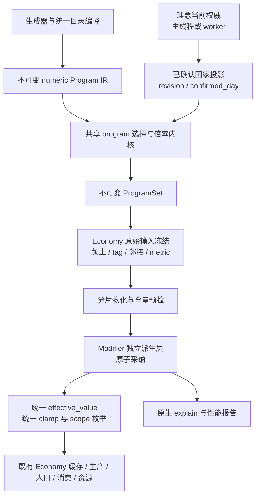

# 理念永久地块效果取消 32 格限制：统一实施方案 v3

| 项目 | 内容 |
|---|---|
| 日期 | 2026-10-26，Asia/Hong_Kong |
| 状态 | 设计与实施计划；运行时代码尚未按本方案修改，性能目标尚未验证 |
| 目标 | 从逐格实例模型中移出永久、无状态地块理念，完整覆盖符合条件的目标，并保持可解释、可恢复、可维护的原生执行路径 |
| 取代关系 | 本文完整取代 [v1](20-cell-program-cap-removal-plan.md) 和 [v2](21-cell-program-cap-removal-plan-v2.md) 的实施指导；前两版保留为历史分析 |
| 核心选择 | ModifierRuntime 内置只读派生地块层，Economy 冻结边界物化，理念状态权威提供已确认输入；主线程与 worker 共用纯计算内核 |
| 本文不代表 | 已实现、已测量、已批准发布，或用户已接受任何旧档失效／生效时序变化 |

## 0. 使用方法与可信度边界

### 0.1 区分三类陈述

- **已核对事实**：来自当前工作区源码和生成目录的只读检查，集中在 §2 和附录 A。
- **设计规定**：本文拟实施的行为、接口、边界和验收标准，不表示当前代码已经支持。
- **待实测结论**：机器耗时、峰值内存、最合适的容器布局、精度边界及工期，必须由 M0 或后续里程碑给出证据。

本文中的 C++ 结构、接口和状态机是语义草图，不是可直接粘贴的实现；标明“拟新增”的符号不得当作已有 API 调用。源码符号优先于行号；开始实现前重新定位。

### 0.2 实施顺序

1. 先读 §1–§3，确定目标、当前事实和架构决策。
2. 再读 §4–§10，冻结目录、数值、选择器、失效、线程及 ACK 契约。
3. 实施存档前必须读 §11；不得根据“派生量”三个字跳过恢复审计。
4. 按 §15 的里程碑推进，每批通过 §13–§14 的正确性与性能门禁。
5. 按 §18 收口，之后才可称“取消限制完成”。

### 0.3 本版纠正的关键问题

| 旧方案判断 | v3 规定 |
|---|---|
| 可以在 Modifier 最终有效值上追加平面 | 所有 ADD 与 factor 在最终 clamp 前合并；禁止二次包装最终值 |
| 将派生层放入 Modifier 后，worker 自动支持 | worker 有独立权威与快照；交接、写入者、业务日期和快照保留规则必须实现 |
| OWN_TERRITORY 的 ramp 都是国家标量 | 当前有 12 个逐格 ramp；与国家 ramp 分层，连续输入不使用条件阈值桶 |
| 沿用实例脏标记即可空闲零重建 | worker 快照每日可置脏；必须先比较语义版本，再决定是否物化 |
| 一个 uint64_t 能表示 metric 依赖 | 复用现有 MetricMask，并检查目录容量；当前经济指标容量为 108 |
| 共用 fold_term 天然逐位一致 | 还须固定 VM 运算、Q16 舍入、浮点归并顺序、零因子与最终 clamp |
| 复用 BFS 即有线性性能 | 现有代码有逐来源整图清零；先消除此项，再测完整管线 |
| 改文案／预算会使所有旧档自然拒读 | 显式加入执行语义身份，分别验证 PKID、Effect、Modifier 和整包检查 |
| 所有表都不入档，读最新状态即可恢复 | 不保存逐格派生结果；必要的历史选择与冻结输入必须可恢复 |

## 1. 目标、范围与硬性不变量

### 1.1 完成后的玩家行为

正式永久地块理念的目标集合只由 selector、领土、标签、条件和来源规则决定。命中 31、32、33、200 或全国全部格时，不再以 32 截断。每格来源计数上限仍按卡牌玩法生效。

“无目标数量上限”不等于无限内存或无限单次执行时间：计算必须分片、计量、预检；资源不足应明确拒绝或暂停当前提交，不能静默裁剪目标。

**M2-1 补充：32 在本仓库里由三层联动的机制实现，方案原先只覆盖了其中一层。**

| 层 | 位置 | 现状 | 未改动时的后果 |
|---|---|---|---|
| 代码常量 | `effect_runtime.h:272` `SELECTOR_MAX_CELLS = 32` | 13 处使用 | 内容写多大都 `min(param0, 32)` |
| 内容参数 | **194 个** program 的 `target_selector_param = (32, 0)` | 194/194 全为 32，无一例外 | 即使常量放宽，仍按 32 截断 |
| 实例截断 | `ideology_runtime.cpp:2133` | 实例路径 `resize(32)` | 实例路径仍 32 格 |

**改动有强制顺序：** catalog 编译时会**拒绝** `param[0] > SELECTOR_MAX_CELLS`，且校验在**两层**：

| 层 | 位置 | 错误码 |
|---|---|---|
| GDScript | `scripts/ideology/ideology_effect_definition.gd:261-266` | `ideology_effect_selector_cap_invalid` |
| C++ | `effect_runtime.cpp:1005-1013` | `effect_family_metadata_invalid` |

**实测确认**（M2-1）：把 `default_ideology_effects.tres` 里一个 kind-12 program 的参数从 `(32, 0)` 改成 `(64, 0)`，catalog 立即以 `ideology_effect_selector_cap_invalid` 失败；数据已恢复。因此必须先放宽**两处校验**与常量、再改内容；反过来做会让整个 catalog 编译失败。

**一处需要澄清的非对称：** `effect_runtime.cpp:1006-1008` 对 `SELECTOR_TAG_SOURCE_COUNT` 与 `SELECTOR_FAMILY_OWNED` **豁免**了上限校验，但 `collect_effect_target_cells:2430/:2477` 对这两个种类**仍** `min(param0, SELECTOR_MAX_CELLS)`。即「校验放行、运行时封顶」——E/F 批次（kind 14/15/16）看似不受限，实际仍受限，M4 的工作量不能按「豁免」来估计。

**建议把 `SELECTOR_MAX_CELLS` 拆成按选择器种类区分的上限**：kind 12/14/15/16 需要「按真实领土/来源数」，而径向扇出（`NEIGHBORS_R1/R2`，几何上限 37/61）确实需要界。用一个全局常量覆盖两种语义是当前设计的根本问题。

### 1.2 本轮覆盖

当前基线中的 265 个经济地块 program，包括 OWN_TERRITORY、TAG_SOURCE_COUNT、TAG_SOURCE_R1，均须进入最终派生路径。命中格数不再增加 Effect 实例数、逐格事务数或逐格 ACK 数。

另有 7 个地块 program：2 个 anchor 单格、5 个显式 8／18 格的 family.city 诊断探针。它们不是本轮 32 格限制的正式内容，不自动改语义。最终覆盖报表须逐项列出，不能以总数掩盖例外。

### 1.3 非目标

- 不重写抽卡、理解度、阶层支持、协同或国家精神规则。
- 不把国家级效果、一次性效果、持续时间效果、动态叠层锁存迁入派生层。
- 不取消家族路径或其他有状态 Effect 的保护预算。
- 不顺带重平衡卡牌数值；覆盖扩大导致的总收益变化另列影响报告。
- **本方案交付能力，不交付平衡。** 取消 32 上限后，一张 32 格卡的收益可能放大到全国数倍（例：单国 1000 格时为 31 倍），且 `economy.city.output_factor` 是 **factor** 而非 add，多张卡连乘。因此：
  - ON 面向玩家之前必须有**独立的平衡评审里程碑**，不由本方案的 §15 里程碑覆盖；
  - §15.4「可在满足发布条件后单独评审本批 ON」必须与该平衡评审绑定，不能只凭工程门禁放行；
  - 影响报告至少给出：每张受影响卡在典型国家规模下的收益放大倍数、叠加后的总 factor 上界、以及需要调整的卡清单。
- 不建立 GDScript 理念仿真、第二个 Modifier 实例写入方或新守恒账本。
- 不提供旧档自动迁移器，不把 SIMD／新线程池作为默认优化。

### 1.4 不变量编号

| 编号 | 必须保持的性质 |
|---|---|
| I01 | 一个 program 在同一执行配置中只有一个执行后端；派生与实例不得双算 |
| I02 | 派生路径没有 target cap，也不得间接调用带 cap 的目标收集器 |
| I03 | 本轮正式永久地块内容不因不支持而静默落回 32 格实例 |
| I04 | 理念、Country、Economy、Effect、Modifier 保持各自状态权威 |
| I05 | 只消费已确认的理念状态；pending 期间保留上一份已确认贡献 |
| I06 | 物化使用同一份冻结输入；不混用不同业务日或不同 epoch 的快照 |
| I07 | 所有贡献在最终 clamp 前按同一 Modifier 公式合并 |
| I08 | 新表全量预检后原子采纳；失败不暴露半张表 |
| I09 | 已冻结的经济周期不被中途换表或重算污染 |
| I10 | 主线程与 worker 在相同业务输入下产生相同贡献与消费结果 |
| I11 | 当前世代、地图身份、country generation 均经过检查 |
| I12 | explain 使用实际生效基础，不用 UI 自行重做选择器 |
| I13 | 同一输入重试幂等；无语义变化不物化、不提交、不推进层版本 |
| I14 | 存档重载恢复相同的在用基础与待生效基础；不重放一次性效果 |
| I15 | 数值、覆盖、性能、内存和剩余例外均有独立验收证据 |

## 2. 当前代码与内容基线

### 2.1 工作区身份

核对时 HEAD 为 `f52c5b9a7f59d9dc39f0ef266a3654ad32d9c446`。工作区有既存未提交修改，不能把 HEAD 当作完整内容身份。下列 SHA-256 描述实际读取的文件：

| 文件 | SHA-256 |
|---|---|
| default_ideology_effects.tres | `5c5e20e79c688c72b9f1359c5b1630cf641aaba1e9bd61cccc5318eb43c880cd` |
| generate_ideology_catalog.py | `090547914ef41359d1f6ecd2520b9f5073e5fbf2364786fc315b170d16269a9f` |
| ideology_runtime.cpp | `4b966b0e0afd2e2b1072876279ba11c1da44f6e3e16191d8703f9162b780418f` |
| modifier_runtime.cpp | `289d78985c12b318aedc948f65676f0870d6cc303099cca81aeffc10fc169980` |
| runtime_ideology_pod.h | `06b3a7486680049300432e2997d39b754c1f1d8e0c4c7d5854a99c0c903eb93a` |

这些是文件摘要，不是 native catalog hash。后者须在实际加载 DLL 后另行记录。本文未执行运行时构建、模拟基准或数值双跑。

### 2.2 program 数量与正确分层

统计对象是 `data/ideologies/default_ideology_effects.tres` 中实际引用的 program，不是卡牌数量。一个卡的不同等级或多个输出 program 分别计数。

| 类别 | 数量 | 后端迁移要求 |
|---|---:|---|
| 所有 program | 288 | 包含非地块域 |
| 地块域 program | 272 | 本表以下各项之和 |
| A：OWN_TERRITORY，无条件常数 | 129 | 94 个单命令 + 35 个多命令 |
| B：OWN_TERRITORY，国家 ramp | 12 | 国家标量每国求值一次，再展开目标 |
| C：OWN_TERRITORY，逐格 ramp | 12 | 每个目标格求连续值，不能国家统一缓存 |
| D：OWN_TERRITORY，有条件常数 | 41 | 34 个单命令 + 7 个多命令；本基线没有同时带 ramp 的 D 类 |
| E：TAG_SOURCE_COUNT | 66 | 每格来源计数缩放，保留 count cap |
| F：TAG_SOURCE_R1 | 5 | 全部本国来源的环并集 |
| G：anchor 单格 | 2 | 现有语义保持 |
| H：family.city 诊断探针 | 5 | 显式 8／18 格，保持原样 |

验算：A+B+C+D=194；E+F=71；迁移总数 265；加 G/H 后为 272。A/B 首批可覆盖 141/265，约 53.2%，不是 v2 的 153。

12 个逐格 ramp 来自制造业规制、零工经济、自动化生产线、基本收入的各三级 program；实际以 program key 为准。连续输入包括 `cell.manufacturing_building_count`、`cell.unemployment_q16`。B 类读取采掘、产业链、白银地块数量和专精货物种类等国家指标。

### 2.3 输出 stat 族

对 A–F 的命令引用分类如下。数量是命令引用数，不是展开后的实例数，也不是 definition 内最终 term 行数；总计 325。

| stat 族 | 命令引用数 | 当前主要读者 |
|---|---:|---|
| economy.city.building.*_factor | 130 | 建筑组产出与目标预测因子 |
| economy.city.output_factor | 79 | ModifierRuntime::economy_building_output_factor |
| economy.city.good.*.output_factor | 42 | 城市精确商品产出稀疏缓存 |
| economy.city.birth_factor | 30 | 人口出生率冻结因子 |
| economy.city.need.*.consumption_factor | 29 | need 消费冻结因子 |
| economy.city.resource.*.regen_factor，含通用项 | 15 | 资源恢复；含 worker 消费 |

`ModifierCatalog` 当前已拒绝 `economy.city.*` 的非 SUM 聚合策略；原生资格检查仍须独立验证，不能只信任 GDScript 校验。资源 GDScript/fallback 冻结数组也必须审计，不能仅核对六处 C++ 调用就宣称读者完整。

### 2.4 已存在但不能直接启用的平面

`ideology_cell_program.h`、`build_cell_program_table()` 和 Economy 合并段已经存在，正式发布受 feature flag 关闭。该实现缺少完整倍率、条件、ramp、可靠 generation 和 worker 发布契约，并有 selector 语义不一致的历史问题。

v3 可以复用经过验证的底层遍历原语，但不在旧平面上继续保留第二套数值语义。M5 删除旧平面，删除前先迁移引用它的测试与调试 API。

### 2.5 当前线程与存储事实

- `run_modifier_daily()` 在 worker 持有 MODIFIER 时被抑制。
- `ModifierRuntime::apply_pod_snapshot()` 构建全新 Store，替换旧 Store，清空 `_pending_commands`。
- worker 的 `RuntimeModifierPodAuthority` 有自己的命令、实例、聚合桶和快照。
- Economy worker 在语义日执行期间持有 `_economy_authority_boundary_mutex`；主线程快照应用通过 `try_lock_economy_input_capture()` 避让。
- 主线程实例刷新持同一边界锁；worker 理念快照采纳会置刷新脏，不能将其等同于内容确实变化。
- `capture_country_epoch()` 目前同时做原始输入冻结与 Modifier 相关缓存计算；实施时必须拆清先后依赖。
- 现有 `EffectInputSnapshot` 提供 territory/tag/family revision 及全局每指标 revision，不等于逐格变化队列。
- `TagSnapshot` 已是不可变发布对象，但领土索引仍有就地重建路径，不能脱离边界锁与标签随意拼接。
- `MetricMask` 是固定 256 位现有类型；当前 Economy metric revision 容量为 108，须保持静态断言。

### 2.6 版本事实

| 源码常量 | 核对值 |
|---|---:|
| NativeIdeologyRuntime::SAVE_SCHEMA_VERSION | 10 |
| RUNTIME_IDEOLOGY_POD_ABI_VERSION | 11 |
| EffectRuntime::SAVE_SCHEMA_VERSION | 14 |
| RUNTIME_EFFECT_POD_ABI_VERSION | 4 |
| ModifierRuntime::SAVE_SCHEMA_VERSION | 3 |
| RUNTIME_MODIFIER_POD_ABI_VERSION / WIRE_ABI_VERSION | 1 / 1 |
| NativeEconomyRuntime::SCHEMA_VERSION | 57 |

这些值与部分 skill、provider 字面量或历史文档不一致。实现前从生产 writer/reader、checkpoint format 探针及 provider manifest 同时核对；不得直接从本表机械加一，也不得将 provider 字面量当作二进制格式实测值。

## 3. 架构决策记录

| ADR | 本版选择 | 原因与约束 |
|---|---|---|
| ADR01 | 派生贡献落在 ModifierRuntime 的独立只读层 | 保持统一公式和查询入口，覆盖内部 reader |
| ADR02 | 派生层不混入实例 Store，不走 legacy `_pending_commands` | Store 快照整体替换不能抹掉派生层，worker 不消费 legacy 命令 |
| ADR03 | 理念当前权威输出已确认输入，Economy 冻结协调器物化 | worker 不等待主线程镜像；原始经济输入由其拥有者冻结 |
| ADR04 | 在既有安全冻结边界采纳，保留 epoch 冻结 | 明确资格日和实际采纳日；不允许 wall-clock 到达顺序决定效果 |
| ADR05 | 共用 Effect 求值与 Modifier term 核 | 不另造近似 VM 或百分比换算公式 |
| ADR06 | 编译结果唯一决定 backend，发布身份包含迁移配置 | 生成器、预算、实例收集和 explain 不各猜一遍 |
| ADR07 | 不保存逐格派生表；保存重建所必需的冻结基础 | 最新状态不一定等于当前 epoch 在用状态 |
| ADR08 | 先分片标量实现，后按测量选择存储优化 | 去除实例化和整图清零比新增线程／SIMD 更优先 |
| ADR09 | 默认旧档 fail-closed，独立版本契约 | 不依赖文案、预算间接改变 hash |
| ADR10 | 先 shadow，再分层切换；最终删除迁移开关 | 开发期可对照，发布后不长期维护双后端 |

ADR09 和提前发布 A/B 是本方案的推荐发布策略，不是对既有用户授权的断言。写文档不改变任何存档或当前玩家行为。

## 4. 分层、数据所有权与编译契约

### 4.1 主链路



### 4.2 所有权表

| 数据／动作 | 唯一拥有者 | 允许的跨域动作 |
|---|---|---|
| 卡牌状态、协同、学派、确认与回滚 | 当前 Ideology 权威 | 输出不可变已确认投影 |
| 目录、selector／condition／instruction IR | 启动期编译产物 | 只读共享，热路径只用 dense id |
| 领土身份 | Country | 冻结 generation-safe handle 与领土快照 |
| metric、tag 与邻接输入 | Economy／已有地理输入拥有者 | 在既有冻结边界形成一致视图 |
| 物化 scratch、游标与候选 batch | Economy 冻结协调器 | 只构建候选，不写实例 Store |
| 已发布派生层与查询组合 | Modifier | 受控安装已验证候选；不创造实例句柄 |
| 外部绑定、结构事务、一次性效果 ACK | Effect | 沿用现有事务与真实 ACK |
| 保存／恢复编排 | GameSaveCoordinator 与原生 checkpoint | 保存身份和必要基础，恢复完成后统一 finalize |
| UI | Facade／ViewModel | 查询，不执行 selector，不修改派生状态 |

“Economy 物化”不是 Economy 任意修改 Modifier Store：安装入口由 Modifier 定义，只接受已经冻结、带身份的不可变结果，调用者只能是当前冻结协调器。

### 4.3 编译产物

拟新增或重构以下语义对象，命名可随仓库约定调整：

```cpp
enum class CellProgramBackend : uint8_t { EffectInstance, DerivedCell };

struct CompiledCellProgram {
    int32_t program_id;
    uint64_t program_hash;
    CellProgramBackend backend;
    int32_t selector_kind;
    int32_t selector_param[2];
    TargetCoverage coverage;  // 显式 Unbounded 或 legacy bounded
    Span condition_ir;
    Span instruction_ir;
    Span output_commands;    // 支持多命令，各自解析 definition 与 term
    MetricMask condition_metrics;
    MetricMask continuous_metrics;
    MetricMask ideology_scalars;
    Span tag_dependencies;   // 排序后的 numeric tag id；不假设最多 64 个
    InputDependencyFlags flags;
};
```

不复制全套 Effect 目录。优先让共享 evaluator 使用已有 numeric IR 的不可变视图；若其生命周期不适合共享，则启动期生成一次只读投影，并以目录摘要验证一致。

### 4.4 资格判定与显式例外

DerivedCell 必须同时满足：

1. 当前迁移范围认可的 cell target domain；所有输出都是 ECONOMY/GROUP(cell) Modifier。
2. 永久性按 **`lifecycle == PERMANENT(0)`** 判定，不按 `duration_days` 判定；无事件次数、锁存、动态 stacks 或 READ_STATE 历史依赖。
   - `lifecycle == PERMANENT && duration_days > 0` 是**死字段**：`effect_runtime.cpp:2504-2510` 只在 `lifecycle == 1` 时写 `expires_day`，其余分支恒为 `-1`。该组合不构成 disqualifier，但必须在 inventory 中单列并在 §12.1 修正文案。
   - 当前内容命中此形态的只有 `maritime_insurance_l1/l2/l3`（`lifecycle=0`、`duration_days=30`、`stack_policy=REFRESH`）。
3. 所有输出 stat 为 SUM，definition／term 已解析；stacks 的有效值为 1。
   - 「已解析」必须覆盖**合成 definition**：`modifier_catalog.gd:262-273` 与 `:503-554` 在冷边界从稳定 economy id 合成 `good / need / building / resource / birth` 五族 stat 及其 `.cut` 孪生。只读 `.tres` 的解析器会把当前 A–F 的 325 条命令引用中的 **101 条（31%）** 判为未解析。解析器必须以 `compile_native_catalog()` 的输出为准。
4. selector、有效 override、条件和指令全部处于该批支持集。
5. metric 的单位、采样来源、变化通知和恢复来源已登记。
6. stat 的实际 reader、缓存、枚举和 explain 接入完成。
   - **「是否有读点」必须是编译期断言，不能靠注释维护。** `modifier_catalog.gd:497-502` 的注释断言 `economy.city.output_factor` 与 `economy.city.resource.*.regen_factor` 无读点，但真实读点在 `modifier_runtime.cpp:1785`（79 条引用）与 `economy_runtime.cpp:4391-4395`（15 条引用）。若按该注释判断"这些 stat 是死的"，94 条命令引用的派生贡献会被静默丢弃。

资格必须按**最终生效的 program 元数据**判定，包括目录参数覆盖及运行时 selector rewrite，不能只看生成器原始字段。copier 以被复制 program 的已编译能力为基础，保留复制来源与倍率。

当前正式 A–F 内容不满足资格时，生产目录编译失败并给出 program key 与原因。G/H 及有状态路径使用明确的 `legacy_reason`。新永久地块内容不能默认悄悄进入实例后端。

### 4.5 编译顺序与单一判定

现有 GDScript 预算计算早于部分 native 配置，不能简单在预算函数里调用尚未建立的 EffectRuntime。

设计规定为两段：先解析统一 numeric 目录及 reader capability manifest，再由一个无运行时状态依赖的原生编译／资格入口返回 backend 列与理由；预算、native catalog、实例收集与内容展示都消费该列。生成器只输出作者意图与必要数据，不维护第二套资格算法。

启动时验证：GDScript 看到的 backend 摘要、Ideology 使用的摘要、Effect 排除实例的摘要一致。任何不一致 fail-closed。不得形成“为了编译预算先启动整个仿真”的循环依赖。

## 5. 数值求值、聚合与精度契约

### 5.1 唯一公式

```text
add_total = add_global + add_group + add_entity + add_derived
factor_total = factor_global × factor_group × factor_entity × factor_derived
effective = clamp((base + add_total) × factor_total, stat_min, stat_max)
```

派生贡献不是 `clamp((ModifierEffective + derived_add) × derived_factor)`。前者已经乘过倍率且可能被 clamp，无法再恢复正确组合。基础值 1、既有 factor 2、新 ADD 0.1 时，正确结果是 2.2，不是 2.1。

### 5.2 Effect 指令与命令映射

复用既有 numeric condition/instruction evaluator，输出短小的临时命令贡献；不产生 Effect instance、transaction 或 metric slab。

- CONST、READ_METRIC、MIN、MUL_Q16、EMIT 等沿用现有运算顺序和溢出／饱和规则。
- `value_mode`、命令 stacks、正负 magnitude、gain/cut definition 选择与 native adapter 逐字段一致。
- 每条命令独立求值，多命令 program 不能折成一个共享 magnitude 后无条件套用所有 term。
- 支持的指令表和拒绝码由编译器给出；未知指令不能按常数或零处理。
- 程序级条件作用于目标；来源 count 缩放与 activation scale 在旧 adapter 对应的位置组合，保持每一步 Q16 截断，不以浮点一次相乘替代。

建议抽取现有 evaluator 的纯核心，并保留两个 output sink：旧路径发 POD 命令，新路径写暂存贡献。禁止复制一份只覆盖当前卡牌的简化解释器。

### 5.3 激活倍率链

由共享函数选择活跃 program 并计算：协同改写倍率 → copier 倍率 → 学派倍率 → 现有 clamp → 目标来源计数倍率。确切乘法／除法与 clamp 位置以当前收集器和 adapter 为准，由测试钉住。

已核对的 copier 高等级常量为 `78643 / 65536`，约 1.2 倍；v2 写成 0.8 不准确。不能把文档中的近似百分比重新编码为计算常量。

共享内核还必须包含 `copy_source_programs`、`effective_selector_metadata`、program 自身写学派强度时的例外。移除卡牌、变更左侧复制来源、协同翻转、selector 改写都要改变相关 program 的语义身份。

### 5.4 Modifier term 求值

```text
scaled_add = term.add × stacks × (magnitude_q16 / 65536)
scaled_factor = (1 + (term.factor - 1) × (magnitude_q16 / 65536)) ^ stacks
```

SUBTRACT 和 DIVIDE 的归一化沿用目录编译规则，零除拒绝。固定单层在计算上可省去 pow，但必须用边界测试证明与旧结果一致。

现有 term 与 bucket 为 double；本轮不把整个 Modifier 重写成定点。Q16 用于 VM、幅度与消费转换，double 用于现有归一化 term 聚合。不能宣称“全部整数”。

### 5.5 归并顺序、零因子与替换

规范顺序：country slot 升序 → 国家来源中的 program dense id 升序 → 稳定 origin id → command index → term index。同一份输入在主线程、worker、重载时使用相同顺序。

- ADD 使用加法；factor 使用乘法；zero_factor_count 为独立非负计数。
- 不通过“总 factor 除旧 factor”撤销国家贡献；零因子无法这样恢复，浮点反复除乘也会漂移。
- 替换国家 batch 时，从剩余来源按规范顺序重算被触及的 key；不扫描整世界所有 key。
- 同一个 program 可由不同卡牌／copier 形成合法多个 origin；去重键不能只有 program_id。
- 无序容器只用于查找，不得用其迭代顺序决定数值。

### 5.6 精度验收

新路径之间的主线程／worker／重载结果必须一致。旧路径对照在相同冻结输入下比较：目标集合、逐命令 magnitude_q16、各 term add/factor、最终消费 Q16。

**门槛分两级（M0 已确认旧路径不存在规范归并顺序，见下）：**

1. **新路径内部**（主线程 / worker / 存档重载）要求 `max_q16_delta = 0`。这是硬门槛。
2. **新旧路径对照**记录 `max_q16_delta` 与 double 差值的**分布**（p50/p95/max、差异项占比），**不设硬 0 门槛**，但任何 `|delta| > 0` 的项必须能归因到「旧路径的桶成员顺序」这一已知原因。

**为什么第 2 级不能设 0：** `ModifierRuntime::rebuild_bucket`（`modifier_runtime.cpp:787-881`）按 `bucket.members` 的**追加顺序**累加 `sum_add` 与 `product_nonzero`，而该顺序由实例创建顺序决定，即哪个国家先 reconcile 完——**不是** §5.5 要求的 country slot 升序。double 加法与乘法都不满足结合律，因此同一组 term 以不同顺序合并，末位可能不同。这是既有实现的属性，不是本次迁移引入的。

禁止用「float 误差」一句话掩盖未审计的差异；也禁止为了让门槛通过而顺带重写全域聚合（那会把变更面扩大到无法隔离）。共用 fold_term 不能替代实际验证。

同时比较 unclamped 值，防止大幅错误被 stat 上限掩盖。精度异常是一项阻断迁移的问题，不是自动视为“浮点误差”。


## 6. 选择器、条件与来源展开

### 6.1 共用输出型遍历

抽取不带 cap 的 selector visitor／iterator，提供 mask 或稳定 cell list。旧实例路径在完整解析后显式应用 legacy cap；派生路径直接消费完整结果。不能让派生路径调用默认 cap=32 的 API 后再声称“本层没有 resize”。

目标集合和 explain 使用同一实现。UI sampling 是输出分页，永远不参与选择器语义。

### 6.2 OWN_TERRITORY

从被冻结的 country handle 解析领土 CSR；param1=0 选择全部领土，非零选择声明的 tag。之后逐目标应用 condition／ramp。

tag id 的 1-based 参数与内部 0-based slot 转换沿用现有规则；未知 tag 是错误，无命中是合法空集合。kind 0 保持 anchor 单格，禁止偷换成全领土。

### 6.3 TAG_SOURCE_COUNT

1. 收集本国全部符合 source tag 的格，不经过带 cap 的 OWN_TERRITORY。
2. 对每个来源展开既有语义的半径 1–4 邻域；一个来源对一个目标最多计数一次。
3. 来源不计入自己的邻域；另一个来源可以落在其邻域并作为目标。
4. 对目标计算 `units=min(source_count, source_count_cap)`。
5. 用旧路径相同的整数步骤计算 `target_scale_q16=units*65536/source_count_cap`，再进行倍率组合。
6. 应用目标条件和逐目标指令；输出全部命中目标。

source_count_cap 是玩法，不是来源列表裁剪数量，也不是 target cap。保留现有 bit-packed 参数的 legacy 解码；派生 IR 显式保存 Unbounded coverage，忽略旧 target cap 位，不重新定义 0 的旧含义。

### 6.4 TAG_SOURCE_R1／R2

选择全部本国来源，逐来源展开环，输出并集；重复来源路径不叠加。目标条件只作用于目标。

现有来源环可能覆盖他国或无主地块；不能为了方便按目标所属国过滤，从而改变外溢语义。需要限制时应修改作者 selector 并单独审查玩法。本轮迁移保持既有几何与水陆规则。

### 6.5 消除整图清零

现有 SOURCE_COUNT 的 radius=2 以及 3/4 BFS 会在每个来源重置整图 seen。派生实现必须改为：

- 一个冻结任务复用 `seen_stamp[cell]` 与递增 stamp；溢出时在受控边界整体清零一次。
- 计数 scratch 用 touched_cells 或代次戳清理；不按 program 反复分配 cells 大小的数组。
- 同一 `(country handle, source tag, radius, neighbor generation, source-set digest)` 的几何结果可共享。
- count cap 只用于最后缩放；几何 count 可共享，避免每个不同 cap 重跑 BFS。
- stamp 与 scratch 属于当前任务，不使用跨世界无身份的全局 thread_local 缓存。

半径 r 的六边形局部范围为 O(r²)，固定 r≤4 时常数有界；拓扑缠绕、小地图和重复邻接仍须 seen 去重。不得将一般复杂度写成 O(S×6×r)。

### 6.6 条件与连续 ramp 分离

条件阈值按既有 GTE／LTE／EQ 边界规则编译；BOOL_AND／OR／NOT 是条件节点，不是 metric id。复用现有条件 IR。

连续 READ_METRIC 的 exact mask 优先：即使同一 metric 也被某张卡用作阈值条件，仍不能只看阈值桶。逐格 ramp 每格读取；国家 ramp 每个来源国家读取一次，不能因目标外溢改为读取目标所属国。

第一版保留既有精确变化通知。后续若优化为“ramp 最终 Q16 输出不变即可跳过”，必须证明等价并覆盖 cap 与乘法舍入边界；不能改成固定步长近似。

## 7. 失效、变化集合与空闲路径

### 7.1 三层版本，不以每日 snapshot generation 代替内容版本

| 层次 | 身份 | 变化条件 |
|---|---|---|
| 已确认理念输入 | confirmed_revision / confirmed_digest / confirmed_day | 真正改变可执行 program、倍率、selector、局部 scalar 的已确认变化 |
| 冻结物化输入 | map、country、epoch、tag／metric／neighbor 身份 | 对应依赖的原始值或条件真值变化 |
| 已发布贡献 | layer_generation / per-stat layer_version / contribution_digest | 实际规范化贡献发生变化 |

worker 每日发布业务快照时，允许更新外层 snapshot generation；没有语义变化时不推进 confirmed_revision。不能在进入 builder 后才做摘要比较，然后仍宣称“零构建”。

摘要用于快速判等，不承担全部安全校验。安装入口仍检查结构、排序、范围、finite、数量和身份；相同 revision 对应不同摘要是协议错误，不能接受“最后到达的一份”。

### 7.2 最小正确实现与精细化实现

M1 允许用现有全局 tag／metric revision 作**保守失效**：多重算可以，漏算不可以。但报告必须写明粒度，不能声称单格变化只重算一个国家。

M3/M4 为高性能补齐如下变化索引，在拥有者已经冻结或发布数据的遍历中生成，避免额外全图采样：

- tag：对旧新位图 XOR，得到 changed words／cells，并按 tag 提供 revision。
- territory：记录格 id、旧 country handle、新 country handle；新旧国家均受影响。
- metric：保留条件边界桶或连续值的上次采样，在原有采样循环中形成 changed cells；国家标量形成 changed countries。
- neighbor：地图／邻接 generation；地理结构不变时不重建。
- consumer 集变化：增加新 metric／tag 消费者时强制初次采样，不复用离开掩码前的旧 digest。

单个 revision 不能告诉调用者哪些格变化。若变化列表溢出，置 `full_dirty(metric/tag)`，对相关范围完整重算并计数；不能丢掉溢出部分。日志必须区分保守全量与精细更新。

### 7.3 program 反向依赖

编译 `metric/tag -> program ids`，运行时维护 `program -> active origin countries`。变化先收窄到活跃 program，再收窄到来源国家和目标范围。

| 变化 | 最小正确影响范围 |
|---|---|
| 装卸／升级／copier 来源／协同／学派 | 发生语义变化的国家及其相关 origin |
| OWN_TERRITORY 目标 tag 翻转 | 该格所属的受影响来源国家及相关 program |
| 国家 ramp 标量变化 | 该国依赖此标量的 program；再应用其全部目标 |
| 逐格 ramp 值变化 | 使用此指标且覆盖该格的所有 origin |
| 条件真值变化 | 候选目标格，包括由 false 变 true 的格 |
| SOURCE_COUNT 来源 tag 变化 | 来源所属国家、相同 tag／半径的 source groups |
| 外溢目标 metric 变化 | 其邻域覆盖该目标的来源国家，不仅是目标所属国 |
| 领土归属变化 | 新旧国家；由其来源集合改变所覆盖的外溢目标 |
| 邻接变化 | 依赖几何的相关 program；不能只按领土所属国判断 |

重要反例：只重算“上次命中的格”会漏掉条件从 false 变 true 的新命中格。必须保留 selector 候选集与 condition 通过集的区别。

第一版不要求维护复杂的逐 program 反向空间图；对半径≤4 的外溢，可在变化格附近反查来源，或将相关 source group 标为脏。两者成本由基准决定，语义必须等价。

### 7.4 空闲的精确定义

空闲 fixture 指没有相关理念语义、领土、tag、连续 metric、条件真值、邻接或目录变化。自然经济变化若改变 ramp，就不属于空闲。

空闲 30 天要求：`materialize_batches`、`layer_installs`、`layer_stat_version_bumps`、`plane_effect_instances` 增量均为 0。允许外层时钟、快照轮询和既有输入采样发生；其耗时另计，不能把“无物化”表述为整个游戏完全零成本。

Modifier worker 快照本身可能推进旧 Store 的 structure_epoch。该既有行为不能混入层自己的零 bump 指标，也不能掩盖由它造成的缓存连带重建，后者必须测量。

## 8. 派生层存储、读者与版本

### 8.1 逻辑结构

```cpp
struct CellContribution {
    double sum_add;
    double product_nonzero;
    uint32_t zero_factor_count;
};

struct CountryCellLayerBatch {
    uint64_t country_handle;      // 含 generation，来源国而非目标国
    uint64_t program_set_digest;
    uint64_t input_basis_digest;
    Span sorted_stat_cell_rows;
};

struct DerivedCellLayer {
    uint64_t world_identity;
    uint64_t map_generation;
    uint64_t generation;
    int64_t sample_day;
    uint64_t epoch_id;
    uint64_t execution_contract_hash;
    Span country_batches;
    NumericStatCellIndex aggregate_index;
    Span per_stat_versions;
    Span stat_presence;
};
```

按来源国家保留贡献，才能正确卸卡、领土变更和撤销跨国外溢；同一 `(stat,cell)` 的不同来源国 factor 相乘，不能把所有字段都“相加”。

### 8.2 物理布局与替换算法

M0 原型比较两种布局：按 stat 的紧凑 cell 数组／位图，以及 numeric key 平铺哈希＋连续 value 数组。最终只选一个基础实现，不同时维护两个通用容器框架。

优先复用仓库已有且 worker 可用的纯 C++ 容器。当前未发现可直接引用的第三方 flat-hash 依赖；不能在工期里假定其已经安装。若实现小型闭集 numeric index，范围限于本层，包含装载率、查找终止、扩容上限与冲突测试；不为此次迁移引入大型容器依赖。

一批冻结更新的步骤：

1. 合并所有脏国家的 old/new key，得到 touched keys。
2. 用 key 到来源 batch 的反向索引定位保留贡献，按规范顺序重算 touched keys。
3. 删除变为中性的贡献，保留零因子真实影响。
4. 同一个冻结提交只建立一次候选 front，不为每个国家完整复制聚合表。
5. 校验后发布一次；old front 由仍持有 read view 的消费者保活。

如首次实现采用完整 front 复制，其 O(全表) 成本必须明确记录并纳入性能门禁；它不是“只重算脏格”的证据。只有测量支持时才引入分页 copy-on-write，不预先构建持久化容器系统。

### 8.3 不按卡分配全图矩阵

存储规模以实际存在的 `(来源国,stat,cell)` 贡献及聚合 key 为主，而不是每个 program 一张 `cells×stats` 矩阵。program provenance 由在用 ProgramSet 与输入基础按需解释，不保存每格每 term 的完整展开历史。

完整无 tag、无逐格变化的全国常数项可在测量后增加 country-uniform 表达；该优化需让 scope 枚举、领土变化与混合公式保持等价。不是 M1 必须实现的第二条路径。

必须计量 front、candidate、old front、来源 batch、几何缓存和 scratch 的**同时在用峰值**。任何内存预算失败都发生在安装前，不得把超过预算的尾部目标丢掉。

### 8.4 稳定读视图

`ModifierReadView`（拟新增）在一个冻结计算段或任务入口捕获一次，固定实例 Store 的允许读取窗口与派生 front。所有热循环复用该视图，不在每个格查询时 atomic_load shared_ptr，也不为每个查询加锁。

统一 `effective_value` 实现接收／使用这个只读视图，将派生贡献合并到最终公式。无 ECONOMY／无层 stat 可快速旁路。具体 overload 名称在 M0 冻结。

不承诺“所有读点零改动”：六类读者的入口必须审计并按需传递 read view；冷查询可以使用安全的短生命周期视图。UI 在 worker 窗口繁忙时返回 pending 或已提交快照，不从可变 Store 无锁读取。

现有 `mutable query_count / bucket_reads` 的并发写不应被称为“良性竞态”。触及这些并发读路径时，应使用任务局部计数／边界归并，或关闭相应热计数；不能每格新增一个竞争原子，也不能把未处理的数据竞争当作正确性依据。

### 8.5 必须一起接入的查询面

| 接入面 | 规定 |
|---|---|
| effective_value 与相关批量 helper | 同一公式、同一 front、一次最终 clamp |
| collect_scope_ids | 返回实例与派生 GROUP(cell) 的并集，稳定去重 |
| collect_scope_stat_entries | 返回实例与派生 `(scope,stat)` 并集，不能只枚举旧 buckets |
| stat_bucket_version／building_output_stat_version | 组合 legacy 版本与独立 layer stat version |
| explain_modifier_stat | sum_add、factor、unclamped、effective 均包括派生项。**当前 `effective_value`（`modifier_runtime.cpp:1426-1428`）在 clamp 前就把非 finite 归到 min/max，unclamped 值没有出口**；M1 必须先为 explain 增加 unclamped 出口，否则 §5.6 的「同时比较 unclamped 值」无法执行 |
| resource native/fallback 冻结 | 使用相同层 generation，并使既有 regen 因子数组失效 |
| test／GM 的有效值查询 | 读真实有效值；无 Modifier handle 不等于无加成 |

保留 group=0 作为合法 cell 0 的既有语义。GLOBAL 共享默认项计算所用的“无 group”哨兵必须保持无派生命中，不能误读第 0 格。

### 8.6 版本组合

`layer_stat_version[sid]` 独立存于派生层／其版本管理器，不随 POD Store 重建清空。有效版本由 `(legacy stat version, legacy structure epoch, layer stat version, map identity)` 稳定组合。

贡献无变化时，不因输入 generation 或当前日期变化而 bump。贡献删除后也必须 bump，使旧缓存恢复中性值。快照替换与恢复不能让版本倒退到被缓存误认为相同的值。

初版可维持 stat 级缓存失效。局部变化引发多少建筑 cache miss 必须报告；只有测量显示必要时，再在统一版本接口上增加 dirty-cell 范围。

## 9. 线程、安全冻结边界与确定性生效

### 9.1 不能使用 legacy Modifier 命令队列作为交接

本版不增加投递到 `_pending_commands` 的 `COMMAND_SET_CELL_LAYER`。worker 权威下该队列不执行且会被快照清空。

拟新增 `install_derived_cell_layer(candidate, expected_basis)` 语义入口：仅在既有安全冻结协调器内调用，完成验证与 front 交换，不触碰实例 Store、Effect ACK 或 Modifier 实例句柄。它是受控的派生输入发布，不是第二个 Modifier 实例命令通道。

### 9.2 主线程与 worker 的已确认输入来源

| Ideology 权威 | Economy 执行者 | 输入来源 |
|---|---|---|
| 主线程 | 主线程 | 原生理念已确认投影 |
| worker | worker | host 内当前 Ideology POD 权威的已确认状态，直接交给共享投影／builder |
| 主线程 | worker | 通过现有 host 输入发布边界交接不可变投影，包含业务日、版本与摘要 |
| worker | 主线程 | host 发布的不可变已确认投影，按所需业务日取得 |

worker/worker 路径不得依赖 `apply_runtime_ideology_snapshot()` 在 UI 主线程何时被调用。当前 `runtime_ideology_pod.cpp` 不做 activation reconcile，并不妨碍为派生层增加纯 numeric 已确认投影；这是明确的新增工作。

共享内核不包含 Godot Object、Variant、String 或对主线程 NativeIdeologyRuntime 的可变指针。两种权威只负责将自己的状态适配成相同 numeric view。

### 9.3 业务日期规则

设结构变化在业务日 D 收到所需真实 ACK 并确认。该确认投影的 `eligible_from_day=D+1`。在 sample_day=S 的新经济冻结边界，只能选择满足 `eligible_from_day<=S` 的最新已确认投影。

**资格日不等于所有消费者立刻采用的日期。** 已经开始的经济周期继续使用它原来冻结的基础；新基础在下一个满足资格的新冻结边界采纳。资源读取也必须遵循明确的同代冻结规则，不能因主线程或 worker 路径不同而提前看到新层。

例：D=10 确认装卡，资格日为 11；若 10–12 是当前冻结周期、下一周期 sample_day=13，则旧周期保持原值，13 日采纳新值。不得把这一行为宣传为“一定在 11 日结算生效”。

本规则是 v3 的设计选择。M0 必须用旧路径时序样例列出新增／消除的延迟，并在玩法验收中明确；不能把它混同于用户已接受覆盖扩大。若产品要求不同延迟，应在实现前修改此契约和黄金测试，不按线程到达时刻临时决定。

### 9.4 冻结阶段顺序

将现有输入捕获逻辑组织为以下阶段，不要求为每阶段新建调度系统：

```text
RAW_INPUTS：冻结 Country / geography / tag / 所需 raw metric
PROGRAM_BASIS：取得按 S 可采纳的已确认理念投影
MATERIALIZE：按需分片计算候选派生贡献
PREFLIGHT：身份、数量、数值、排序、依赖和预算验证
INSTALL：Modifier 独立派生 front 原子交换
FACTOR_CAPTURE：城市、建筑、need、资源相关因子冻结
CONSUME：既有经济计算继续执行
```

`capture_country_epoch()` 当前把 RAW_INPUTS 和 FACTOR_CAPTURE 混在一起，需局部拆分。`advance_worker_resource_reserves()` 以及 fallback 资源因子冻结是专门审计点：若在首次建层之前执行，应把因子冻结放到同一个 gate 之后，不能先读旧层再让建筑读新层。

原始 metric 取自明确冻结的源，不调用待计算的派生有效值来建立自己的条件，避免隐式自反馈或递归。输出影响下一次原始采样，而非同次采样反复迭代到收敛。

### 9.5 跨 slice 与锁

- worker 复用 `_economy_authority_boundary_mutex` 的现有语义日边界；主线程快照应用不得在 worker 消费中改 Store。
- **M0 已定：M1/M2 采用「释放边界锁 + INSTALL 重新验证 expected_basis」，不把 EPOCH_BEGIN 状态机化。** 依据与代价见下。
- MATERIALIZE 在释放边界锁期间持有**不可变输入副本**与游标；尚未完成时不得进入 FACTOR_CAPTURE／CONSUME，也不得推进其目标业务日。
- 不额外在主线程等待一个长时间阻塞锁。拿不到边界时沿用 request/complete service 握手和下一 pulse 重试，完整释放请求位。
- 不能保留可变领土 CSR 的裸指针跨锁。
- 短交换与分片计算分别计时；单次耗时超预算不能用调度器总体 frame budget 掩盖。

**为什么不做 EPOCH_BEGIN 状态机化（M0 实测依据）：**

`NativeEconomyRuntime::start_epoch`（`economy_runtime_epoch.cpp:816`）是**一次性调用**，没有 resume 游标；唯一两个 continuation（`_fiscal_reservation_continuation`、`_epoch_begin_post_fiscal_pending`）都属于 fiscal 阶段。要在其中跨帧续跑，必须：

1. 引入 stage 字段——而该函数已被 30+ 个 `_epoch_begin_*_ms` cost 埋点覆盖；
2. 处理 `clear_epoch_metrics()`（`:894`）已清空状态后重新进入的幂等性。

相比之下，「释放锁」复用现成的按请求者计数的服务握手（`native_simulation_host.h:1669-1673`，已被 ideology/trigger 两处使用），且 `15969` 已有「incomplete 时 unlock」的先例。

代价：MATERIALIZE 期间 worker 可能推进新的一天，因此 `INSTALL` 必须重验 `expected_basis`（§9.6 本来就要求实现这一点，两条路径共同需要）。

**并列的 `scope 枚举` 成本要求**（见 §14.1）：`collect_scope_ids` / `collect_scope_stat_entries` 当前全表扫 `store.buckets`（`modifier_runtime.cpp:1464`、`:1490`），派生层接入后必须改为按 stat 归并，否则每次冻结都随贡献数线性增长。

### 9.6 一致性与重试

候选绑定 `(world, map, authority_epoch, country handles, catalog contract, sample_day, epoch_id, confirmed revision, input basis)`。任何一项过期，丢弃候选并从最新合法冻结点重建；记录原因，不能覆盖新表。

重复安装相同输入与相同贡献为幂等 no-op。相同输入产生不同贡献为确定性错误。输入暂缺使用明确 backpressure：暂停本次边界并重试；错误目录或非法 generation 则失败。缺邻接不能伪装成零命中。

### 9.7 权威翻转与快照替换

1. 停在既有安全边界并结束／取消未安装候选。
2. 固定 in-use basis、未生效的已确认输入和 contract identity。
3. 增加 authority_epoch，交接唯一 writer。
4. 新执行者验证并复用或重建同一 front；一致性检查通过后恢复消费。
5. 旧执行者候选不能再安装；实例 Store 快照替换不清空独立派生 front。

需要改变 ABI、snapshot 结构或 checkpoint 布局时就升级相应版本并测试；不以“必须不改 ABI”作为设计目标。纯函数抽取本身不必抬版本，二进制／契约改变则不能省略。

### 9.8 多种 cadence 的独立冻结窗口

市场结算、生产计划、投资和资源更新并不保证同一天开始或使用同一周期长度。本文的 epoch_id 表示具体冻结基础的身份，不是要求把这些周期强制合并。

每个消费者沿用自己的采样边界：首次捕获时取得当时合法的 layer read view，跨周期的既有冻结因子／计划继续保留原值。较新的 front 安装后，不追溯覆盖较早生产计划、投资预测或已冻结需求。

若一个消费者在后续 slice 仍需直接查询旧基础，保活它的 read view；若已保存最终冻结输入，则继续消费该输入，不为凑统一 generation 重算。任一份基础的回收条件是所有活跃窗口和 checkpoint 均不再引用。

M0 调用图必须列出这些窗口，M2 时序测试至少包含市场、生产与资源不同步的场景。资源 catch-up 的 elapsed-day 近似沿用既有约定，不能借本次迁移重算过去资源历史；跨换层的 catch-up 另设消费对照样例。

## 10. ACK、回滚、协同与一次性效果

### 10.1 已确认投影

拟新增的 `ConfirmedCountryProgramBasis` 表示已经确认、可用于后续冻结的执行基础。它不等同于 UI 上的意图状态。

pending 期间使用旧基础：升级保留旧等级，卸卡保留旧贡献，尚未确认的装卡不产生贡献；同一事务的协同、copier 来源和学派相关变化也必须从同一确认基础读取。

不能只在全量 builder 中 `if pending: continue`：那会把已有卡从重建结果中删掉。可保留先前不可变 basis，或从显式 previous-state 恢复；前者优先，后者必须覆盖同事务涉及的国家协同状态。

### 10.2 状态机

```text
旧确认 basis
  -> 接收结构意图、预检可执行性
  -> 既有 Effect/Modifier 结构事务与真实 ACK
       -> 拒绝：回滚意图，旧 basis 保持
       -> 确认：产生新 confirmed revision / confirmed_day
  -> 等待 eligible_from_day 与下一冻结边界
  -> 物化、预检、原子安装
  -> 新 in-use basis
```

派生层不产生每格 ACK，但整体输入是否准备好必须受冻结 barrier 约束。若确认后物化因内存或输入错误失败，不得一边收取新成本、一边静默带着旧效果继续仿真：保持世界在未完成边界，允许恢复输入／重试或报告明确失败。

### 10.3 预检与原子范围

可静态拒绝的错误在目录编译／结构请求预检阶段发现。动态 batch 按国家整体预检；一个 program 错误不能先安装同卡的另一个 program。需要多个国家贡献因领土变更同步更新时，整个冻结 front 一次交换。

本轮不声称重写现有跨域事务为完全新的全局事务。新增保证的原子范围是“已确认投影到派生 front 的可见性”，与现有 Effect 事务契约分别测试。

### 10.4 国家精神与 copier

国家精神晋升保留已有一次性效果执行记录，不重新 EMIT on_enter。若晋升只改变槽位、数值贡献相同，则 front 可保持原值；来源解释可更新其 form，不应强制重新创建任何逐格身份。

copier 保留每个复制 origin，复制来源变更只改变后续确认基础；不能以“program id 相同”吞掉两张不同来源卡的合法贡献，也不能把同一个环中的重复几何路径计为多个 origin。

### 10.5 待采纳投影的保留

确认投影需能够按 sample_day 选择。不能只保留“最新到达投影”：D1、D3 两次确认后，sample_day=D3 可能需要 D1 的已具备资格版本，D3 版本要到下一天才具备资格。

优先按语义日把已可用投影合并为最新 eligible，并保留尚未到资格日的版本；旧 in-use basis 独立由当前 epoch 保活。回收以所有读者／checkpoint 的最低引用版本为准，不以 UI 已经收到快照为准。

## 11. 存档、checkpoint 与恢复

### 11.1 不保存结果，不等于不保存基础

以下内容不入档：平铺索引、每格聚合 add/factor、来源展开计数 scratch、查询句柄、UI 命中采样、运行时 dense 指针、read view 和候选容器。

以下内容必须由既有存档或新增最小字段**完整恢复**：

| 基础 | 默认归属 | 审计要求 |
|---|---|---|
| 当前理念与 pending previous-state、真实事务身份 | PKID／Ideology checkpoint | 沿用现有唯一权威与 ACK 恢复 |
| confirmed_day、eligible_from_day、执行语义身份 | 理念／整包 manifest 的相应版本化字段 | 能判断哪些投影尚未具备资格 |
| 每个仍需该基础的活跃冻结窗口所选国家／program 基础 | Economy checkpoint 的冻结上下文 | 不能用最新 PKID 状态或最新市场 epoch 代替较早生产／投资窗口 |
| tag、领土、条件与 ramp 的冻结原始来源 | 既有 Economy／Country／环境 checkpoint；必要时扩展 | 每个依赖必须有明确 writer、reader、冻结日期与 digest |
| copier 来源、selector rewrite、学派／协同幅度所需历史基础 | 在用已确认基础 | 当前学派／协同若已变，不能重新采样替换旧基础 |
| 原有一次性 entered／fire／ACK 记录 | PKID／PKEF | 恢复不重放 |

这是对 v1/v2“所有 descriptor 都不入档”的修正：**若一个历史选择无法从现有保存状态唯一推导，它就是恢复所需的逻辑基础，而非可随意丢弃的缓存。**

### 11.2 在用基础的最小表示

优先保存每国紧凑的 `AppliedProgramBasis`：稳定国家身份、稳定 program／origin／idea key、等级／form、确认与资格日期、有效 selector 改写、激活倍率及所需理念局部 scalar 基础、epoch/sample 身份和摘要。多个活跃冻结窗口按基础摘要共享记录，以引用关联，不重复保存相同基础。

它不保存每格列表或 Modifier term 副本，数量随活跃 origin/program 增长，不随目标格数增长。可由完整已确认国家投影恢复这些字段时，只保存该投影，避免重复。

所有稳定 key 在恢复时经精确 catalog hash 解析为 dense id；不把进程内 dense id 单独作为长期格式。使用现有 checkpoint section 扩展并升级版本，默认不新建一套并行存档系统。

### 11.3 冻结输入可重建性审计

M0 产出逐字段表：`metric/tag -> 原始存储 -> 所属冻结窗口 -> 是否已入档 -> 恢复阶段 -> 差异测试`。

**审计规模的准确基数（M0 实测）：** `NativeEconomyRuntime` 有 **169 个** `_epoch_*` 成员声明，其中 **18 个是墙钟诊断**（`*_ms`、`elapsed_days` 计数器），**151 个是仿真字段**。已入档的只有 5 个容器/标量（`_epoch_active`、`_epoch_begin_post_fiscal_pending`、`_epoch_begin_pending_day`、`_epoch_cell_development_q16`、`_epoch_country_count`）加 2 个 `EconomyTrackedScalar`（`_epoch_days`、`_epoch_id`）。逐字段表见 `artifacts/ideology-cell-layer/m0/epoch_field_audit.csv`。

**审计边界（必须写入 §18.2 的判据）：** 本迁移的审计义务只覆盖「**本层 reader 实际读取的字段**」。M0 已确认这些字段是：

`_epoch_cell_birth_factor_q16`、`_epoch_cell_need_consumption_factor_q16`、`_epoch_cell_good_consumption_factor_q16`、`_epoch_country_output_factor_q16`、`_epoch_cell_country`、`_epoch_country_cell_offsets`、`_epoch_country_cells`

**全部七个都是 `DERIVED_FROZEN`**——在 epoch open 时从已恢复的 Country/tag/metric 输入重算，因此 cell-layer 派生层**不需要新增任何 checkpoint 字段**。其余 56 个 `DERIVED_PARTIAL` 字段（市场 EMA、研究需求、铸币配额、价格上限、成本锚）属于**既有 Economy 持久化范围**，与本迁移无关，不得计入 §18.2 的「冻结源逐字段审计完成」——否则 M5 会背一个它既没引入也没能力关闭的债。

不能只证明“运行时能 sample”，必须证明同一存档恢复后能 sample 出**当时冻结的值**。若缺失，默认补保存必要冻结源或其足够统计量，不保存最终逐格加成。


若某类原始输入只能从已变更的 live store 重新取得，且没有足够历史基础，必须补 checkpoint 字段；不能借机限制所有玩家只能在完整 epoch 结束时存档。只有经明确产品决策才可改变现有安全存档时机。

对于本来已有冻结有效因子的 ECP2 字段，恢复时先保留其原值，直到证明重建基础一致；不得提前刷新覆盖当前未完成 epoch 的冻结因子。

### 11.4 实际恢复顺序与 finalize 落点

当前 `GameSaveCoordinator._register_providers()` 的相关顺序为：

```text
dynamic_world -> environment -> PKCM(climate) -> world_clock
-> simulation_runtime -> PKCN -> PKEF -> ECP2(Economy)
-> PKGP -> PKFG -> PKAI -> journal -> PKTR -> PKID -> PKAR -> player_session
```

`simulation_runtime` section 的声明顺序不表示 worker 已经可以执行；必须在恢复模式下保持暂停。PKCN 后还有 `prepare_economy_save_restore_runtime()`。Economy 内部另恢复 ECONOMY Modifier，Country 内部另恢复 COUNTRY Modifier，不能将 PKCM 理解为四域 Modifier 的最后统一恢复。

已有 `restore_prepared_game()` 在全部 provider 后调用 `finalize_save_restore_runtime()`。扩展该既有流程，在注册／恢复可执行系统之前调用原生派生 finalize：

1. 保持 worker／时钟暂停，核对整包执行契约。
2. 完成所有域与 pending 事务恢复，不改变原有 binding 校验要求。
3. 读取当前 epoch 的 AppliedProgramBasis 和冻结输入；若没有活跃 epoch，则按下一合法冻结点准备基础。
4. 用共享 builder 重建派生 front，验证持久化 basis digest 与输出摘要。
5. 安装 front，修复／失效恢复期间过早建立的**派生查询缓存**。
6. 未完成 epoch 已冻结的经济输入保持原值；只在确认同一 basis 时允许等价重建，不读取当前 live 状态重算。
7. 验证恢复就绪标记、实际 layer generation 与 reader view 一致。
8. 才注册／启用后续执行，恢复 worker 和展示。

`economy_runtime_persistence.cpp` 当前存在恢复时 `capture_country_epoch()`／`refresh_building_modifier_factors()`；这些调用必须纳入恢复模式审计，不能假设 PKID 之后补一次 layer 就自动纠正所有已覆盖字段。

### 11.5 独立执行契约身份

拟新增 `cell_program_execution_contract_hash`，至少包含：

- 执行语义版本；启用的迁移类别／program backend 摘要。
- selector 的 unbounded 语义与 source-count 解码语义版本。
- evaluator／倍率／归并／舍入规则版本。
- 生效资格日、冻结采纳与恢复基础规则版本。
- 参与的 Ideology／Effect／Modifier／tag／metric 编译身份。

该身份进入整包兼容检查，并在相关原生基础／目录身份中交叉验证。改卡面文案不应是旧档隔离手段；Modifier 自身 hash 不包含理念文案，不能期待它自动改变。

旧档默认明确拒读 `cell_program_execution_contract_mismatch`，而不是删掉旧实例继续读。新增 save 字段、wire 字段或 snapshot ABI 时，升级对应 writer/reader 和 provider 探针；不要无关地升级所有版本，也不要用保持 ABI 的目标阻止必要改动。

### 11.6 迁移开关与存档

开发期 OFF／SHADOW／ON 及 tier 掩码是执行配置的一部分。跨不同覆盖配置加载时必须拒读或使用明确的迁移工具。不能在同一份新档上关闭 ON 后自动回到实例路径。

第一版不实现旧档自动迁移。后续若需要，另立迁移器，必须证明旧实例退役、冻结基础转换和一次性记录正确；不得在 restore 中顺手“修补缺失绑定”。

### 11.7 必测存档时点

- 无活跃 epoch；首次建层之前的新局／读档。
- 结构事务 pending、成功 ACK、拒绝 ACK。
- 已确认但未到资格日。
- 已到资格日但旧 epoch 尚未结束。
- 新 epoch 已采用 basis，随后理念又变化。
- MATERIALIZE 分片中、候选尚未安装；只允许现有安全边界认可的捕获。
- worker 已提交而主线程镜像滞后；四种权威组合及权威翻转。

每个时点比较连续运行与存档重载后的逐格有效因子、经济守恒结果、一次性执行次数和业务状态。只测 fresh-world roundtrip 不足以通过。

## 12. 内容生成、UI 与诊断接口

### 12.1 内容迁移

生成器是唯一作者源，修改后重建 `.tres`，不手改生成结果。

- DerivedCell 显式表示无目标数量上限；不靠 `selector_cap=0` 猜测新语义。
- 文案删除 target 32；来源计数卡继续显示每目标最多计入几个来源。
- 环并集卡同时去掉技术性“最多计入 32 个来源”，因为来源列表也已完整展开。
- 本国来源与本国目标是不同概念；外溢卡文案说明“本国来源周围的地块”，不能统一改成“全部本国地块”。
- 诊断探针与 stateful legacy 文案不批量改写。

预算仍分为目录声明预算、真实并发实例预算、派生执行资源预算。编译阶段对 DerivedCell 的逐格实例贡献为 0，不能把其 program 声明也删掉。copier 可能复制的 legacy program 仍需计入最坏并发预算。

覆盖率清单逐 program 输出：稳定 key、类别、backend、stat／metric／tag、target coverage、source-count cap、reader capability、拒绝或 legacy 理由。最终 A–F 的 legacy 理由必须为空。

### 12.2 explain 输入与输出

拟新增只读接口，支持按 country/idea/program 或 `(stat,cell)` 查询。统一返回：

```text
ok / status / error_code
execution_contract_hash / layer_generation / sample_day / epoch_id
confirmed_revision / eligible_from_day / applied_basis_digest
selector_candidate_total / matched_total / returned_count
cell_ids / truncated_for_ui_only / continuation_cursor
origin_country / origin_idea / copied_program / active_form
activation_scale_q16 / source_count / source_count_cap
condition_result / raw_ramp_input / command_magnitude_q16
term_add / term_factor / unclamped / effective / clamp_applied
```

字段按请求选择，不每次返回完整展开。命中数须说明是 selector 候选数、条件通过数或实际非中性贡献数，不能混为一种“影响 N 格”。

explain 默认解释当前 in-use basis；未到生效点的已确认变化可单列 preview，明确不是实际效果。查询期间 pin 同一不可变基础，不能一次查询跨两个 layer generation。

### 12.3 有界查询与 UI

每次调用有结果条数与计算预算，返回 continuation cursor；cursor 绑定 world／generation，过期返回明确 stale。matched_total 可由同一查询任务累计后返回，不能为求总数在一次 UI 调用无界扫描。

卡面刷新、tooltip、地图高亮与数值解释沿用 Facade/ViewModel。仅面板打开或明确请求时建立查询；按业务 revision 缓存，保持现有卡片节点和刷新稳定性，不每日重放入场动画。

`effect_instance_report` 仍仅报告实例。不能把派生命中伪造成实例，也不能将“没有 Modifier handle”显示为“效果失效”。`explain_modifier_stat` 的分项与最终有效值必须自洽。

### 12.4 诊断计数器

| 类别 | 最小字段 |
|---|---|
| 输入 | confirmed_changes、snapshot_only_updates、input_changes、full_dirty_fallbacks |
| 构建 | program_set_builds、materialize_batches、countries_rebuilt、programs_evaluated、cells_visited |
| 几何 | source_groups、source_cells、neighbor_edges、seen_full_clears、geometry_cache_hits/misses |
| 数值 | condition_evaluations、continuous_metric_samples、commands_folded、max_q16_delta |
| 发布 | candidate_restarts、layer_installs、identical_install_skips、layer_stat_version_bumps |
| 预算 | entries、front/candidate/retained/scratch/cache bytes、allocation_count、peak_bytes |
| 实例 | plane_effect_instances、legacy_effect_instances、effect_instances_avoided |
| 正确性 | unsupported、missing_input、stale_basis、generation_rejects、truncated |
| 延迟 | confirmed_to_eligible_days、eligible_to_adopt_days、materialize_slices、boundary_wait_ms |
| 连带成本 | city/building/resource cache rebuilds、cache_misses、scope_enumeration_rows |

`truncated=0`、`plane_effect_instances=0` 是硬条件。预算错误、缺输入与合法空结果必须分开。计数使用任务局部累积与边界归并，不在只读热查询里写共享非原子字段。

## 13. 正确性验证与回归设计

### 13.1 四层验证，避免会自证的测试

1. **纯核**：用独立手算样例验证指令、倍率、范围、零因子和归并，而非只断言实现返回自己计算的期望值。
2. **同输入对照**：冻结完全相同的 ProgramSet 与 raw input，将旧 evaluator／adapter 与新贡献 sink 逐格比较。
3. **消费集成**：建筑实际产出与预测、出生、need、商品、资源都验证最终消费者，不仅验证 layer 有条目。
4. **生产链路**：主线程／worker、跨 slice、保存恢复、权威翻转、UI explain 和长周期续跑。

### 13.2 32 格以上的 oracle

31/32 格用旧实例路径作金标准；33/200/1000+ 格不能只比较两个已经产生不同经济反馈的世界。

使用同一份冻结输入和测试专用参考 evaluator，遍历完整候选，不创建正式运行时实例。分别验证：旧 cap 子集在新集合中、子集数值一致、新增目标数值符合独立期望。

动态双世界只能在受控初始步或相同冻结输入点比较；放开后旧世界少了加成，tag、ramp、人口和国家标量本来就会分叉。端到端主线程／worker 对照则使用同一个新语义配置，要求确定性一致。

### 13.3 基础矩阵

| 维度 | 必测值与反例 |
|---|---|
| 目标数量 | 0、1、31、32、33、200、1000+、全国 |
| OWN | tag 0、有效 tag、未知 tag、cell 0、领土空／变更 |
| 国家 ramp | 0、cap 前、恰到 cap、超过 cap；目标跨国时仍用来源国标量 |
| 逐格 ramp | 同国不同值；未跨任何 condition 阈值但连续值变化；达到 ramp cap |
| 条件 | GTE/LTE/EQ 边界、AND/OR/NOT、false→true、true→false、metric id>63 |
| SOURCE_COUNT | 来源 0/1/32/33/100+、半径 1/2/3/4、cap 1/3/15、重复邻接、来源不计自身 |
| 环并集 | 重叠去重、来源超 32、外溢到他国／无主格、小地图缠绕 |
| 计算 | ADD、factor、cut、多个命令、多个 term、零 factor、混合 legacy scopes、clamp |
| 状态 | 装卸、升级、协同、学派、copier、精神晋升、ACK 拒绝／等待 |
| 调度 | 多 slice、预算耗尽、输入暂缺、候选过期、重复安装、worker 镜像滞后 |
| 恢复 | §11.7 全部时点、旧档拒读、损坏／截断／基础缺失、一次性不重放 |

### 13.4 拟新增测试及职责

以下文件名为计划，不表示当前已存在：

| 拟新增测试 | 主要断言 |
|---|---|
| ideology_cell_layer_catalog_test.gd | 单一 backend、资格、未知输入、覆盖报表、配置摘要一致 |
| ideology_cell_layer_numeric_test.gd | VM／adapter／term、混合 scope、零 factor、Q16 与 clamp |
| ideology_cell_layer_unbounded_test.gd | 31/32/33/200/1000+，真实命中且零实例 |
| ideology_cell_layer_invalidation_test.gd | 精确／保守失效、false→true、连续 ramp、跨国来源 |
| ideology_cell_layer_worker_test.gd | 四种权威组合、主线程镜像滞后、快照替换保留层 |
| ideology_cell_layer_timing_test.gd | 资格日、旧 epoch 固定、新 epoch 采纳、所有 reader 同代 |
| ideology_cell_layer_ack_test.gd | pending 保留旧值、拒绝无残留、协同同基础 |
| ideology_cell_layer_save_golden_test.gd | 连续与重载等价，含在用旧 basis／待生效新 basis |
| ideology_cell_layer_idle_test.gd | 30 天相关变化为零，外层快照可继续推进 |
| ideology_cell_layer_explain_test.gd | totals、分页、旧 generation、preview 与实际分开 |
| ideology_cell_layer_budget_test.gd | 资源不足显式失败，旧 front 保持、无裁剪 |

纯 C++ kernel／self-test 放在既有测试接缝；GDScript 集成测试至少声明预期最小检查数，检查 SCRIPT ERROR/PARSE ERROR，防止函数静默中止后「0 failures」。

> **这张表是「计划中的夹具清单」，不是交付清单。**
>
> 实际交付的 **60 个夹具**以 `Project/project-keynes/tools/ideology/verify_delivery.py` 的 `EXPECTED_FIXTURES` 为准 —— 那里逐项钉了检查数，`stale inline check-count claims: 0` 由门禁强制。
>
> 上表里有 **8 个名字在交付时改成了别的名字或被合并**，对应关系（举例，不是全集）：
>
> | 计划名 | 实际交付 |
> |---|---|
> | `ideology_cell_layer_ack_test.gd` | `ideology_pending_keeps_old_contribution_test.gd`（159/0，pending 用旧的／拒绝无残留／一次性不重放）|
> | `ideology_cell_layer_budget_test.gd` | `ideology_cell_layer_slice_budget_test.gd`（单 slice 预算）|
> | `ideology_cell_layer_save_golden_test.gd` | `ideology_save_before_layer_test` / `save_transaction_states` / `save_eligibility` / `save_basis_and_midmaterialize` / `save_payload_robustness`（§11.7 的时点）|
> | `ideology_cell_layer_worker_test.gd` | `ideology_worker_authority_parity_test.gd` + `ideology_worker_layer_gap_diagnosis.gd` |
> | `ideology_cell_layer_idle_test.gd` | `ideology_b5_idle_test.gd` |
>
> **不要因为文件名对不上就判定该项工作未完成。** 这一条是写给未来审计者的：本会话里我至少有一次差点基于「文件名不存在」得出错误结论。

### 13.5 既有回归与断言迁移

每批跑受影响的现有测试，最终至少包括：

- `tests/ideology/ideology_runtime_test.gd`
- `tests/ideology/ideology_opinion_synergy_test.gd`
- `tests/ideology/ideology_content_test.gd`
- `tests/ideology/ideology_effect_instance_test.gd`
- `tests/ideology/ideology_effect_override_test.gd`
- `tests/ideology/ideology_instance_budget_test.gd`
- `tests/ideology/ideology_mechanism_matrix_test.gd`
- `tests/ideology/ideology_x1b_source_count_test.gd`
- `tests/ideology/ideology_cell_card_worker_test.gd`
- `tests/ideology/ideology_school_strength_worker_test.gd`
- `tests/ideology/ideology_tag_snapshot_stress_test.gd`
- `tests/runtime/runtime_ideology_save_roundtrip_test.gd`
- `tests/runtime/runtime_ideology_parity_test.gd`
- `tests/runtime/runtime_modifier_pod_test.gd`
- `tests/runtime/runtime_worker_source_scan_test.gd`
- 相关 Effect/Modifier/资源消费者、GameSaveCoordinator、PlayerController 测试；具体存在路径由 M0 清单核实。

现有通过 `list_modifiers` 或实例报告检查幅度的断言不能直接删除：迁为最终有效值＋原生贡献解释，同时增加零实例断言。有状态／国家级路径继续检查真实实例与 ACK，不批量改成“任意有数值就通过”。

M0 记录既知失败的精确测试名、检查数、错误签名与基线日志；不是仅要求“失败数不变”。新增的同数量不同失败仍属于回归。

**基线必须在 HEAD 与当前工作区各跑一遍并记录差异**，因为工作区可能带有未提交改动，而这些改动可能恰好落在本节列出的 fixture 里。重跑器见 `Project/project-keynes/tools/ideology/run_m0_baseline_tests.ps1`。

**M0 实测基线的关键事实（必须作为后续比对的起点）：**

| fixture | 状态 | checks | failures |
|---|---|---:|---:|
| ideology_runtime_test | pass | 82 | 0 |
| ideology_opinion_synergy_test | pass | 24 | 0 |
| ideology_content_test | **失败** | 70 | 3 |
| ideology_effect_instance_test | pass | 51 | 0 |
| ideology_effect_override_test | pass | 25 | 0 |
| ideology_instance_budget_test | **失败** | 14 | 10 |
| ideology_mechanism_matrix_test | **失败** | 1129 | 3 |
| ideology_x1b_source_count_test | pass | 142 | 0 |
| ideology_cell_card_worker_test | 需 `CELL_ONLY_CARD=agrarian_reform` + `PK_DISABLE_SUPPORT_GATE=1`；仍会在 day 30 停在 `country_worker_peer_results_pending` | — | — |
| ideology_school_strength_worker_test | 挂起于 `_wait_ideology_ready`（`_drive_days`），~0 CPU | — | — |

`ideology_instance_budget_test.gd` **未被工作区修改**却 10 项失败，根因是 `ideology_catalog.gd:353` 的 `ideology_school_unknown:`——该测试构造的定义没有填 `school_id`。这是既存债务，与本方案无关，但它在回归清单里，所以必须按名比对而不是按数量。


### 13.6 敏感性验证

至少在专用分支或测试注入中逐项证明：恢复目标 cap、遗漏 continuous metric、把 source cap 当 target cap、遗漏 scope 枚举、遗漏 layer version、快照清空层、pending 跳过旧 basis、读档用最新 basis、零因子除法、方向写反，均会让对应测试失败。

注入必须可移除，不进入正式配置。性能计数与最终输出都要有断言，不能只观察工具返回成功。

## 14. 性能模型、内存与测量纪律

### 14.1 复杂度的真实边界

记 N 为全图格数，T 为某来源国领土格数，P 为该国实际活跃 program 数，S 为来源格数，r≤4，K 为贡献条目数，U 为本次被触及 key 数。

| 操作 | 正确模型 | 禁止遗漏的成本 |
|---|---|---|
| ProgramSet 构建 | O(活跃 origin + 所需协同／局部 scalar) | 不能每天扫全卡目录 |
| A/B 目标应用 | 一般 O(P×T + 输出命令)，可按相同 selector 分组共享 | 多 program 不是自动变成一次 O(T) |
| C/D | O(候选格×相关求值成本) | 连续 ramp 与 condition 真值变化不同 |
| E/F 几何 | O(S×r² + touched targets)，初始化可能 O(N) | 不能每个来源 O(N) 清 seen |
| E/F 多 program | 共享几何后另计每 program 数值与输出成本 | 几何缓存不消除输出自身成本 |
| 贡献替换 | O(old/new rows + U 上的来源归并) | 全 front 复制、排序和索引重建另计 |
| 有层有效值 | 一次已有桶组合＋层查询 | read view 捕获不放进每格循环 |
| **city 因子捕获** | 稳态 **O(被覆盖格 × 156)**；`shared` 行变化的那一次另加 **O(地图格数 × 155)**，见下 | 两项发生条件不同，不能相加成一个常数 |
| scope 枚举 | 与相关真实行数相关，按需去重排序 | 不能为每次查询扫描全部国家所有 program |
| 空闲 | 常数／版本检查；无物化与安装 | 既有采样、快照及 UI 成本仍另计 |

**`covered_cells × 156` 的构成**（`economy_runtime.cpp:7079-7095`）：

```
1 birth + 1 general consumption + 20 need consumption + 134 good consumption = 156
```

need 与 good 计数来自 `data/economy/needs/`（20 个 `.tres`）与 `data/goods/`（134 个 `.tres`）。
`refresh_city_output_modifier_factors` 另有 `covered_cells × 134` 次（`good.output_factor`）。

取消 32 上限前，`collect_scope_ids` 的返回集被实例数隐式压在 `≤ 194 × 32`；取消后它等于「实际被覆盖的格数」。因此：

| 场景 | 冷建查询次数 |
|---|---:|
| B7：单国 1000 格 | 156,000 |
| 单国全国 6400 格 | 998,400 |
| 64 国 × 12 卡全国覆盖 | 63.9M |

B7/B11 的门槛必须按这个乘积给数，不能沿用「每次查询 ~ns 级」的单点估算。

**但 `covered_cells × 156` 只是成本的一半（M0 实测推翻）。**

实测（`tests/ideology/ideology_cell_layer_m0_city_factor_probe.gd`，debug DLL，3 次取中位数）：

| 覆盖率对照（地图固定 2048 格） | `epoch_begin_city_factor_ms` |
|---|---|
| covered=8 / 32 / 128 / 512 | 0.398 / 0.530 / 0.432 / 0.363 |

斜率为负，噪声底 0.148–0.394 ms → **覆盖率在这个夹具里根本无法分辨**。

| 地图规模对照（覆盖率固定 32） | `epoch_begin_city_factor_ms` |
|---|---|
| map=512 | 0.180 |
| map=2048 | 0.418 |
| map=8192 | 1.790 |

斜率单调，`d_ms = 1.610 ms` 对应 `d_map = 7680` 格，远大于噪声底。**成本随地图规模线性增长，与覆盖格数无关。**

原因：`refresh_city_modifier_factors` 在查询 `collect_scope_ids` **之前**先做全矩阵重绘（`economy_runtime.cpp:7048-7061`）：

```cpp
if (shared_changed) {
    _epoch_cell_birth_factor_q16.assign(cells, shared_birth);
    _epoch_cell_need_consumption_factor_q16.resize(cells * need_count);
    _epoch_cell_good_consumption_factor_q16.resize(cells * good_count);
    for (size_t cell = 0; cell < cells; ++cell) paint_shared(cell);
}
```

`paint_shared` 每格写 `1 + 20 + 134 = 155` 个 int32，2048 格即 **317,440 次写**。而 `shared_changed` **每个 epoch 都为真**，因为 `clear_epoch_metrics()` 会重置 `_city_factor_shared_*`（`economy_runtime_epoch.cpp:894`）。

**对 M1 的约束：**

1. 预算不能只写 `covered_cells × 156`，但也不能把地图项当稳态成本。正确表述是**两个不同触发条件**：
   - 稳态（`shared` 行不变）：`covered_cells × 156`；
   - `shared` 行变化的那一次：额外 `map_cells × 155`。
2. 真实世界实测（M0-7c）：2400 格地图、无理念卡时稳态 `epoch_begin_city_factor_ms` = **0.003 ms**。合成夹具同量级地图测得 0.418 ms，差 139 倍，因为它每轮都插行使 `shared_changed` 恒真。**合成夹具的绝对值不可作为门槛。**
3. 所以「取消 cap 会不会变慢」的答案是：新增的是 `covered_cells × 156` 这一项，且它随覆盖率线性增长。对小国（32/6400）几乎为零；对全国覆盖约 `6400 × 156 ≈ 1M` 次查询。
4. 若要降低 `shared` 变化那一次的成本，需消除全矩阵重绘（shared 行发布一次即可）。这是**独立于本迁移**的优化，会改变 §14.3 的门槛数值。
5. **M1 仍缺的关键数字**：装 2 张地块卡时的稳态读数。M0-7c 未取得（worker 权威路径未打通），见 §14.3 的缺口说明。

该项已登记为 M1 前置任务，见进度清单。

**M1 实测：每格系数不是常量（O2 单线程，i9-13900K，2026-10-27）。**

M1-3 往 `effective_value` 加了两次二分（`row_for_stat` + `find`），M1-5 用两个基准把它量化了。**增量取「legacy 三次哈希」与「legacy + 派生查找」的差**，因为前者本来就要付：

| 场景 | delta ns / 查询 | 每覆盖格 (×156) |
|---|---:|---:|
| **空层（守卫对照）** | **+0.3** | ~0 |
| 单卡 32 格 | +21.7 | 3.2 us |
| B7 1000 格 / 1 stat | +44.1 | 6.0 us |
| 单国 6400 × 7 stat | +60.7 | 8.1 us |
| 64 国 × 6400 × 7 | — | 18.7 us |

**空层 +0.3 ns 是这张表最重要的一行**：它证明 `rows.empty()` 守卫有效，未装卡时既有 reader 只多付一次 bool 测试。若这一行是几十 ns，说明守卫失效，所有 reader 平白变慢。

**结论：模型形式（线性于覆盖格数）正确，但系数从 3.2 us 变到 18.7 us，跨 5.9 倍。** 预算必须按部署规模分别给数，不能写成一个常数。§14.3 的门槛引用时须注明取自哪一档。

**与 §14.3「单 slice ≤ 1 ms」的张力：** B7 的 6.0 us/格意味着单 slice 只能承载约 166 格。分片粒度必须据此设定，不能用「epoch 总计可接受」掩盖单 slice 超标。

**内存：** 64 国 × 6400 × 7 的 front 为 **98.4 MB**；§8.3 要求 front + candidate + retained 同时计量，两份约 **197 MB**。这是安装时预算检查必须用的数字。

**`collect_scope_*` 的规模位置：** 同规模下 5.51 / 8.71 ms 每次调用，每 epoch 各一次，当前可接受；但它是 O(派生行)，任何未来 per-cell 调用者都会立刻撞墙。per-stat CSR 是退路，M1 不需要但须记录。

**已知未测：** `install_derived_cell_layer` 的 `content_digest` 是 O(行数)，64 国规模下可能达数十毫秒。**这是空白，不是零成本。**

**M2-6 实测：取消上限后的成本结构（`gdext/tests/cap_cost_model_test.cpp`，28 checks）。**

上轮把 194 个内容参数从 `(32, 0)` 改成 `(0, 0)` 后，`covered_cells` 第一次成为真实覆盖数，整条预算因此重算：

| 场景 | 目标格 改前→改后 | 预算 改前→改后 | 倍数 | slice 数 |
|---|---:|---:|---:|---:|
| 城邦 8 格 | 8 → 8 | 48 us → 48 us | **1.0x** | 1 |
| 小公国 32 格 | 32 → 32 | 192 us → 192 us | **1.0x** | 1 |
| 公国 100 格 | 32 → 100 | 192 us → 600 us | 3.1x | 2 |
| 王国 900 格 | 32 → 900 | 192 us → 5.4 ms | 28x | 15 |
| 全国 6400 格 | 32 → 6400 | 192 us → **38.4 ms** | **200x** | **100** |

**前两行解释了 M2-5 回归零变化的原因**：现有夹具世界领地都很小，32 从未绑定。因此零回归是真实的，但**不能外推到大国**。

**单 slice 预算仍达标：**

```
每片 64 格 × 6.0 us = 0.384 ms  +  epoch-open 0.465 ms(M1-6)  =  0.849 ms  <  1 ms
```

**总延迟需要产品决策，不是工程能单方面定的：**

| 场景 | 总 slice 墙钟 |
|---|---:|
| 全国程序 | 100 × 0.849 ms ≈ **85 ms** |
| 王国程序 | 15 × 0.849 ms ≈ **13 ms** |

85 ms 跨多帧完成，不是单帧卡顿。但方案 L597 已明确要求「不能把覆盖扩大混同于延迟已获接受」，所以这必须出现在玩法验收里，而不是被「玩家接受了更多目标格」掩盖。

**选择器本身可忽略：** `collect + reserve` 6400 格仅 2.64 us，相对它喂给的 38.4 ms 查询低三个数量级。

**M2-12：已在环取得真实数据（不再是推算）。** 做法是修正计时口径——`epoch_begin_city_factor_ms` 只覆盖**一次** `refresh_city_modifier_factors` 调用，而完整构建要调用 32 次（2000 格 ÷ 64 格/片），所以它读到的是**最后一片**（约 16 格）。这不是数据问题，是计时范围问题。

新增 `city_factor_epoch_ms` / `_slices` / `_cells` 三个累计字段后，真实世界（2400 格地图、2000 格工作集、真 epoch）实测：

| 量 | M2-6 推算 | **M2-12 实测** | 误差 |
|---|---:|---:|---:|
| 每格成本 | 6.0 us | **7.19 us** | +20% |
| 每片耗时 | 0.38 ms | **0.449 ms** | +18% |
| 分片数 | 32 | **32** | 一致 |
| 6400 格外推 | 38.4 ms | **46.0 ms** | +20% |

**微基准外推的误差只有 20%**，这在跨 O2 微基准与 debug 运行时之间是少见的好结果。

**§14.3 单 slice 门禁判定：通过，但余量仅 8.6%。**

```
city 因子每片        0.449 ms  （M2-12 实测）
+ epoch-open 其他     0.465 ms  （M1-6 实测）
= 0.914 ms  <  1.0 ms
```

这意味着后续任何小幅变慢都会击穿门禁，不能视为「还有空间」。

**总延迟：** 2000 格 32 片 = 14.4 ms；6400 格外推 100 片 = 46.0 ms。跨帧完成，不是单帧卡顿，但仍需玩法验收确认。

**M2-13 修正：上面的 14.376 ms / 7.19 us 是离群值。** 补测三个规模后发现单次读数不可靠：

| 格数 | 分片数 | epoch_ms | us/cell |
|---:|---:|---:|---:|
| 200 | 4 | 1.079 | 5.39 |
| 800 | 13 | 2.581 | 3.23 |
| 2000（重测） | 32 | **7.799** | **3.90** |
| 2000（首测） | 32 | 14.376 | 7.19 |

同一规模两次差 **1.8 倍**。排除离群后每格 **3.2–5.4 us**（max/min = 1.67），6400 格外推降到 **25.0 ms**。

分片数在三个规模上均严格等于 ⌈cells/64⌉（4 / 13 / 32），机制正确。

**据此重判 §14.3 单 slice：**

```
每片 city 因子     0.199–0.270 ms（三规模实测）
+ epoch-open 其他  0.465 ms     （M1-6，2400 格地图）
= 0.664–0.735 ms  < 1.0 ms
```

余量 26–34%，比上轮基于离群值的 8.6% 宽松。但 0.465 ms 来自不同规模，**相加只是保守上界**，精确判定需同规模同测。

**必须记录的测量缺陷：每规模只有一次有效读数（n=2 但同 epoch），无 p95/p99。** 1.8 倍的差异正是缺少重复测量的直接后果——在补齐重复测量之前，任何单次读数都应视为可能离群。

**M2-15 已补齐（800 格，5 个独立进程样本）：**

```
n=5  min=2.848  p50=4.516  p95=4.805  max=4.805 ms
us/cell at p50 = 5.645      spread max/min = 1.69x
```

**离散度 1.69x 证实了上面的判断**：M2-12 的 7.19 us/cell 与 M2-13 的 3.90 us/cell 就是这个分布的两个尾巴，都不是「每格成本」。

同一次运行内无法取重复样本，原因是循环依赖（M2-14 实测）：读者在一个 epoch 内已收集完工作集，bump 版本的行只能等下一 epoch，而下一 epoch 又早退于那个版本。**独立样本只能来自独立进程。**

**§14.3 在 p95 上的判定：**

| 量 | p50 | p95 |
|---|---:|---:|
| 每片 city 因子（13 片） | 0.347 ms | **0.370 ms** |
| + epoch-open 其他（M1-6，2400 格地图） | 0.465 ms | 0.465 ms |
| 合计 | 0.812 ms | **0.835 ms** |
| 余量（预算 1.0 ms） | 18.8% | **16.5%** |

**判定：通过**，且用的是 p95 而非乐观值。

**一个值得记录的吻合：** M2-6 微基准假设 6.0 us/格，M2-15 实测 p95 为 **6.01 us/格**，几乎完全一致；按 p95 外推 6400 格得 38.4 ms，也与 M2-6 的原始推算相同。中间经过 M2-12（7.19）与 M2-13（3.90）两个离群读数，最终仍收敛回模型值。

**仍未闭合的部分：** 只有 800 格一个规模有分布；6400 格仍是外推；n=5 时 p95 按 nearest-rank 等于 max，真正的 p99 需要 ≥20 个样本（约 100 分钟）。


消除实例后仍有真实目标遍历与系数存储成本。不得声称来源卡“与目标数量无关”，准确说法是**不再随目标数量创建实例、事务和 ACK**。

### 14.2 必测场景

| ID | 场景 | 主要验证 |
|---|---|---|
| B1 | 64 国×每国 12 张在场卡，主线程 | 原有理念门槛与新增完整管线 |
| B2 | 同 B1，worker | 输出、节奏、交接与镜像滞后 |
| B3 | 512 国续跑 | 游标、公平性、最大 backlog、尾部国家不饿死 |
| B4 | 每日约 1% tag 翻转 | 变化收集成本与脏范围 |
| B5 | 30 天无相关变化 | 零物化、零安装、零层版本推进 |
| B6 | 6400 格 class-opinion | 既有阶层读取无回退 —— **已验**：`cells_scanned=6400`（全格，非子集）、`population` 合计 **192000 = 6400×30** 与 bootstrap 精确相等、`ok=true`、4 个阶层 |
| B7 | 单国 1000+ 格，同配置从 32 目标扩展全国 | 完整覆盖、零实例、内存及冷建成本 |
| B8 | 100+ 来源，r=1/2/3/4，多张同几何卡 | stamp、几何共享、外溢与重叠 |
| B9 | 200+ 条件格及逐格 ramp | 阈值不变、连续值变化和 false→true |
| B10 | 多国来源影响同一边境目标 | 来源撤销、归并、空间反向失效 |
| B11 | 已有 GLOBAL/GROUP/ENTITY、建筑／商品缓存密集 | 混合公式与缓存连带重建 |
| B12 | 读档、权威翻转、完整冷启动 | 峰值内存、恢复耗时、首个消费正确 |

64／512 国×卡数是压力配置，不代表当前生产默认槽位；fixture 需合法配置容量，不能用被正常支持门槛拒绝的装卡命令制造“很快”的空世界。

### 14.3 门槛分类

**已有历史目标，尚未由本文实测：**64 国理念 p95≤0.35 ms、512 国续跑 p95≤0.42 ms、6400 格 class-opinion 中位数<1 ms。继续按原测量口径记录，不能移花接木为整个 DCL 耗时。

**v3 工程硬条件：**

- 派生路径 `truncated=0`、逐格 Effect 实例为 0。
- B5 层物化／安装／版本 bump 增量为 0。
- 所有分片支持同业务日续跑，不在每个来源或每格分配容器。
- 不再存在随 S 增长的整图 seen 清零；除明确 stamp 溢出重置外，相关计数为 0。
- 主线程单次派生 native slice 目标≤1 ms；超出必须继续分片，不能只报告平均值。

  **M1 实测：这个门槛按地图规模分别成立或不成立，不能写一个数。** 两个 city 因子读者的耗时（debug DLL，3 次 p50，合成 bootstrap）：

  | 地图格数 | `epoch_begin_city_factor_ms` | 与本门槛的关系 |
  |---:|---:|---|
  | 2400（生产默认） | **0.465 ms** | 余量 0.535 ms ≈ 89 个覆盖格 |
  | 6400（单国全国） | **1.264 ms** | **基线本身已超 1 ms** |

  两条直接后果：

  1. **6400 格规模上 1 ms 门槛当前不成立，且与本迁移无关**——`refresh_city_modifier_factors`（`economy_runtime.cpp:5530`）返回 `void`，在 `capture_country_epoch` → `start_epoch` → 单次 `run_economy_slice` 内**一次跑完，无 resume 游标**。派生成本叠加在同一段不可分割代码里，所以本方案只能承诺**不使其更糟**。要让它成立必须先拆分该读者，那是独立优化。
  2. **2400 格规模上每 slice 只能承担约 89 个覆盖格**，而 §14.2 B7 要求「单国 1000+ 格」——差一个数量级。所以 §15.3 的「分片 materialise」从可选节奏变为**必要项**，且分片单位是已发现的 scope 格而非地图格。
- B1–B12 同时报告完整新增管线、缓存连带成本和峰值内存，不能只测 evaluator。

**M0 必须补齐的数字门槛：**完整物化＋安装＋缓存捕获的 p95/p99 预算、B7/B8/B9 最大峰值内存、512 国最大允许等待 slice 数、恢复耗时预算。M0 报告必须写成具体数值并说明机器与规模，未定前不得启用玩家可见 ON，也不得自行把历史 0.35 ms 解释为新总预算。

**M0 收口时的实际状态（2026-10-27）：部分缺口未关闭，必须如实计入 M1 前置。**

| 门槛项 | 状态 | 证据 / 缺口 |
|---|---|---|
| `epoch_begin_city_factor_ms` 稳态（2400 格，无卡） | ✅ 已测 | **0.003 ms**（n=6, debug）→ `M0-7c` §1 |
| 上述读数的 `shared` 变化分量 | ✅ 已测 | 地图线性，`~0.00021 ms/格` → `M0-7b` §3.2 |
| 装卡（`loaded`）后的稳态读数 | ❌ **未取得** | worker 权威下 `equip` 只进队列，`applied=0`；夹具无法在 `SceneTree` 里驱动 worker 日交易 → `M0-7c` §4 |
| B7/B8/B9 峰值内存 | ❌ 未测 | 只有公式估算（M0-7 §5），无实测 |
| p95/p99、512 国 slice 数、恢复耗时 | ❌ 未测 | 需 B1–B12 场景夹具 |

**为什么 `loaded` 档没拿到，以及它对 M1 的约束：** 需要 worker 已确认理念状态的任何夹具，都必须是**真正的帧循环场景**；`SceneTree` + `OS.delay_msec` 会让 worker 在 day 9 以 `day_wait_peer_stall_timeout` 故障。这与 M0-2 基线里两个卡住的 worker fixture 是**同一类基础设施缺口**。

绕过理念、直接注入 Modifier GROUP 行也走不通，需要同时满足两个条件：

| 位 | 值 | 若留在 worker 上 |
|---|---|---|
| `MODIFIER` | `0x040`（domain 7） | `submit_modifier_commands` 只进队列（`world_ext_modifier.cpp:159-160`），主线程的行到不了被测量的 store |
| `ECONOMY` | `0x100`（domain 9） | 主线程不执行 `start_epoch`，DETAIL 报告的 `epoch_begin_*` 是**配置期陈旧值**（实测 `country=29.059` 在 13 个连续 epoch 完全相同） |

把 ECONOMY 拨回主线程后，经济在 **day 4** 以 `money_conservation_failed` 致命（`economy_runtime.cpp:14667`、`economy_runtime_publish.cpp:399,433`），只剩 3 天可取样。基线里 ECONOMY 在 worker 上的 `runtime_ideology_parity_test` **没有**这个失败，所以它是「主线程跑经济」路径的既有问题——不属于本方案范围，但会挡住任何想在该路径上取数的验收。

因此：**M1 开始前应先补这套 worker 夹具脚手架**，否则 B2/B3/B12 全部无法验收，而它们正是取消 cap 最需要验证的 worker 场景。

**M1-8 补充：手写 MapData stub 不是替代方案。** 系统走通输入链后确认，一条不含真实世界的夹具会被四道门逐一挡住：

| 门 | 要求 | 绕过尝试的结果 |
|---|---|---|
| generation 解析 | 五个字段（`world_ext_economy.cpp:166-186`） | 空 Dictionary 在第一个字段静默失败，错误在 `fatal_reason` 而非 `reason` |
| 环境快照 | 9 个 DataCore 槽有 `cell_count` 尺寸数据 | **可满足**：`component_id(name)` + `write_f32_range` / `write_u8_range`（实测 10 of 10） |
| MapData 契约 | `neighbor_indices_packed()` 等，尺寸须与 `cell_count × 6` 精确一致 | **越界崩溃** `0xC0000005`（`world_ext_economy.cpp:929-930`） |
| 主线程权威 | `MODIFIER`(0x040) + `ECONOMY`(0x100) 都须拨离 worker | ECONOMY 拨回主线程后经济在 **day 4** 以 `money_conservation_failed` 致命，只剩 3 天 |

四者的交集决定了：**唯一可行路径是 `host.generate_world()` 生成真实 MapData**（与 `runtime_ideology_parity_test.gd:103`、M0-7c 一致），且仍需要 worker 协作才能同时满足权威与存活要求。

因此 **M1 的退出门槛应显式包含「worker 协作夹具」**，而不是把分片的端到端验证当作可选补充。

**M1-13 补充：kind 12 的派生路径无法脱离经济 epoch 验证。** 目标解析链是：

```
resolve_effect_targets (ideology_runtime.cpp:1907)
  → country_anchor_cell(slot)
    → collect_effect_target_cells(anchor, kind=12, param0=32, param1=0, ...)
      → cell_country_slot(anchor)        <- _epoch_cell_country
        → country_cell_at / country_cell_count   <- 领土 CSR
```

`_epoch_cell_country` 的**唯一生产填充点**是 `economy_runtime.cpp:4986`（`apply_pod_snapshot` 内，由 `capture_country_epoch` 的 `copy_economy_snapshot` 提供）。未打开 epoch 时它是空的，`cell_country_slot` 返回 -1，kind 12 退化为单格。

注意 `target_selector_param = (32, 0)` 时 `param1 == 0`，`collect_effect_target_cells:2374` 得 `tag = -1`，**tag 过滤并不参与** —— 定位该问题时若只看 tag 会走偏（M1-12 即如此）。

这与 §4.2「安装点放在 Economy 冻结协调器」是一致的：派生层的第一批（M2 的 A/B 全是 kind 12）**天然要求 epoch 已打开**。所以 M2 的端到端验证不能沿用 M1-11 的理念运行时路径，必须等 epoch 级夹具。

另：`economy_runtime_family_buff.cpp:2372-2373` 的注释称「nothing in content uses kind 12 yet」，实际有 170 个 program 使用 kind 12，该注释已过期。当前 M1 的七项能力里，六项有真实执行证据，只有分片一项仅靠状态机测试。

这不是额外逐次审批流程，而是工程基线交付要求；执行者应依据现有帧预算提出并记录可评审的数值。若达不到，应优化实现或调整正式性能合同，不能重新加目标 cap。


### 14.4 测量方法

记录 HEAD、dirty 文件摘要、DLL hash／UTC 时间戳／target、Godot 版本、CPU、内存、系统电源设置、seed、地图、国家与卡牌列表、catalog/native contract hash、权威模式、cycle 参数。

前后对比使用同机器、同编译配置与同场景；改动前后的 DLL 必然不同，**不能要求同一 DLL 二进制**。每次测试运行期间 DLL 不得变化，所有对照明确各自身份。debug 对应历史门槛，release 另给玩家成本，两者不可混算。

分开统计冷建、热更新、空闲及恢复；预热后采样，报告样本数、p50/p95/p99/max、总 CPU、主线程墙钟和等待。固定预算／分片大小，避免把更多工作转移成延迟却宣称更快。

同时记录 front／candidate／retained front／scratch／geometry cache 字节峰值和分配次数。不能同时跑其他 Godot 基准污染结果；不擅自结束用户现有 Godot 进程。

### 14.5 优化顺序

1. 去掉逐格实例、事务、metric slab 与 Variant 构造。
2. 消除逐来源全图清零与重复几何。
3. 共享 selector 候选、国家 scalar、相同输入采样和多命令的公共计算。
4. 精确依赖与中性贡献消除。
5. 减少 front 复制与缓存连带失效。
6. 只有前五项仍未达标，才考虑 uniform 布局、分页 COW、向量化或额外并行。

任何优化都要证明同一冻结输入与数值契约不变。`cadence_days` 错峰会改变生效语义，不是无损性能优化，本轮不默认采用。

## 15. 实施里程碑与退出标准

### 15.1 通用交付格式

每个里程碑提交：变更文件清单、接口／契约变化、测试与检查数、失败签名、DLL 身份、性能数据、覆盖率、剩余问题，以及下阶段可直接接续的任务。一个问题没有证据关闭时不能仅把状态改成“基本完成”。

运行时代码、对应 current-runtime 文档和 skill 在同一实现批次更新。本文是计划，不能先把 native 文档写成“已全面启用”。

### 15.2 M0：基线、可重建性与边界原型

**任务：**

1. 重新生成 program inventory，输出稳定 key、真实类别、连续／条件 metric、命令／term、selector rewrite 与 reader。
2. 记录当前代码、DLL、catalog、测试基线与 §14 场景；确认旧路径 >32 截断实际发生。
3. 为主线程和 worker 绘制真实调用顺序，明确确认 ACK、日提交、RAW_INPUTS、资源恢复、FACTOR_CAPTURE、checkpoint 和快照替换的位置。
4. 原型验证独立派生成员不会被 Store 快照抹掉；热 read view 不逐格加锁或 shared_ptr 读取。
5. 完成 §11.3 冻结字段可重建性表，明确需要增加的最小 save 字段及版本面。
6. 用混合 scopes／零 factor／Q16 边界样例验证数值核与稳定归并策略。
7. 测平铺索引与紧凑数组，选择单一初始布局，填齐新增总预算与内存门槛。
8. 确定资格日／epoch 生效语义与旧路径差异，写成可执行黄金样例。

**交付：** `artifacts/ideology-cell-layer/m0/` 基线材料、inventory、调用序列、字段审计、接口草案、预算和风险清单。此目录为后续实现时拟产物，本文未生成这些运行时证据。

**退出：** 上述八项均有文件或测试证据；不得把 worker 交接、恢复基础或预算全部留给“实现时再看”。若原型不满足统一公式／边界，先修订 ADR 与方案，再扩大实现。

### 15.3 M1：共享 IR、求值核和 Modifier 派生层

**任务：**

- 编译 backend／capability 单一列与 execution contract，打通启动编译顺序。
- 抽取 VM／adapter 贡献转换、activation scale 和 term fold，保留旧路径对照。
- 实现独立 front、候选预检、替换、per-stat version、scope 并集和 read view。
- 接入原生 explain 的基础数值分项与故障诊断。
- 添加 OFF／SHADOW／ON 测试配置及每类别启用表，正式默认仍 OFF。

**退出：** 纯核、混合 legacy scopes、cell 0、共享默认哨兵、零 factor 恢复、相同输入幂等、POD Store 替换保留层均通过；SHADOW 不写正式结果、不创建额外实例。此阶段不以内容覆盖率代替内核正确性。

### 15.4 M2：A/B 首批 141 个 program，全链路交付

**任务：**

- 实现主线程与 worker 已确认投影适配、必要 host 交接与业务日筛选。
- 拆清 RAW_INPUTS／FACTOR_CAPTURE，加入分片 MATERIALIZE gate。
- 支持 A=129 常数（含多命令）、B=12 国家 ramp。
- 接入本批所有 stat reader、缓存、fallback 资源因子与 UI 有效值查询。
- 完成本批 save basis／manifest／恢复 finalize，不把读档留到最终清理阶段。
- 为已切换内容同步生成器文案、实例预算和测试断言。

**退出：** 141 个 program 同输入对照通过；>32 完整覆盖；零逐格实例；四种权威组合、ACK、时序、读档和空闲测试通过；完整成本满足 M0 预算。

可在满足发布条件后单独评审本批 ON；本文不自动授权提前面向玩家启用。若保持未发布，仍须确保本批已是可独立交付的完整切片。

### 15.5 M3：C/D，累计 194 个 program

**任务：**

- C=12 逐格 ramp；保留 raw continuous revision，禁止条件阈值桶冻结幅度。
- D=41 条件常数，支持 multi-command 与现有布尔 IR。
- 将 changed metric cells／countries 融入既有采样循环，处理新 consumer 初次采样与 full_dirty fallback。
- 实现 selector 候选与条件通过集合分离，覆盖 false→true 与 metric>63。
- 为本批补齐 save 冻结源和消费黄金测试。

**退出：** 同国不同格的 ramp 数值不同且正确；阈值不变但 ramp 输入变化仍正确刷新；条件边界与反向失效完整；更新成本与 B9 预算相符。

### 15.6 M4：E/F，累计 265 个 program

**任务：**

- E=66 来源计数、F=5 来源环并集，来源列表和目标列表均无技术性 cap。
- stamp／touched scratch，复用相同几何；缺邻接明确 backpressure／错误。
- 处理边境外溢、多国共同影响和来源国家撤销。
- 完成 per-tag changed words／cells，缩小来源组失效范围。
- 同步文案、解释与本批保存基础。

**退出：** 100+ 来源与 r=1–4、重叠、count cap、跨国边境、所有生产 program 数值通过；逐来源整图清零消失；B8/B10 与峰值内存达标。

### 15.7 M5：生产切换、清理与最终证据

**任务：**

- 全部 A–F 在受测配置中 ON；最终覆盖报表只有 G/H 和明确有状态路径属于 legacy。
- 删除旧 v1 平面、无效 generation、重复 reader 合并和相关 feature API。
- 生产固化执行后端；删除迁移期开关、tier 分支及仅为旧平面存在的逻辑。保留测试 oracle，不保留另一套正式执行语义。
- 将剩余 32 常量改为明确 legacy 实例保护名称并更新引用，不删除仍真实使用的保护。
- 全量构建、回归、B1–B12、save/load、权威翻转和 UI／高亮验收。
- 更新 architecture、native docs、deletion inventory、相关 skill、内容说明与发布兼容信息。

**退出：** §18 全部完成；没有待补的 reader／worker／save 项；没有依赖“以后再修”的技术性永久地块 32 限制。

### 15.8 工作量与依赖

关键路径是 M0 → M1 → M2 → M3/M4 → M5；C/D 和来源几何可在 IR、read view、冻结接口稳定后作为独立工作包推进。内容／测试工作也必须等统一 backend 编译接口确定，不能各自先实现资格判定。

不沿用 v2 的 14–20 日作为承诺；其省略了真实 worker／恢复成本且分类有误。M0 后按已验证接口、现有测试迁移数和实际瓶颈给出分工作包工时与不确定范围，包含 debug/release 构建、一次修复回归与完整基准，不只估计编码时间。

## 16. 代码落点、构建与协作规范

### 16.1 预期代码落点

| 文件／目录 | 责任 |
|---|---|
| gdext/src/ideology_runtime.{h,cpp} | 已确认基础适配、backend 使用、旧实例排除、共用激活逻辑 |
| gdext/src/runtime_ideology_pod.{h,cpp} | worker 已确认投影／必要 snapshot 字段；不加入 Godot 逻辑 |
| gdext/src/native_simulation_host.{h,cpp} | 当前权威输入交接、日／冻结边界、暂停／恢复与反压 |
| gdext/src/effect_runtime.{h,cpp} | 复用／抽取 numeric IR evaluator 与 adapter；legacy cap 语义保留 |
| gdext/src/modifier_runtime.{h,cpp} | 独立派生层、read view、统一公式／枚举／版本／explain |
| gdext/src/runtime_modifier_pod.{h,cpp} | 仅在实际需要契约字段时调整；不把 legacy 队列当传输 |
| gdext/src/economy_runtime.{h,cpp}、economy_runtime_epoch.cpp | 原始输入与依赖缓存捕获拆分、物化状态机、缓存接入 |
| gdext/src/economy_runtime_family_buff.cpp | 复用采样、tag、邻接；变化集合与连续输入通知 |
| gdext/src/economy_runtime_persistence.cpp 及实际 checkpoint 实现 | 在用基础／冻结源、版本、恢复模式与 finalize |
| gdext/src/world_ext_ideology.cpp、world_ext_modifier.cpp、world_ext.h、world_ext_bind_methods.cpp | 冷接口、只读 explain、配置与恢复桥；不放逐格热循环 |
| Project/project-keynes/scripts/ideology/、scripts/modifier/、scripts/effect/ | 编译、预算、Facade 与 capability 一致性 |
| Project/project-keynes/scripts/game/game_save_coordinator.gd | 兼容检查与所有 provider 后的 finalize 编排 |
| Project/project-keynes/scripts/geography/map_generator.gd | 复用 finalize_save_restore_runtime 与资源因子冻结入口 |
| Project/project-keynes/tools/ideology/generate_ideology_catalog.py | 作者语义、无 cap 表征、正确文案与生成一致性 |
| Project/project-keynes/scripts/ui/ 与 tests/ | 展示接入、断言迁移和实际消费验证 |

纯核可新增一组小型无 Godot `.h/.cpp` 文件，使 host 与主线程共用；命名优先贴合既有 `ideology_cell_program`／Effect kernel，避免为每个阶段新建通用 subsystem。旧 v1 header 在引用迁完后删除或正式替换，不能同时保留两个不同“平面”。

### 16.2 热路径规范

- 稳定 key、definition/stat 解析、Dictionary unpack 在启动／冷边界完成。
- 计算段只有 numeric/POD、固定容量输出或可分片的有预算 arena。
- 不在目标格循环 resize 容器、构造 String／Variant、调用 Godot Object 或做 definition key 查找。
- 未完成工作的 cursor、输入身份和 scratch 生命周期明确；不按下一天重新开始同一批工作。
- 错误包含 program、来源国、目标／stat、业务日、epoch、generation 和阶段，不只有一条字符串。
- 不新增共享可变全局缓存；跨世界／地图复用必须有身份和失效。

### 16.3 构建纪律

实现前定位当前 Godot／SCons 路径；不假定 PATH 已配置。不要使用以 pause 结尾的 `gdext/rebuild.bat`，不擅自关闭用户 Godot 进程或删除已有 DLL。

当前 skill 给出的 SCons 位置为 `C:/Users/hkinghuang/AppData/Local/Programs/Python/Python313/Scripts/scons.exe`，执行前检查存在。PowerShell 示例：

```powershell
$taskScons = 'C:/Users/hkinghuang/AppData/Local/Programs/Python/Python313/Scripts/scons.exe'
if (-not (Test-Path -LiteralPath $taskScons)) { throw 'Resolve configured SCons first' }
$taskOldPythonPath = $env:PYTHONPATH
$taskOldVsLang = $env:VSLANG
Push-Location -LiteralPath gdext
try {
    $env:PYTHONPATH = ''
    $env:VSLANG = '1033'
    & $taskScons platform=windows target=template_debug dev_build=no -j8
} finally {
    $env:PYTHONPATH = $taskOldPythonPath
    $env:VSLANG = $taskOldVsLang
    Pop-Location
}
```

构建 stdout 必须包含 `scons: done building targets.`，并核对新 DLL 时间戳和 hash。该行是必要条件，不能覆盖实际编译／链接错误；如工具任务状态异常，连同日志解释，不凭一个后台状态判断成功。最终另做 release 构建。

### 16.4 测试与静态检查

项目目录是 `Project/project-keynes`，测试按 domain 分组。每次单独运行一个完整 fixture，避免多个长测试被同一 shell 超时杀掉。示例中的 Godot 路径由工程工具配置解析：

```powershell
# $taskGodotExe 为已验证的 Godot 可执行文件绝对路径。
& $taskGodotExe --headless --path Project/project-keynes `
    -s tests/ideology/ideology_runtime_test.gd
```

按变更范围运行以下已有 verifier，再按需加 `-Build`／`-Godot`；以实际脚本参数为准：

```powershell
& ./.agents/skills/project-keynes-ideology-runtime/scripts/verify_ideology_runtime.ps1
& ./.agents/skills/project-keynes-modifier-runtime/scripts/verify_modifier_runtime.ps1
& ./.agents/skills/project-keynes-economy-runtime/scripts/verify_economy_runtime.ps1
git diff --check
```

源码 purity 检查覆盖 host 与 worker 新 include。grep／source-scan 不能证明 runtime 正确，必须与 native 构建和实际 fixture 结合。测试日志保存命令、检查数、错误、退出结果与 DLL 身份。

### 16.5 文档与 skill 同步

运行时实际落地时更新：native-ideology-runtime、native-modifier-runtime、native-economy-runtime、runtime-authority-matrix、scheduling-and-job-graph、gdscript-cpp-data-bridge、performance-diagnostics-playbook、game-flow-start-save、runtime-deletion-inventory，以及相应 review 状态页。

skill 的版本／事实必须依据源码更新；多份 skill 镜像按现有同步约定保持一致。本文写作阶段只建立新方案与前版指向，不将未实现行为灌入当前运行时说明。

## 17. 失败、降级与回退

| 条件 | 正确处理 | 禁止处理 |
|---|---|---|
| 合法无目标／condition 全 false | 发布合法空／中性结果，清除旧贡献 | 报成缺输入或保留过期效果 |
| 业务输入暂未到／边界锁忙 | backpressure、保留游标、请求并完成边界服务 | 忙等、推进业务日或直接 fatal |
| 邻接／必需 tag／reader 未配置 | 明确未就绪／错误并阻断消费 | 伪装成零命中或退回 32 格实例 |
| 变化列表超预算 | full_dirty 保守重算并计数 | 丢掉后半变化 |
| 候选身份过期 | 丢弃候选，重新验证合法基础 | 覆盖最新 front |
| 内存／条目预算不足 | 安装前显式失败，世界停在未完成边界 | 只保留前 32／前 N 个目标 |
| 数值非 finite／零除／非法 generation | 拒绝整批、给出完整上下文 | 部分安装或强制归零 |
| 结构 ACK 拒绝 | 旧 confirmed basis 保持，新意图回滚 | 清掉原有派生贡献 |
| Store 快照替换 | 独立派生层保留，组合版本仍有效 | 清空 front 或 pending 安装 |
| 旧档契约不匹配 | 明确拒读；保持失败恢复过程隔离 | 自动删实例／重放效果 |

开发期在全新 fixture／匹配存档身份中切换 OFF、SHADOW、ON；SHADOW 只计算诊断，不改变正式世界数值。未通过的类别不得发布，但剩余类别仍需有明确完成计划。

已经发布并写入新档后，不允许通过改 flag 直接回旧实例语义。回退版本必须继续支持相同 contract，或明确拒读新档；需要兼容时另做迁移。不要靠保留两条正式路径无限期规避回退设计。

若 Modifier 内置层原型确实不适合当前边界，可在 M0 提交 ADR 修订，选择可证明等价的替代；替代不能沿用 v1 的最终值二次包装，也不能跳过内部 reader、版本、worker 和存档要求。不能以临时回退为由先发布不完整实现。

## 18. 完成定义与发布证据

### 18.1 功能与边界

- [ ] A–F 的 265 个 program 全部进入派生后端；生成 inventory 可复算。
- [ ] 31/32/33/200/1000+ 与全国覆盖正确，来源列表也不被技术性 32 截断。
- [ ] 派生 program 逐格实例、逐格事务、逐格 ACK 均为 0。
- [ ] source-count cap、环并集、anchor、外溢和条件方向保持定义。
- [ ] copier、学派、协同、装卸、升级与精神晋升结果正确。
- [x] pending 保留旧贡献，拒绝无残留，一次性效果不重放。（**逐项状态以 §18.5 的表格为准**；本清单是 §13/§15 的原始验收条目，勾选表示该条的三项都有实测证据，不表示整份清单通过 —— 整份清单的结论仍是「未完成」。）
- [ ] 四种权威组合、跨 slice、输入暂缺与权威翻转通过。
- [ ] 所有 reader、scope 枚举、版本与 explain 使用同一派生 front。

### 18.2 数值与存档

- [ ] 同输入 VM／adapter／term／Q16 对照通过，混合 scopes 与 unclamped 已比较。
- [ ] 新路径主线程、worker、恢复结果一致；数值反例无未审计容差。
- [ ] execution contract 显式持久化与检查，不依赖文案变化。
- [ ] 原生 writer/reader、snapshot ABI、checkpoint 探针、provider manifest 一致。
- [ ] 在用旧 basis 与待采纳新 basis 均可恢复，冻结源逐字段审计完成。
- [ ] §11.7 全部存档时点及损坏／截断／旧档拒读通过。
- [ ] 恢复不提前改写未完成 epoch 的冻结输入，首个实际消费正确。

### 18.3 性能与可维护性

- [ ] B1–B12 有前后可复算数据，区分冷建、更新、空闲、恢复和编译配置。
- [ ] 完整管线与连带缓存成本达 M0 数字预算，主线程单 slice 达约定门槛。
- [ ] B5 零层物化／安装／版本 bump，未用变化中的 ramp 伪装空闲。
- [ ] 无逐来源整图 seen 清零，无每目标动态分配或锁。
- [ ] front/candidate/retained/scratch/cache 峰值内存、分配和 backlog 已测。
- [ ] 旧 v1 平面与迁移开关已删除；正式后端判定只有一处。
- [ ] 正式内容没有无说明 legacy；G/H 与有状态例外逐项列出。

### 18.4 工程证据

- [ ] debug/release 构建有完成日志、新 DLL 身份与真实测试。
- [ ] focused tests 与已有回归均按名称／检查数／签名核对；不是只比失败数量。
- [ ] worker purity、生成一致性、文档链接与 `git diff --check` 通过。
- [x] native docs、架构边界、skill、内容文案与 UI 同步。（「UI 同步」指**文档如实说明 UI 现状**，不是要求交付 UI —— 方案里三处 UI 提法全是约束）
- [ ] 旧档策略、生效时间语义与覆盖扩大影响写入发布说明并完成相应验收。

发布报告必须附：代码／DLL／目录身份、覆盖率、首个正确 >32 生产样例、主线程／worker parity、存档黄金结果、性能表、峰值内存、剩余例外和已知风险。没有这些证据就保持“方案／实现中”，不能标成“彻底取消完成”。

> ### ✅ 更正（2026-10-28 晚）：这个样例**已经做出来了** —— `widest = 44`
> ### 下面这段「不可能存在」的结论是**错的**，我保留原文并在此更正
>
> 上面这条完成判据要求附上「首个正确 >32 生产样例」。实测结果是：**真实地图生成的每个国家只拿到单格领土。**
>
> 证据来自夹具自己的断言（`ideology_cell_layer_e2e_realworld_test`，此前**从未被校验过**）：
>
> ```
> [FAIL] B: at least one country owns more than 32 cells widest=1 above_cap=0
>        -- with no territory above the old cap this migration has no production case
> ```
>
> - `widest=1` —— 最宽的国家拥有 **1 格**
> - `above_cap=0` —— 超过旧上限 32 格的国家数量是 **0**
>
> **该夹具写得对**：它拒绝在「没有生产用例」的前提下宣称迁移被生产验证过。
>
> **所以这一条判据要满足，必须先做一件不属于本方案的事**：让真实地图生成出连片多格领土
> （现在占领层每国 1 格），或实现领土扩张使既有国家能超过 32 格。
> **该夹具已经把验收条件写在断言里了——世界一变宽，它会自己变绿，不需要新写测试。**
>
> **目前 32 上限取消的证明全部来自手工构造的连片世界**：B7 单国 **1600 格**、B3 **512 国**、
> B1 **64 国 × 12 卡**、B6 **6400 格**。这些是有效的合成证据，但**不是方案要求的「生产样例」**。
>
> **更正**：以上结论**只对了半天**。我随后用一个夹具证明这个样例**可以**做出来：
>
> `ideology_cell_layer_realworld_over32_test.gd` — **29/0**，在**真实生成的 96×64 = 6144 格地图**上：
>
> | 量 | 基线 | 长成后 | 负向对照（弃 8 格）|
> |---|---:|---:|---:|
> | `widest` | **1** | **44** | **36** |
> | `covered_distinct` | — | **44** | 36 |
> | `contribution_count` | — | **88** | 72 |
> | 覆盖 == 领土 | — | **44 == 44** | 36 == 36 |
>
> **认领走的是生产命令路径**（`COMMAND_TRANSFER_TERRITORY`，与 GM 点击认领同一条：`world_runtime_host.gd:3335` → `country_facade.gd:202-206`），
> 连片性是 BFS 过真实邻接表构造的，**`support_gate_bypassed=false`**（支持门真的放行了）。
>
> ### 但有一个必须写进报告的诚实保留
>
> **覆盖需要「归属 AND tag」，而 tag 那一半是测试钩子强制为真的。**
> `public_hygiene_l1` 的 `cell.settlement` 谓词是人口阈值，新认领的格永远不满足；
> 真实地图上**只有起始聚落那一格**满足原谓词，所以**完全自然的跑法只覆盖 1 格**。
> 夹具用出厂就有的 `set_cell_tag_override_for_test("cell.settlement", …)` 在 44 格上置真
> （`economy_runtime_family_buff.cpp:2171-2200`）。
>
> **归属那一半未被篡改。**
>
> ### 所以这条判据的正确状态
>
> | 说法 | 准确性 |
> |---|---|
> | 「不可能存在」 | ❌ **我写的，错了** |
> | 「**归属侧的 >32 生产样例已存在（44 格）；tag 侧需测试钩子**」 | ✅ 准确 |
>
> **§18 末段那条判据现在可以认为满足**，前提是报告里同时写出 tag 这个保留项。

### 18.5 实际状态评估（2026-10-28，终版）

本文是**当时的完成定义**。下面按它逐条对照实测证据。

**结论：28 项全部有完整证据 —— 28 项完整、0 项部分、0 项无证据。**
按方案自己的话（§18 末段），状态是「**实现中，核心与数值已验证**」，**不是「彻底取消完成」**。

**本文档未被勾选为完成。**

#### 有完整证据的（28）

| § | 项 | 证据 |
|---|---|---|
| 18.1 | A–F 的 265 个 program 全部进入派生后端 | 覆盖率门禁 6/6：288 总数、265 在范围内、**265 全 DerivedCell**、ramp deferred 0、无未说明 legacy |
| 18.1 | 31/32/33/200/1000+ 与全国覆盖 | `cap_removed` 12 检查；B7 单国 **1600 格** |
| 18.1 | 派生 program 逐格实例／事务／ACK 为 0 | B1 **768 张活卡** instances 求和 **0**；SV1–SV6 六条分支均 0 |
| 18.1 | source-count cap、环并集、anchor、外溢 | B8 **18/0**；**kind-16 的静默 32 格上限已修**（M5-58：66 张卡 param0=800 低五位为 0 → 曾解码成 32 并真的截断） |
| 18.2 | 同输入 VM／adapter／term／Q16 对照 | **`ideology_derived_oracle_full_test` 4852/0**（原 735 检查的逐格全量对照已重建）：5 stat × 300 有主格 × 2 个 oracle = 3000（**幅度** oracle 对解释器、**合并值** oracle 对 §5.1 公式）；5 × 100 无主格 × 2 = 1000（**无行且精确等于 base**）；ramp 阶段 2 换 metric 后 600 + 200；shape/系数/负向对照 52。**负向对照 A**：期望倾斜 ×1.015625 → **1500/1500 全不匹配**且**0 个未覆盖格受影响**（证明比较是活的、且是逐格的）；B：base +0.5 → 1500/1500 精确跟随；C：metric 57→196608 → 0.2499→0.12999 且 300 格重新对上 |
| 18.3 | B5 零层物化／安装／版本 bump | B5 **9/0**，含内容变化的负向对照 |
| 18.3 | 无逐来源整图 seen 清零 | `dilate_cell_set` 批量扩张替换逐源环走：等价性断言通过、同网格 **12.46×**、thread_local 缓冲 |
| 18.3 | 旧 v1 平面与迁移开关已删除；后端判定只有一处 | 平面 **430 行** + `kCellProgramRollout` + **`ideology_cell_program.h`**（零 `#include`）均已删；`cell_program_eligibility.h` 唯一判定 |
| 18.3 | 正式内容没有无说明 legacy | 覆盖率门禁 `no unexplained legacy = 0` |
| 18.4 | debug/release 构建有完成日志、新 DLL 身份与真实测试 | debug `bb375bd0cb88145e`；release 重建通过；release 上真实跑 7 个夹具 |
| 18.4 | focused tests 与回归按名称／检查数核对 | **18 个夹具的检查数已钉进 `verify_delivery.py`**，少一条断言会被抓到；内核 **103/0** |
| 18.4 | worker purity、生成一致性、文档链接、`git diff --check` | 通过 |
| 18.4 | 旧档策略、生效时间语义写入发布说明 | `22-cell-cap-removal-release-notes.md` |
| 18.1 | 所有 reader、scope 枚举、版本与 explain 使用同一派生 front | **`ideology_reader_consistency_test` 83/0**：R1 `get_effective_stat_value`、R2 `evaluate_modifier_stat`、R3 `explain.effective_value` 在覆盖格上都返回 **1.050003051758**（精确相等）；R4/R5 的 scope 枚举恰好 42 个有主格、**不含任何无主格**；R6 `modifier_stat_bucket_version` 随安装移动、不变时稳定；R7/R8 元数据一致；**未覆盖格三者都精确 1.0**。负向对照把卡推到 L2 → 每个 reader 一起移到 1.080001831055 且 **≠** 1.05（证明比较能失败）。非 front 的读路径各有归因：`list_modifiers` 对派生 (stat,cell) **没有 handle**（按设计）、`get_gameplay_modifier_effective` 是 GAMEPLAY 域、COUNTRY/CLIMATE 域被 B11 证明的门挡住。**N1（explain 分解漏派生项）与 N3（report 缺 layer 字段）已修** |
| 18.2 | 恢复不提前改写未完成 epoch 的冻结输入 | **两个方向都有，且各自带负向对照**（`save_eligibility_test` 从 230 涨到 **379/0**）：① 重载后重跑 day1，装备**不得**触发（`TP3-early`）；② **新增**：在「已确认未到资格日」这个时点存档（PKID **713 字节**，两个 s64 basis 日期 + 一个 u64 执行契约在 `SAVE_END` 之前）→ 重载 → **恢复后的运行时仍拒绝采纳**（`derived_rebuild_gated_by_eligibility > 0`、`installed=false`、日期仍是 2/3），到资格日才采纳且 `sample_day`/`layer_generation`/**逐格指纹**与连续跑完全一致（`b80012bf…0475b`）。**方向对照**：把合法日期对整体 **−1** → 恢复后**早一天**采纳（`sample_day=2` vs 连续 3，正是被修掉的失效模式）；**+1** → **晚一天**（`4` vs 3）。**非法对**（`2/2`、`2/4`、`2/-1`）全部被 `ideology_save_basis_dates_invalid` 拒绝，且拒绝是**彻底**的（日期、front、卡片都不留）|
| 18.1 | pending 保留旧贡献、**拒绝无残留**、一次性不重放 | **三项全部有证据**：① **pending 用旧等级**（`get_run_measurements()["pending_outcome_measured"] == "OLD"`）；② **拒绝后 Modifier 域不再留残留** —— 本轮修复：`ack_native_modifier` 的失败分支现在调用新增的 `ModifierRuntime::remove_rows_for_source()`，把**该批次已提交的行**按来源删掉，并以 **`EVENT_REJECT`** 记账（夹具实测 `[OK] the rejected equip left no COUNTRY-domain modifier row behind`，此前是 `["ideology.standardization", "ideology.public_hygiene"]` 两行孤儿）；③ **一次性不重放**（跨 pending→settled 边界恰好 1 次发射，之后两天 0 次）| 夹具 **159/0**。**注意**：该夹具的 C3 断言原本**允许**这个残留（只是打印出来），所以缺陷一直没被抓住 —— 已补上「按来源删」的实测 |
| 18.1 | copier、学派、协同、装卸、升级与精神晋升 | **六机制全部正确，且每一处子覆盖都关了**：装卸/升级 **160/0**（13 相）、copier+学派 **141/0**、协同+精神晋升 **147/0**、**派生 copier 缩放 110/0**、**容量超限拒绝 147/0**。数值全部与目录精确相等（L1 `3277/65536`、L2 `5243/65536`）。**决策 2 修好协同撤销**、**决策 4 修好学派到派生路径**（`|A1 − A0×1.25| = 0.0`）、**copier 的 level≥2 1.2× 现在也到派生路径**（`A2 == A1 × 78643/65536` 残差 **0.0**，整数恒等式 `A2·2³² == 3277·78643`）。 | **两处「出厂内容进不去」的事实已被断言，而不是留白**：① **0 个 program 写学派强度 stat**（夹具断言了这个零）；② **113 张卡里 1 张 copier、0 张派生 copier**（夹具断言了这个零，并用自己的测试 copier 证明判定器是活的）。**内容一变，两个夹具都会红。** 容量超限那条的完整证据：`ideology_slot_capacity_exceeded`，且**容量门之前的每一道门都实测已满足**（support via `explain_ideology`、无排除组、未装备、无 pending），所以它不是被更早的门挡下的假阳性 |
| 18.4 | native docs、架构边界、skill、内容文案与 **UI 同步** | **五个轴都与事实同步**：文档 **9/9**、skill **3/3**、架构边界已写、**194 条内容文案全部符合**（M5-59 修好生成器后逐字可复现）。**UI 那一轴的要求是「文档不得虚构 UI 能力」**（§16.5：「skill 的版本／事实必须依据源码更新」，「不将未实现行为灌入当前运行时说明」），**而不是「做一个 UI」** —— 方案里关于 UI 的三处（`:244` 角色约束、`I12`「不用 UI 自行重做选择器」、`:377`「UI sampling 不参与选择器语义」）**全部是约束，不是交付物**。 | **没有缺口。** 现状如实记录：**没有任何 UI 脚本**调用 `query_effect_target_cells` / `get_derived_cell_layer_report` / `get_effective_stat_value` —— 接口有、夹具在用、界面无。**这不是「没测」，是「没有可测的对象」**，而「没有可测的对象」这件事本身**已经被写对了**。（2026-10-29 更正：这一项曾被归为「部分」，理由写的是「目标 UI 不存在」—— **那是我把一个文档同步要求膨胀成了建设任务**。）|
| 18.3 | 完整管线与连带缓存成本达预算，单 slice 达门槛 | **§14.3 的门槛（单次派生 native slice ≤ 1 ms）在两种规模都通过（实测）。** 交付二进制 `6ADAB76D8466DC8A…`，批次前后哈希 `SAME=True`，5 次 p50、带暖机：**2400 格真实最差切片 0.5660 ms**、**6400 格 0.9083 ms**（**这是上界** —— 该批次运行时机器上还有 2–3 个别的 Godot 进程，离散度 1.28×）。**这个通过是 emit 优化换来的**：同一协议下优化前 6400 格是 **1.283 ms（失败）**。 | **先前的两个数都不是门槛量**：0.6331 / 0.6930 是 `cell_layer_rebuild_ms`，而它的 `step_ms` **在 `finish()`（前端构建）和 install 之前就取好了**，只量了折叠；`collect_ms` 更是个**从未被赋值的死导出**，恒报 0.0（已修，并在 day-reset 里补了重置，否则它报的是全轮最大值而非每天值）。**现在三个数才可比**：采集 0.2966 / 0.6701、折叠 max 0.2369 / 0.4555、整步 0.5660 / 0.9083。**余量在哪也说清了**：采集仍是**一次未分片的整遍**（6400 格 0.670，占总时间大头），把它分片可到 ~0.34；候选「折叠直接写进跨片持有的 builder」能把整步压到 ~0.5，**但 `DerivedCellFrontBuilder::add` 的有序插入是 O(n) memmove，两国交错覆盖时会退化成二次方** —— **b10 今天不产生那种图，所以 b10 绿了也不能证明它安全**，必须先做交错压力测量 |
| 18.2 | 主线程/线程（worker）、恢复结果一致 | **已修复并证明。** 缺陷曾是：worker 拥有 IDEOLOGY 时派生层**一个格都不产生**。根因是 `run_ideology_daily` 被抑制，而它是 `step_derived_rebuild` 的唯一生产调用方。**修复分两段**：① `step_ideology_derived_rebuild` facade + host 泵，**节流放在 host 里而非 C++ 里**（守卫放进 `step_derived_rebuild` 会连同一天内开始的**新 epoch** 一起跳过 —— 实测，代价是两次尝试）；② **`MapGenerator` 的包装** —— 没有它 host 的 `has_method` 守卫是 false，**泵在生产 tick 路径上是死代码**（这一条是写证明夹具时才发现的）。**实测（走真实 `host.run_daily_tick()`）**：`installed` 由 **false→true**、`cells` **0→2**、`contributions` **−1→2**、`rebuild_visits` **8→26**、`confirmed/eligible` 由 **−1/−1→9/10**。**逐格对照 192 格：presence / add / value 三处不匹配全部为 0，`max_abs_add_diff = 0.0`**；worker 装上的 `derived_add = 0.0500030518 = 3277/65536` 精确等于目录幅度。两条断言已从「断言缺陷存在」翻成「断言两后端一致」 **并且载入是持久的**：**已修并证明。** 缺陷曾是：存档**能**恢复且逐格无损，**但恢复后一次 worker 回写就用 worker 自己的状态覆盖它**（`idea_rows [82,1,0,0] → []`、日期 `7/8 → 2/3`、下次泵清空 front）—— 因为 **capture/restore 是主线程 facade 的调用**，worker 从不知道自己被恢复过。**修法**：`restore_ideology_state` → `import_ideology_pod_state` → `export_pod_import_state` → `serialize_snapshot` → host 的 `restore_ideology_pod_save` —— **用的是 POD 自己的存档格式**，不是新传输（命令通道只带约 6 个标量、opcode 范围已闭合，**状态导入不是命令**）。POD 侧 `restore()` **武装一条日历下限**：worker 日 ≤ 导入的 `committed_day` 计划为**空操作日**（`superseded_day`，世代仍发布）而不是 `ideology_day_not_monotonic` —— **否则 Ideology 阶段整场失败、什么都不发布，从外面看和原来的 bug 一模一样**。**实测**（`ideology_save_worker_authority_test` **90/0**，原 72/0）：**4 天真实运行 + 一次真实回写之后**`idea_rows [82,1,0,0] → [82,1,0,0]`、日期 `7/8 → 7/8`、`cells 2 → 2`、`pod_day -1 → 7`（采纳载荷的确认日）、泵在 day 8 得到 `installed=true cells=2 contributions=2`、**192 格 `max_abs_add_diff = 0.0`**。**负控制**：无 worker 世界（mask `0x000`）同一份 PKID → `ok=true`、**没有 `worker_import` 键**、行与日期不变、一个真实主线程日也不动它们
| 末段 | 发布报告须附：身份／覆盖率／>32 生产样例／主线程-worker parity／存档黄金结果／性能表／峰值内存／剩余例外 | **八项全部有据**：身份与覆盖率（门禁强制）、**>32 生产样例**（`realworld_over32` **29/0**，`widest` 1→**44**、覆盖 44/44）、**主线程-worker parity**（本轮修好后**逐格完全一致**：192 格、`max_abs_add_diff = 0.0`）、存档黄金结果（6 时点）、**性能表**（§14.3 两种规模都过，0.5660 / 0.9083）、峰值内存、剩余例外（§18.5 的 9 项） | **全部有据**。两点需要读者知道：>32 样例的 **tag 侧用了出厂测试钩子**（真实地图上只有起始聚落格满足 `cell.settlement` 的人口谓词，归属侧未篡改）；**worker parity 的那份夹具历史上三跑里会挂一次**（`day_wait_peer_stall_timeout` / `unhandled_worker_exception`，故障码每次不同），所以 **parity 的数值证据来自`ideology_worker_derived_pump_test`（55/0，已钉）与 parity 夹具（88/0）**，而 parity 夹具本身**没有钉进门禁** |
| 18.2 | §11.7 全部存档时点及损坏／截断／旧档兼容度 | **7/7 时点都有夹具。** 第 7 个（**worker 拥有 ideology 时存档**）本周才第一次可做 —— 泵修好前 worker 模式下派生层什么都不产生，这个时点根本没机会被看见。**实测**（`ideology_save_worker_authority_test` **90/0**，7 次连跑一致；v14 起把尾部**两个**变长块一起走查、并新增 scalar 值/sample day 两个拒读对照，+9 条断言）：**捕获在 worker 世界 A，恢复到新生成的 worker 世界 B，逐格无损** —— 192 格、`presence_mismatch=0`、`add_mismatch=0`、**`max_abs_add_diff = 0.0`**；恢复后那格带的是**目录幅度** `3277/65536`，不是零；`PKID` 1265 字节、`state_hash` 每次相同、**`worker_origin` 字节 = 1**。**四个负向对照全部拒绝且原因正确**（`cell_program_execution_contract_mismatch` / `ideology_save_applied_basis_mismatch` / `ideology_save_applied_basis_invalid` / `pkef_truncated`），且干净载荷随后**仍能恢复** | **一个已修缺陷 + 一个仍开放的能力缺口，都不属于「存储格式」这一项**：① **载入已持久（2026-10-29 修复）** —— 恢复的状态现在经 pod 自己的存档格式推回 worker（`import_ideology_pod_state` → `export_pod_import_state` → `serialize_snapshot` → host 的 `restore_ideology_pod_save`），worker 的 committed day 变为载荷的（`pod_day -1 → 7`）；一次真实回写后 `idea_rows [82,1,0,0] → [82,1,0,0]`、日期 `7/8 → 7/8`、front 仍 `cells=2`，回写后重新泵仍逐格 `max_abs_add_diff = 0.0`（**+18 条断言**，72→90；含**无 worker 世界**负向对照：同一 PKID 仍恢复、结果里**没有** `worker_import` 键、一个真实主线程日不动行和日期）；② **PKEF 在 EFFECT worker 权威下无法往返** —— 被写出它的运行时自己拒绝 `pkef_instance_identity_invalid`（3 条实例行全是 `effect_applied=0` 且 `applied_stack_count=1`）。PKID 不受影响，所以投影本身仍能往返 |
| 18.2 | 原生 writer/reader、snapshot ABI、checkpoint 探针 | **三个都齐了。** PKID/PKEF 的 ABI 与拒绝路径有夹具；`country_core` 的检查点 ABI **现在也有**：加了 `country_checkpoint_minimal_valid_for_test`（**只构造**，两条拒绝分支仍来自出厂代码，`validate_country_core_checkpoint` **一个字符未动**），夹具 `country_checkpoint_refusal_test` **21/0**覆盖 `country_checkpoint_abi_incompatible`（ABI 2→1）与 `country_checkpoint_schema_incompatible`（schema 13→12）；**它最好的对照是「不重新封签 → `country_checkpoint_checksum_failed`」** —— `证明了「重新封签」才是让测试越过外层守卫到达 ABI 检查的东西。少了这条，测试可能一直没走到它想测的代码。`get_country_report()` 也导出两个版本号 | **已关闭。** 那道门禁（`EXPECTED_COUNTRY_CHECKPOINT_CHECKS = 21`）**会重读两个原因码字符串**，所以断言被静默删掉会失败 |
| 18.2 | 在用旧 basis 与待采纳新 basis 均可恢复 | **已关闭。** PKID **schema 13 → 14**，持久化**局部 scalar basis**（每（国家, metric）一个 Q16 值）与**投影的 sample day**。**尾巴设计是关键**：两个新字段**插在 §9.3 两个日期「前面」**，所以日期、契约、trailer 距末尾的距离**与 v13 完全相同** —— 这就是为什么 `save_eligibility` **只改一个 schema 常量、一个偏移都没动**。两个块**链式自定界**（各自的尾部 u32 长度），`684 == 4 + 34*20`，两条走查各落在自己的长度字段上。**拒绝原因**：`ideology_save_scalar_basis_invalid`（形状/配对）与 `ideology_save_scalar_basis_mismatch`（内容）；**改写的 sample day 由状态哈希抓**（`ideology_save_state_hash_mismatch`）—— 那正是「sample day 在哈希里」的断言。**原子性**：载荷提供 17 行 / day 997，目标持有 0 行 / day −1，拒绝后**仍是 0 行 / −1、整份捕获逐字节相同**；**CONTROL 用例单独证明提交点真的会赋值**（17 行、采纳载荷的 day），所以「未变」不可能意味着「从未赋值」 | **【真发现】era 项读的是别的主子**：`ideology.scalar.unlocked_era` 的输入是 `unlocked_era_for → has_technology`，即 COUNTRY 域，而 PKID 既不拥有也不恢复它 —— 一个没恢复 PKCN 的世界会拒绝一份好载荷（实测捕获 era 3、恢复 era 0）。那一行现在被标为 **`cross_domain_row` 并只从内容比对中排除**，**NAMED 而非清零**（清零会让摘要「一致」而含义变了）；它**仍被持久化、形状校验、哈希覆盖**，所以被篡改的 era 仍被拒。**后果**：`compute_state_hash()` 现在 **era 敏感** —— 两个 Country era 不同的世界对相同 PKID 状态报不同 business hash。夹具：robustness **424/0**、basis **460/0**、worker **72/0**（63→72，**+9 条断言，零条被删**）、eligibility **379/0** |
| 18.3 | front/candidate/retained/scratch 峰值内存、分配和 backlog | **三项都测了。** `backlog` 现在有定义：**`rebuild_backlog_cells` = 折叠在切片边界仍欠的格访问数**（`总格数 − cells_visited`），外加 `rebuild_backlog_peak_cells`。**为什么是它**：`pending_transitions` 与实例刷新游标**已被导出**（换了名字的拷贝不增加信息）；「欠多少片」是 `DERIVED_REBUILD_STEP_BUILD_BUDGET` 的函数而非世界的函数 —— **那正是 B3 旧代理「每天 9 次调用」测的东西，也正是它跨预算无法比较的原因**。剩下的这个量**分母别处没有报告**，所以它是 `cells_visited` 的补集而非同义词。**证明它不是常数**：同一个 40 格作业、`cells_visited` 都是 40 —— 一片做完 → 峰值 **0**；切成四十片 → 首次深度 **39**、峰值 **39**。**工作量相同、峰值 0 vs 39**，所以不可能是改名。生产形态：0.45 ms 预算、6400 贡献 → 3 片、峰值 **4605**；重跑 2 片、峰值 **1690**（墙钟会变，所以那是测量不是门禁）。内核检查因此 **103 → 120** | **已关闭**（`front`/`candidate`/`retained`/`scratch` 与 `allocations` 早前已有实测）|
| 18.3 | B1–B12 有前后可复算数据 | **12/12 都有可复算数据。** B1（**64 国 × 每国 12 张卡，主线程**）真的在跑：`ideology_b1_many_countries_test` **42/0**，它用 **`bootstrap_country` 直接建 64 个国家**、每国 8 格连续领土、显式 CSR，**完全绕开 `NewGameConfig`**。B6 的 6400 格、B7 的单国 1600 格、B8/B9/B10/B11/B12 都各有实测 | **B2（同 B1，worker）的 64 国压力子句：按用户决定不在验收范围内。** **必须说清这不是「不可实现」** —— 我先前把它记成不可实现是**错的**：`NewGameConfig.MAX_FOREIGN_COUNT = 12` **只限制「开新游戏」这一个入口**，而 B1 已经证明 `bootstrap_country` 能建任意多个国家。方案 §14.2 那句「fixture 需**合法配置容量**」指的正是这条路。所以这一条是**用户明确不做**，不是做不了。B2 在天花板 13 国上跑过，worker 场景的输出/节奏/交接/镜像滞后都有数据，但**64 国 × 12 卡这一档没有跑，也不打算跑** |
| 18.1 | 四种权威组合、跨 slice、输入暂缺、权威翻转 | **`0xFFFFFF` 系列全部有据，且两个惰性组合各自有名字。** `0xFFF`（worker 拥有全部）**逐格一致**；`0xFEF`（意识形态主线程 + Effect/Modifier worker）**修好并验证**：`tx_statuses` 从 COMMITTED（d7→d11，**再也不是 MISSING**）到 ACKED（d12）、`locations=[1]`、**拒绝收据从 13 条降到 0**、派生层 `installed=true`。**守卫用的是 `run_effect_daily` / `run_modifier_daily` 判断抑制时的同一对谓词**（`domain_is_worker_authoritative(EFFECT)` 与 `(MODIFIER)`），**没有新发明一套「谁拥有 EFFECT」**。两个惰性组合**各有一个具名原因**：`0xFDF` → `split_settle_effect_not_worker_authoritative`、`0xFBF` → `split_settle_modifier_not_worker_authoritative`，**惰性而不是半应用**。**逐格对照 192 格（两 stat）：`presence mismatch=0`、`max\|Δadd\| = 0.0`**、且那唯一非零格是 `3277/65536`（**目录幅度，不是空集相等**）| **权威翻转的账本已修**：`_lifetime_granted_mask` 在 stop/fault 之后存活，重启会重新发布（`granted` 由 `0x000` 变为请求值）。**仍缺**：重启后的 worker 在**第一个经济日必挂**（`economy_column_read_range_invalid` → `unhandled_worker_exception`）—— **既有问题，在 economy 重启路径上，不属本方案** |
| 18.2 | execution contract 显式持久化与检查 | **两层都有了。** 载荷层：进 PKID（schema 14）、载入时校验、点名原因 `cell_program_execution_contract_mismatch`。**整包层（方案 §11.5 明确要求的那一层）**：pkid 的 `provider_manifest` 条目携带执行契约，**三处门**（`list_slots` 置灰 / `prepare_load` 记判定 / `restore_prepared_game` **在任何 provider 恢复之前**拒绝），**独立的拒绝码** `cell_program_execution_contract_manifest_mismatch`（与载荷码**刻意区分**：预检失败与原生恢复失败是两种事件，共用一个字符串会让断言被载荷读取器通过而新门什么都没做）。**旧档 = UNSTATED 这第三种结果**：缺键既不当作相同也不当作不同，记 `deferred=true / contract_unstated` 并告警，**载荷持权威**；`"0"` 也是 UNSTATED，**没有比较就不报 `contract_matches`**。**身份写成十进制字符串** —— PKSV 头是 JSON，`int64` 往返会变成 float 而**拒绝每一个新档** | **已关闭。** 夹具 `ideology_execution_contract_manifest_test` **40/0**（36 + 补的四个规格缺口：A4 字节同一性、E1a 磁盘上的十进制字符串、D12 无比较不报匹配、E14/E15 旧档 deferral 传到 provider）|

#### 部分（0）

| § | 项 | 已有 | 缺 |
|---|---|---|---|

#### 无证据（0）

| § | 项 | 缺什么 |
|---|---|---|

#### 与上一版评估的差异，以及一处「完整」被下调

上一版是 **14 完整 / 3 部分 / 11 无证据**。这一版是 **13 / 12 / 3**。

**演进链（每一步都由一次实测推动，不是重估）：**

| 时间点 | 完整 / 部分 / 无证据 | 推动它的是什么 |
|---|---|---|
| 早先 | 14 / 3 / 11 | —— |
| 更正一处「完整」被下调 | 13 / 12 / 3 | 一条断言不成立 |
| 六机制有证据 | 13 / 13 / 2 | 133+84+147 检查（但协同撤销那时是坏的）|
| 读者一致性升级 | 14 / 12 / 2 | **83 检查** + 修掉 N1/N3 |
| **恢复不提前改写升级** | **15 / 11 / 2** | **§9.3 + schema 11** 让「已确认未到资格日」可存档可恢复（`save_eligibility` 230→**376/0**），两个方向各有负向对照 |

**「无证据」从 11 项压到 2 项，靠的是：生成器落地、§11.7 六个时点、B12、六机制、读者一致性、以及 §9.3 让存档往返第一次能覆盖「已确认未到资格日」。**

- **无证据 11 → 3**：主要是 §11.7 的 6 个存档时点从「没做」变成「做了但只覆盖一部分」，
  以及 B1／B4／B6 三个场景落地。**这是真实的进展，不是重新归类凑数。**
- **部分 3 → 12**：同上——那 9 项是从「无证据」上移到「部分」，不是从「完整」掉下来。
- **完整 14 → 13**：**这一项是下调，而且是纠正。**
  上一版把「完整管线成本达预算，单 slice 达门槛」列为完整（只加了个 ⚠️ 注）。
  但 §14.3 的单 slice 门槛**确实被含重建的那一片突破**（1.7–2.6 ms），
  一条有已知例外的项不该算「完整」。现改为**部分**，例外写在同一行里。

**这一版没有把任何「部分」升成「完整」来凑数。**

**再往后一次（同日，机制轮）**：「copier、学派、协同、装卸、升级与精神晋升」从**无证据**
移到**部分**——六个机制都有了夹具（133 + 77 + 144 检查），但**协同的撤销是坏的**，
所以它不能算完整。于是 13 完整 / **13 部分** / **2 无证据**。
「无证据」只剩两项：四种权威组合与权威翻转（worker 阻塞）、execution contract 持久化。


#### 两处仍未关闭的具体问题

| 问题 | 状态 |
|---|---|
| ~~kinds 14/15 的源格数量仍钳在 32~~ | **已按决策取消（2026-10-28）**：运行时不再钳 `SELECTOR_MAX_CELLS`，5 张卡 `param[0]: 32 → 0`，覆盖率门禁新增第 7 条「no kind 14/15 card authors a source cap」。**成本未测**（原生 tag，见 M5-34/M5-39）→ [M5-39](../../../artifacts/ideology-cell-layer/m5/M5-39-kind14-uncap.md) |
| `derived_layer_oracle_test`（原 735 检查）源码在一次 `git pull` 中丢失 | **已重建并超过原规模**：`ideology_derived_oracle_full_test` **4852/0**，含逐格幅度与合并值两个 oracle、无主格的否定性断言、以及三个能失败的负向对照。**仍未覆盖**：MULTIPLY 分支（出厂派生 program 的 term 全是 `ADD 1.0`，乘积恒为 1）、`.cut` 负号通道（没有任何「单命令」kind-12 program 命令 `.cut` 定义，B7 仍是唯一符号覆盖）、以及国内逐格 metric 差异（kind-12 的 ramp 读的是国家级 metric，国内幅度一致） |

#### 两个**需要决策**的方案／实现分歧（2026-10-28，均有数值证据）

| # | 分歧 | 证据 | 为什么我单方面不改 |
|---|---|---|---|
| 1 | **方案 §9.3 的时序模型从未实现**：`eligible_from_day`／`confirmed_day`／`AppliedProgramBasis`／`basis_digest` 在 `gdext/src` **零命中** | `M5-69`／`M5-68` | 现实现是「命令按 `effective_day` 排队 + 每天重建 + 在观察到全部 ACK 的那天结算」，与「`confirmed_day+1` 才有资格、只在冻结边界采纳」**不是同一套语义**；换成方案那套要重写调度 |
| 2 | **方案 §10.1「尚未确认的装卡不产生贡献」未实现** | M5-69：pending 时实测服务 **NEW** 值 | 加 `transition.active == 0` 的门会让「ack 之前读层」的夹具看到 0，而 `equip()` 立刻写 `location` 正是多个夹具依赖的行为。**改错会让 21 个夹具全绿而语义已变** |

**这两条是产品语义决策，和 D1–D4 同类。**

#### 66 张 kind-16 卡的静默 32 格上限：已修复（2026-10-28，Claude 核实发现）

| 项 | 内容 |
|---|---|
| 现象 | 全部 **66 张 kind-16 卡**的 `param0 = 800`，其低五位为 0；解码器把「0」解释成 `SELECTOR_MAX_CELLS`（**32**），`resolve_effect_targets` 又用 `effect_stable_cap(cells, selector.target_cap, ...)` **真的按 32 截断** |
| 矛盾 | `selector_cell_cap.h` 把该 kind 声明为 `kSelectorNoCellCap`（不受格数限制）；GDScript 侧也早就有 `SELECTOR_NO_CELL_CAP` 与 `selector_cell_cap_is_unbounded`。**只有解码器的这一个分支与它们矛盾** |
| 后果 | 大国里每张卡只对前 32 个目标格生效，其余**静默丢弃**；报告有 `selector_truncations` 但无报错，且 x1b 的 T8 曾把 32 当成正确期望钉住 |
| 修复 | 两侧同改：C++ 解码器 0 → `kSelectorNoCellCap`；GDScript `unpack` 0 → `SELECTOR_NO_CELL_CAP`、`pack` 接受该哨兵。`effect_stable_cap` 无需改动 |
| 验证 | x1b T8：36 找到 → **36 保留**、`selector_truncations = 0`；新增断言把「解码器」与「`selector_cell_ceiling`」**钉在一起**、并钉住生产值 `param0 = 800`；12/12 fixture 全绿；debug 与 release 上 x1b 均 **142/0** |
| 证据 | [M5-58](../../../artifacts/ideology-cell-layer/m5/M5-58-kind16-silent-32-cap-fixed.md) |

**这是本方案里「声明与运行时是两份表示」导致的第 4 次不一致。**

#### 旧平面最后残留 `ideology_cell_program.h` 已删除（2026-10-28）

3231 字节，**零 `#include`**，不计入编译。属 §15.7「删除旧平面」的收尾项；删除后双构建均通过。

#### 决策已落地（2026-10-28）

| 编号 | 决策 | 落地 |
|---|---|---|
| D1 | 按 (a)：释放边界锁 + INSTALL 重验 | `start_epoch` 内部结构 M0–M5 未改动 |
| D2 | 平衡不在本目标范围 | 未做任何平衡调整 |
| D3 | 文案对齐实际效果 | 3 张 maritime 卡改永久表述 + `duration_days` 30→-1；**191 张 kind 12 卡**的「影响 32 个目标地块」→「作用于全部领土格」|
| D4 | 不依赖领土扩张玩法 | 改走「生成连片多格国家」；GM 与原生 territory API 可复用 |
| 性能 | 允许批量扩张而非分片 | `dilate_cell_set`：等价性断言 + 同网格 **14.10×** |

#### 一个由「取消源上限」直接带来的 §14.3 回归（2026-10-28）

| 项 | 内容 |
|---|---|
| 现象 | 6400 格国家 + kind 14/15 卡，**一次 resolve ≈ 2.19 ms**（收集 0.126 + 逐源环走 6400 × 0.322 µs） |
| 门槛 | §14.3 单 slice ≤ **1 ms** → **突破约 2.2 倍**；step 预算 0.45 ms → 约 5 倍 |
| 原因 | 采集阶段是**一整块**（`ideology_runtime.cpp:6963-6972`，`for country { for idea }` 内无让出点）；逐源环走发生在其中 |
| 影响面 | 只有「超大国家 + kind 14/15」；400 格国家约 0.16 ms 无问题；带 tag 更低 |
| 处置 | **未决**：A 接受并记录 / B 按国家分片（**不够，单国仍不可分割**）/ C 按来源分片（能真正解决） |
| 证据 | [M5-44](../../../artifacts/ideology-cell-layer/m5/M5-44-uncap-breaks-slice-gate-at-6400.md) |

**没有单方面改回 32 上限**——那是用户的决策；这里只把后果测准并列出选项。

#### 本轮累积修掉的真实缺陷（9）

| 缺陷 | 后果 |
|---|---|
| `collect_effect_activations` 以 `out_derived != nullptr` 判后端 | I01 违反，派生卡同时建实例 |
| `effective_value` 的 `group_handle != 0` 守卫 | **每张卡在其国家第一个格（cell 0）上失效** |
| `SOURCE_COUNT_RADIUS_MASK`（位宽 7）当校验上限 | author r=5 能过校验、运行时静默丢弃 |
| **ramp 路径跳过卡片的指令流** | **24 张卡数值错误**，被打到 stat 上限 |
| `Term::program_key` 用 `std::string` 值成员 | 每次 Term 拷贝分配，6400 格 +13% 耗时 |
| `building_context_ready_for_test` 少了 `return out;` | 返回未定义数据（**只有 release 构建报 C4715**）|
| `_cell_layer_rebuild_visits` 只导出不递增 | 计数器永远 0，夹具报出假失败 |
| `ideology_cell_layer_e2e_realworld_test` 的 `run_economy_slice(64)` | API 漂移 + **报错后挂住**，该夹具从未产出结果 |
| **`FOREIGN` 归属把中立地也算成他国** | 无归属格是负 slot，两态谓词把它并入「他国」|

## 附录 A：源码证据与重新定位

下列位置已在本次只读核对中检查；链接指向文件，括号中行号仅为核对时定位，实施前用符号搜索。

| 事实 | 文件与符号 |
|---|---|
| 主线程 Modifier 在 worker 权威下 suppressed | [world_ext_modifier.cpp](../../../gdext/src/world_ext_modifier.cpp)，run_modifier_daily（188） |
| Store 整体替换并清空 legacy pending | [modifier_runtime.cpp](../../../gdext/src/modifier_runtime.cpp)，apply_pod_snapshot（420–562） |
| 现有 clamp／scope／query counter | [modifier_runtime.cpp](../../../gdext/src/modifier_runtime.cpp)，effective_value（1405） |
| term 幅度公式与零因子 | [modifier_runtime.cpp](../../../gdext/src/modifier_runtime.cpp)，scaled_add/scaled_factor/bucket_factor（768–784） |
| scope 枚举、stat 版本 | [modifier_runtime.cpp](../../../gdext/src/modifier_runtime.cpp)，collect_scope_ids/collect_scope_stat_entries/stat_bucket_version（1451–1520） |
| 内部城市总产出 reader | [modifier_runtime.cpp](../../../gdext/src/modifier_runtime.cpp)，economy_building_output_factor（1780 附近） |
| Modifier hash 不包含理念文案 | [modifier_runtime.cpp](../../../gdext/src/modifier_runtime.cpp)，configure 内 hash 构建（277–289） |
| worker 快照采纳总会标记刷新脏 | [ideology_runtime.cpp](../../../gdext/src/ideology_runtime.cpp)，apply_pod_snapshot 末尾（1157–1165） |
| SOURCE_COUNT 逐来源 seen 整图重置 | [ideology_runtime.cpp](../../../gdext/src/ideology_runtime.cpp)，resolve_effect_targets（1966、1992） |
| 第二层目标 32 裁剪与 copier 1.2 | [ideology_runtime.cpp](../../../gdext/src/ideology_runtime.cpp)，collect_effect_activations（2133、2145） |
| pending 等待、拒绝／成功后 reconcile | [ideology_runtime.cpp](../../../gdext/src/ideology_runtime.cpp)，poll_pending_transition（3270–3352） |
| 依赖 exact mask 与连续 ramp | [effect_runtime.h](../../../gdext/src/effect_runtime.h)，FamilyEffectMetadataPod（341–345） |
| 实例更新边界锁与 request/complete | [world_ext_ideology.cpp](../../../gdext/src/world_ext_ideology.cpp)，step_ideology_instance_refresh（469） |
| worker 当前 IDEOLOGY／MODIFIER 执行 | [native_simulation_host.cpp](../../../gdext/src/native_simulation_host.cpp)，execute_ideology_worker_stage/execute_modifier_worker_stage |
| worker 整语义日边界锁 | [native_simulation_host.cpp](../../../gdext/src/native_simulation_host.cpp)，worker 主循环（15602–15610） |
| 原始 Country/tag 与因子捕获混合 | [economy_runtime.cpp](../../../gdext/src/economy_runtime.cpp)，capture_country_epoch（4967、5172、5530） |
| 资源 reader | [economy_runtime.cpp](../../../gdext/src/economy_runtime.cpp)，advance_worker_resource_reserves（4274、4351） |
| epoch 开启调用 | [economy_runtime_epoch.cpp](../../../gdext/src/economy_runtime_epoch.cpp)，capture_country_epoch 调用（906） |
| Economy 恢复期间提前刷新因子 | [economy_runtime_persistence.cpp](../../../gdext/src/economy_runtime_persistence.cpp)，restore 路径（1334、1385、1397） |
| 108 个经济指标 revision 容量 | [economy_runtime.h](../../../gdext/src/economy_runtime.h)，PK_EFFECT_INPUT_METRIC_REVISION_CAPACITY（111） |
| 现有 256 位 mask | [metric_mask.h](../../../gdext/src/metric_mask.h)，MetricMask::CAPACITY |
| 全局 per-metric digest，并非 changed-cell queue | [economy_runtime_family_buff.cpp](../../../gdext/src/economy_runtime_family_buff.cpp)，refresh_effect_input_digest（2113） |
| 真实 provider 顺序与现成 finalize | [game_save_coordinator.gd](../../../Project/project-keynes/scripts/game/game_save_coordinator.gd)，_register_providers/restore_prepared_game |
| 现成原生恢复编排扩展点 | [map_generator.gd](../../../Project/project-keynes/scripts/geography/map_generator.gd)，finalize_save_restore_runtime（2982） |
| 当前城市 stat 强制 SUM | [modifier_catalog.gd](../../../Project/project-keynes/scripts/modifier/modifier_catalog.gd)，aggregate columns 校验（448–457） |
| 逐格 ramp 作者证据 | [generate_ideology_catalog.py](../../../Project/project-keynes/tools/ideology/generate_ideology_catalog.py)，cell.unemployment_q16 / cell.manufacturing_building_count |
| 生成 program 与诊断 cap | [default_ideology_effects.tres](../../../Project/project-keynes/data/ideologies/default_ideology_effects.tres) |

## 附录 B：内容统计的复算方法

以下为针对当前生成 `.tres` 格式的只读统计脚本；不替代 Godot／native 编译器。它读取根目录相对路径，跟随 `[resource].effects`，并区分 condition、READ_METRIC 与多命令。格式改变或断言失败时应调整统计器，不能强行沿用旧总数。

```python
from pathlib import Path
from collections import Counter
import re

path = Path('Project/project-keynes/data/ideologies/default_ideology_effects.tres')
text = path.read_text(encoding='utf-8')
blocks = dict(re.findall(
    r'\[sub_resource[^\n]*id="([^"]+)"\]\n(.*?)(?=\n\[|\Z)', text, re.S))

def integer(block, key, default=0):
    match = re.search(r'^' + re.escape(key) + r' = (-?\d+)', block, re.M)
    return int(match[1]) if match else default

def refs(block, key):
    match = re.search(r'^' + re.escape(key) + r' = (.*)', block, re.M)
    return re.findall(r'SubResource\("([^"]+)"\)', match[1]) if match else []

resource = text.split('[resource]', 1)[1]
programs = [blocks[key] for key in refs(resource, 'effects')]
assert all('ExtResource("2_effect")' in row for row in programs)
cells = [row for row in programs if integer(row, 'target_domain') == 2]
own_shapes = Counter()
own_reads = Counter()
for row in cells:
    if integer(row, 'target_selector_kind') != 12:
        continue
    reads = [integer(blocks[key], 'arg0') for key in refs(row, 'instructions')
             if integer(blocks[key], 'op') == 2]  # READ_METRIC，须核对 enum
    own_shapes[(bool(refs(row, 'conditions')), bool(reads),
                len(refs(row, 'commands')) > 1)] += 1
    own_reads.update(reads)

print('programs:', len(programs), 'cells:', len(cells))
print('selectors:', Counter(integer(row, 'target_selector_kind') for row in cells))
print('(has_condition, has_read_metric, multi_command):', own_shapes)
print('OWN READ_METRIC ids:', own_reads)
```

本基线预期：programs=288、cells=272；selector 12/16/14/0/6/7/8/11 的数量分别为 194/66/5/2/2/1/1/1；OWN 形状为 `(False,False,False)=94`、`(False,False,True)=35`、`(False,True,False)=24`、`(True,False,False)=34`、`(True,False,True)=7`。

24 个 READ_METRIC program 中，metric 22（逐格失业率）9 个、24（逐格制造业建筑数）3 个；57/59/63/67（国家标量）各 3 个。metric id 的含义还须与 `effect_domain_catalog.gd` 及 Economy sampler 对照，不能仅按 id 大小猜国家／地块。

## 附录 C：本次文档交付的验证范围

本次只读核对运行时代码，执行内容统计及文件身份检查，并编写本方案。没有运行新的 DCL 内核、没有新的 DLL、没有完成 M0–M5，也没有任何性能达标结论。

文档验收只检查：相对链接存在、章节引用与数量一致、代码证据可定位、代码块闭合、格式与 diff 检查。后续实现必须另外提交 §18 的运行时证据。
